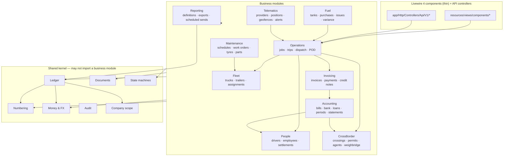
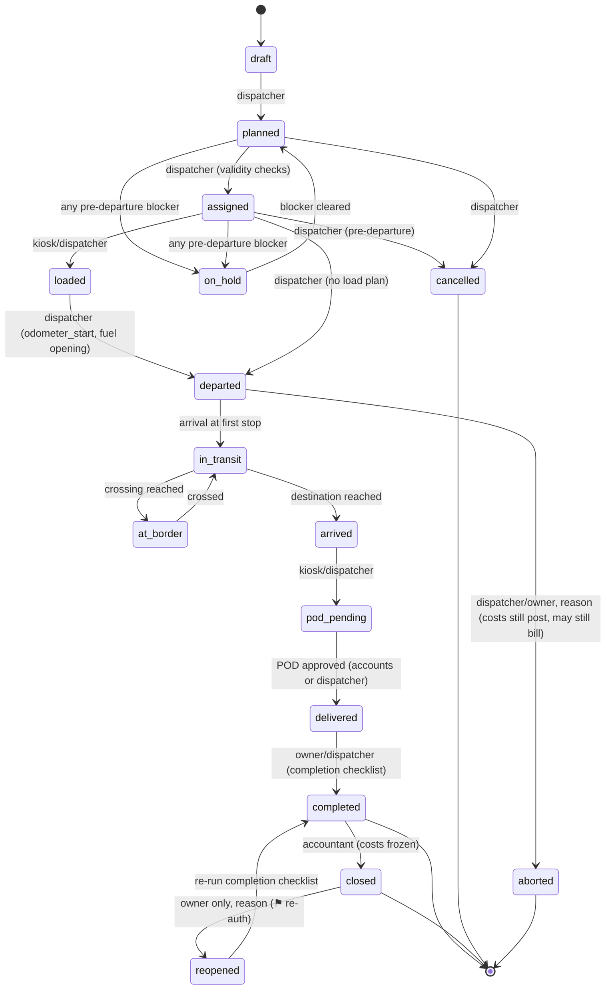
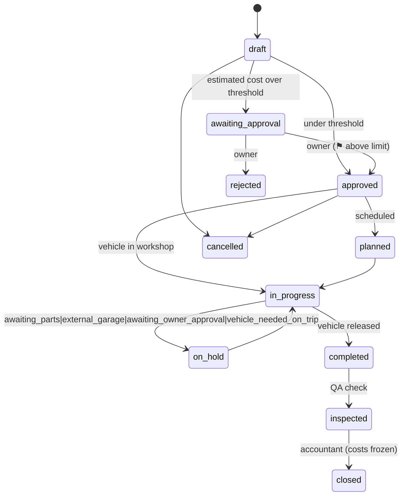

# Fleet Guard — Design Document

**Status:** Approved 2026-10-26 · Phase −1 in progress · **no business logic written yet.**
**Scope of this document:** everything the brief asked for before Phase 0: module map and dependencies, entity relationship diagram, money and currency strategy, ledger design, permission matrix, state machines, domain events, package list with reasons, folder structure, build order, risks and open questions.
**Decisions locked by the owner (2026-10-26):** production target **Laravel Cloud**; **full accounting system in-app** (the ledger is the statutory books, not only a profitability engine); **trip-scoped kiosk tokens** for driver field capture instead of driver user accounts; `tests/` **may exist locally but stays gitignored**.

| Field | Value |
|---|---|
| Product | Fleet, haulage and cross-border transport management |
| Operator | One owner-operated trucking business, Botswana, operating across SADC |
| Fleet size at go-live | 21+ trucks, trailers and equipment; staff accounts added later |
| Base currency | BWP (Botswana Pula), multi-currency capture |
| Timezone | Africa/Gaborone (CAT, UTC+2, no DST) |
| Units | kilometres, litres, tonnes, engine hours |
| Stack | Laravel 13 · PHP 8.4 · Livewire 4 · Alpine.js · Tailwind CSS v4 · Vite · `wire:navigate` |
| Installed & verified (2026-10-26) | `laravel/framework` **13.38.0** · `livewire/livewire` **4.4.8** · `laravel/fortify` **1.41.0** · ~~`livewire/flux` **2.21.0** (composer `license: proprietary`)~~ **removed 2026-10-26, sec.20.2** · `laravel/passkeys` **0.2.1** · `laravel/pint` 1.32.1 · local PHP **8.4.27** with `bcmath` ✅ `intl` ✅ `openssl` ✅ and **`sodium` ❌ `redis` ❌ not loaded** |
| Production | Laravel Cloud (managed MySQL + Valkey + managed queues + scheduled tasks) |
| Document version | 1.1 — 2026-10-26 (amended with Phase −1 verification findings, sec.20.1) |

---

## Table of contents

1. [How to read this document](#1-how-to-read-this-document)
2. [Global non-negotiables](#2-global-non-negotiables)
3. [Module map and dependencies](#3-module-map-and-dependencies)
4. [Entity relationship diagram](#4-entity-relationship-diagram)
5. [Money and currency strategy](#5-money-and-currency-strategy)
6. [Accounting core: the ledger](#6-accounting-core-the-ledger)
7. [Document numbering](#7-document-numbering)
8. [Tenancy model](#8-tenancy-model)
9. [Security and permission matrix](#9-security-and-permission-matrix)
10. [State machines](#10-state-machines)
11. [Domain events between modules](#11-domain-events-between-modules)
12. [Package list with reasons](#12-package-list-with-reasons)
13. [Folder structure](#13-folder-structure)
14. [Cross-cutting foundations](#14-cross-cutting-foundations)
15. [Build order](#15-build-order)
16. [Risks and mitigations](#16-risks-and-mitigations)
17. [Open questions](#17-open-questions)
18. [Traceability: every requirement in the brief](#18-traceability-every-requirement-in-the-brief)
19. [Where I propose a different design than the brief implied](#19-where-i-propose-a-different-design-than-the-brief-implied)
20. [Verification log](#20-verification-log)

Related files: [docs/DESIGN-SYSTEM.md](docs/DESIGN-SYSTEM.md) · [ADR-0001 Ledger schema](docs/adr/0001-double-entry-ledger-schema.md) · [ADR-0002 Numbering](docs/adr/0002-gap-free-document-numbering.md) · [ADR-0003 Tenancy](docs/adr/0003-single-tenant-with-company-id-everywhere.md) · [ADR-0004 Money and FX](docs/adr/0004-money-and-multi-currency-frozen-base-amount.md) · [ADR-0005 Laravel Cloud constraints](docs/adr/0005-laravel-cloud-runtime-constraints.md) · [ADR-0006 Driver kiosk tokens](docs/adr/0006-driver-kiosk-tokens-not-driver-accounts.md)

---

## 1. How to read this document

This is an engineering contract, not a pitch. Three conventions make it usable across ten build phases:

- **Column sketches are normative.** Where a table's columns are listed, the type and nullability stated here is what gets migrated. Anything marked `⚠` is a decision that has been thought about and can be argued about, but should not be changed after the phase that creates it ships.
- **Each hard-to-reverse decision has an ADR** (`docs/adr/000N-*.md`) with the alternatives that were rejected. The brief asked me to tell you before these decisions are made: the ledger, invoice numbering and the tenancy model are the three it named, and ADR-0005 and ADR-0006 are two more that the Laravel Cloud and kiosk-token choices added.
- **Section 19 lists where I disagree with the brief.** The brief explicitly invites this. Four of them change the phase order; two change the schema in ways that would be expensive to reverse later.

Section 18 is a traceability table mapping every requirement in the brief to a section here. If a requirement is missing from that table, it was dropped deliberately and should be challenged.

---

## 2. Global non-negotiables

These leak into every module, so they are stated once and referenced everywhere.

| Rule | Decision |
|---|---|
| **Time** | `config/app.timezone = 'UTC'`. Every *business date* is an explicit `DATE` column derived in `Africa/Gaborone` (`Carbon::today('Africa/Gaborone')`). The ledger carries both: `posted_at` (UTC instant) and `posted_on` (local business date) — and **`posted_on` is what periods are keyed on**. Do not set the app timezone to Gaborone and let `now()` write local literals: mixing that with UTC GPS payloads and a future driver app is a class of bug you find only in reconciliation. |
| **Money** | Integer minor units. Never `decimal` for money, never a float, ever. `brick/money` behind a `MinorUnits` cast pair. Money serialises to JSON as **strings** (`{"amount":"125000","currency":"BWP"}`). |
| **Keys** | `char(26)` **ULID** primary keys for externally-referenced aggregates (trips, jobs, invoices, documents, journal entries, work orders). `unsignedBigInteger` auto-increment for high-volume append-only rows (`gl_journal_lines`, `gps_positions`, `audits`, `stock_movements`). A ULID carries a timestamp, which doubles as the idempotency and ordering key for the future API. FK columns are always type-matched. |
| **Tenancy** | `company_id unsignedBigInteger NOT NULL DEFAULT 1` on **every** business table, as the **leading column of every unique key and hot composite index**. See sec.8. |
| **Mutation** | Every business write goes through an **Action** (`app/Domain/{Module}/Actions/…`): one public method, an immutable DTO in, a model or DTO out. Livewire components and controllers never mass-assign and never contain business rules. This is what makes the future Sanctum API and driver app a thin layer instead of a rewrite. |
| **Deletes** | Soft delete only for master data with no postings. Transactional records move to `void` / `cancelled` / `archived` through a state machine. **The ledger has no delete path at all.** |
| **Reads** | No query in a Blade view. Eloquent relations are eager-loaded at the Action or table-query level; `preventLazyLoading()` is on outside production. |
| **IDs in UI** | Never expose an auto-increment as a document reference. The visible reference is the `number` (sec.7); the ULID is for links only. |
| **Nothing invented** | No fabricated business data in production code or UI copy. Demo data exists only in clearly labelled seeders (`Database\Seeders\Demo\*`) behind `--demo`, separable from production setup. |

---

## 3. Module map and dependencies

Twelve business modules on top of one shared **Kernel**. The Kernel is the only thing that may be depended upon by everyone and depends on nobody.



### 3.1 Dependency rules (enforced, not aspirational)

| # | Rule | Why |
|---|---|---|
| D1 | `UI → component → Action → Model`. A Livewire component's write path is exactly one line: build a DTO, call the Action. | Keeps the API and a future driver app thin. |
| D2 | `Kernel` imports no `Domain/*` module. | Prevents the shared layer becoming a god object. |
| D3 | A module never posts to the ledger except through `LedgerService::post(PostingDto)`. | One place to enforce balance, period locks and idempotency. |
| D4 | Cross-module **notification** uses domain events. Cross-module **invariants** are direct synchronous calls. | Never make an invariant asynchronous for architectural purity — a dispatch conflict check that runs later is not a check. |
| D5 | A module's *model* is not queried from another module's UI. Use that module's read model/DTO or an explicit relation declared in one place. | Stops the module map dissolving into a graph of accidental joins. |
| D6 | Money never exists as a `decimal`/`float` column, and never without a currency code beside it. | sec.5. |

Enforcement without a test suite: a `composer lint:architecture` script greps `use App\Domain` statements and fails on a Kernel→module or module→module-model import violation. This is deliberately dumb, cheap and machine-checkable (see sec.14.6).

### 3.2 Module → screen map

| Module | Primary screens (all list → filter → detail → create/edit per the design system) |
|---|---|
| Dashboard | Executive KPI cards, action-first ordering, date-range and comparison filters, drill-down to source records |
| Fleet | Fleet list, vehicle detail with timeline, assignment history, odometer/hours log |
| Operations | Jobs board, dispatch board (drag-drop day × vehicle grid), trip detail, POD capture, trip costs |
| Fuel | Fuel log per truck, purchase entry, issue/receipt, consumption analysis, bulk tank stock |
| Maintenance | Service schedule due list, work order detail, tyres, parts inventory, inspections, breakdown register |
| Invoicing | Invoice list/draft builder, consolidated billing run, payments & allocation, credit notes, ageing, statements |
| Accounting | Journal browser, chart of accounts, expenses, bills, bank & cash accounts, loans, period close, trial balance, P&L, balance sheet, cash flow, opening balances (cutover) |
| People | Driver list/detail, employee register, licences & permits expiring, salary & allowance setup, advances, trip settlement |
| Cross-border | Crossing register, border cost capture, permits, weighbridge tickets, agent floats & reconciliation, per-country summary |
| Telematics | Live map, trip playback, planned vs actual, geofence setup, alerts |
| Documents | Central document store, per-entity document tabs, expiry dashboard |
| Reporting | Report library, export queue, scheduled report setup |
| Security | Users & roles, invitations, MFA settings, sessions/devices, audit trail, re-auth gates, settings |

---

## 4. Entity relationship diagram

Three diagrams: the operational hub (the trip), the financial spine, and the fleet/fuel/maintenance cluster. Column sketches for the money tables are in sec.5–sec.7; the tables here show keys and the columns that define relationships. `UK` = unique key, `FK` = foreign key, `IDX` = indexed.

### 4.1 The trip as the hub


**The trip is the hub of the whole system.** A trip links the job, customer, route, truck, trailer, driver, loads, costs, fuel issues, border crossings, documents, GPS track, invoice lines and settlement. Trip profitability is the sum of its revenue and cost ledger lines (sec.6.6). Two structural rules here, both explained in sec.19:

- A **job is not a trip**: `Job (commercial: customer, rate, terms) → trips/legs (vehicle + driver + dates) → POD per leg → chargeables → invoice per customer per billing run`. Multi-leg and return loads are additional trips against the same job, not a self-referencing trip.
- **`invoiced` is not a trip state.** One job can produce several invoices (freight, detention, accessories, recharge of customs) and one invoice commonly bundles many trips (a monthly statement per customer). Billing status is therefore *derived* (`billing_state`) from `chargeables`/`invoice_lines`, never stored as a trip status.

### 4.2 The financial spine

```mermaid
erDiagram
    GL_ACCOUNT ||--o{ GL_ACCOUNT : parent_rollup
    GL_ACCOUNT ||--o{ GL_JOURNAL_LINE : posted_to
    GL_PERIOD ||--o{ GL_JOURNAL_ENTRY : belongs_to
    GL_JOURNAL_ENTRY ||--|{ GL_JOURNAL_LINE : balances_with
    NUMBER_SEQUENCE ||--o{ INVOICE : allocates
    NUMBER_SEQUENCE ||--o{ GL_JOURNAL_ENTRY : allocates
    INVOICE ||--o{ INVOICE_LINE : itemised_by
    INVOICE_LINE }o--o| CHARGEABLE : sourced_from
    INVOICE ||--o{ PAYMENT_ALLOCATION : settled_by
    PAYMENT ||--o{ PAYMENT_ALLOCATION : applied_through
    INVOICE ||--o{ CREDIT_NOTE : corrected_by
    INVOICE ||--o{ STATEMENT_LINE : presented_in
    LOAN ||--o{ LOAN_INSTALLMENT : amortises_as
    BILL ||--o{ BILL_LINE : itemised_by
    BANK_ACCOUNT ||--o{ GL_JOURNAL_LINE : moves
    CUSTOMER ||--o{ INVOICE : billed
    SUPPLIER ||--o{ BILL : invoices

    GL_ACCOUNT {
        bigint id PK
        bigint company_id FK
        string code UK "5100"
        string name
        string type "asset|liability|equity|revenue|expense"
        string normal_balance "debit|credit"
        bigint parent_id FK
        bool is_system
        bool is_postable
        bool is_active
        tinyint allowed_dimension_mask "bit flags: truck|trip|customer|driver|cost_centre"
        bigint default_tax_rate_id FK
        char3 currency_code "restrict bank accounts"
        string external_ref "accountant/Xero code"
    }
    GL_JOURNAL_ENTRY {
        char26 id PK
        bigint company_id FK
        string entry_no UK "JE-2026-000412"
        datetime posted_at "UTC instant"
        date posted_on "business date - period key"
        bigint period_id FK
        string status "draft|posted|void"
        string description
        char3 currency_code
        decimal fx_rate_19_8
        string fx_rate_source
        date fx_rate_date
        bigint total_debit "base minor units"
        bigint total_credit "base minor units"
        smallint line_count
        string source_type "logical key, not table"
        char26 source_id
        char26 source_event_id
        char26 reverses_entry_id FK
        char26 netting_group
        bigint created_by FK
        datetime voided_at
        string void_reason
    }
    GL_JOURNAL_LINE {
        bigint id PK
        bigint company_id FK
        char26 entry_id FK
        bigint account_id FK
        string direction "debit|credit"
        bigint amount_foreign
        bigint amount_base "authoritative"
        date posted_on "denormalised for single-table reporting"
        char3 currency_code
        string line_note
        bigint truck_id FK
        bigint trailer_id FK
        char26 trip_id FK
        char26 job_id FK
        bigint customer_id FK
        bigint supplier_id FK
        bigint driver_id FK
        bigint employee_id FK
        char26 work_order_id FK
        char26 invoice_id FK
        char26 bill_id FK
        char26 fuel_issue_id FK
        char26 border_crossing_id FK
        char2 country_code
        bigint cost_centre_id FK
        json dimension_extra "long tail: permit_id, tyre_id, route_id"
        datetime created_at
    }
    GL_PERIOD {
        bigint id PK
        bigint company_id FK
        string period UK "2026-03"
        date starts_on
        date ends_on
        string status "open|closed|locked"
        datetime closed_at
        bigint closed_by FK
    }
    INVOICE {
        char26 id PK
        bigint company_id FK
        string number UK "nullable until issued"
        bigint customer_id FK
        string status "draft|issued|void"
        date issued_on
        date due_on
        char3 currency_code
        decimal fx_rate_19_8
        string fx_rate_source
        date fx_rate_date
        bigint base_amount
        bigint vat_amount_base
        bigint balance_due_base "maintained by allocation events"
        string settlement_state "derived: open|partial|paid|refunded|written_off"
        string delivery_state "not_sent|pdf_generated|emailed|failed"
        string terms_note
        bigint creator_id FK
        datetime voided_at
        string void_reason
    }
    INVOICE_LINE {
        bigint id PK
        bigint company_id FK
        char26 invoice_id FK
        char26 chargeable_id FK
        char26 trip_id FK
        string description
        bigint quantity
        string unit "tonne|trip|km|hour|item"
        bigint unit_rate
        bigint line_amount
        char3 currency_code
        bigint base_amount
        bigint tax_rate_id FK
        bigint tax_amount_base
    }
    CHARGEABLE {
        bigint id PK
        bigint company_id FK
        char26 trip_id FK
        char26 job_id FK
        bigint customer_id FK
        string type "freight|detention|accessories|customs_recharge|fuel_recharge|other"
        string basis "per_tonne|per_trip|per_km|fixed"
        bigint amount
        char3 currency_code
        bigint base_amount
        string status "pending|ready|billed|written_off"
        string source_uuid UK "idempotent generation from POD"
    }
    PAYMENT {
        char26 id PK
        bigint company_id FK
        string receipt_no UK
        bigint customer_id FK
        date paid_on
        bigint bank_account_id FK
        bigint amount
        char3 currency_code
        decimal fx_rate_19_8
        string fx_rate_source
        bigint base_amount
        string method "cash|eft|mobile|card|debit_order"
        string reference
    }
    PAYMENT_ALLOCATION {
        bigint id PK
        bigint company_id FK
        char26 payment_id FK
        char26 invoice_id FK
        bigint amount_base
        bigint fx_gain_loss_base
        bigint allocated_by FK
        datetime allocated_at
        bigint reverse_of_id FK
        string reason
    }
    CREDIT_NOTE {
        char26 id PK
        bigint company_id FK
        string number UK
        char26 invoice_id FK
        bigint customer_id FK
        string status "draft|issued|applied|settled|cancelled"
        date issued_on
        bigint amount
        char3 currency_code
        bigint base_amount
        string reason_code
        string narrative
    }
    LOAN {
        char26 id PK
        bigint company_id FK
        bigint supplier_id FK "lender"
        string reference UK
        string purpose "vehicle|equipment|working_capital"
        bigint truck_id FK
        bigint principal
        char3 currency_code
        bigint base_principal
        decimal interest_rate_19_8
        string frequency "monthly|fortnightly"
        date first_payment_on
        bigint bank_account_id FK
        string status "loan state machine"
    }
    LOAN_INSTALLMENT {
        bigint id PK
        bigint company_id FK
        char26 loan_id FK
        smallint seq
        date due_on
        bigint principal_due
        bigint interest_due
        bigint total_due
        bigint paid_principal
        bigint paid_interest
        string status "scheduled|partial|paid|overdue|restructured"
        datetime paid_at
    }
    BILL {
        char26 id PK
        bigint company_id FK
        bigint supplier_id FK
        string supplier_doc_no
        string status "draft|recorded|partially_paid|paid|void"
        date bill_on
        date due_on
        bigint amount
        char3 currency_code
        decimal fx_rate_19_8
        bigint base_amount
        char26 source_work_order_id FK
        string category "fuel|parts|labour|insurance|lease|other"
    }
    BANK_ACCOUNT {
        bigint id PK
        bigint company_id FK
        string name
        string institution
        string number_masked "readable, never decrypted in lists"
        text number_encrypted
        string key_version
        char3 currency_code
        bigint account_id FK "gl_accounts 1010-ish"
        string type "bank|cash|wallet"
        bool active
    }
    STATEMENT_LINE {
        bigint id PK
        bigint company_id FK
        bigint customer_id FK
        date statement_on
        string document_type "invoice|payment|credit_note|opening"
        char26 document_id
        bigint amount_base
        bigint running_balance_base
    }
```



### 4.3 Fleet, fuel and maintenance cluster

```mermaid
erDiagram
    TRUCK ||--o{ FUEL_TANK : has
    TRUCK ||--o{ VEHICLE_ASSIGNMENT : assigned_to
    TRUCK ||--o{ SERVICE_SCHEDULE : serviced_by
    TRUCK ||--o{ TYRE : runs_on
    TRUCK ||--o{ ODOMETER_READING : measured_by
    TRAILER ||--o{ VEHICLE_ASSIGNMENT : assigned_to
    DRIVER ||--o{ LICENCE_ENDORSEMENT : holds
    DRIVER ||--o{ VEHICLE_ASSIGNMENT : assigned
    FUEL_PURCHASE ||--o{ FUEL_ISSUE : dispenses
    FUEL_TANK ||--o{ FUEL_ISSUE : fills
    FUEL_ISSUE ||--o| FUEL_VARIANCE : analysed_as
    SERVICE_SCHEDULE ||--o{ WORK_ORDER : generates
    WORK_ORDER ||--o{ WORK_ORDER_LINE : costs
    WORK_ORDER ||--o{ PART_ISSUE : consumes
    PART ||--o{ STOCK_MOVEMENT : moved_as
    PART ||--o{ PART_ISSUE : issued_as
    TYRE ||--o{ TYRE_POSITION : fitted_as
    WORK_ORDER ||--o{ INSPECTION : checked_by
    TRUCK ||--o{ BREAKDOWN : suffers
    DOCUMENT ||--o{ DOCUMENT_VERSION : versioned_as

    TRUCK {
        bigint id PK
        bigint company_id FK
        string registration_no UK "BWD1234K"
        string fleet_no UK "T-07"
        string vin UK
        string make
        string model
        string year
        string status "available|on_trip|in_workshop|out_of_service|sold"
        bigint carrying_capacity_tonnes
        bigint odometer_km
        decimal engine_hours_10_2
        bigint purchase_amount_base
        date purchased_on
        char26 loan_id FK "financing link"
        bigint insurance_document_id FK
        bigint tyre_size
        smallint service_interval_km
        smallint service_interval_hours
        smallint service_interval_months
        string fuel_type "diesel|petrol|paraffin"
        smallint main_tank_litres
        smallint aux_tank_litres
        decimal expected_consumption_per_100 "litres"
        string compliance_flags_json
        bool active
    }
    TRAILER {
        bigint id PK
        bigint company_id FK
        string registration_no UK
        string fleet_no UK
        string vin UK
        string type "flatbed|tipper|curtainsider|tanker|lowboy"
        decimal capacity_tonnes_10_2
        string status
        bigint odometer_km
        string axle_config
        bool active
    }
    EQUIPMENT {
        bigint id PK
        bigint company_id FK
        string code UK
        string kind "loader|generator|toolbox"
        string status
        bigint purchase_amount_base
    }
    VEHICLE_ASSIGNMENT {
        bigint id PK
        bigint company_id FK
        bigint truck_id FK
        bigint trailer_id FK
        bigint driver_id FK
        char26 trip_id FK
        datetime from_at
        datetime to_at
        string assigned_by FK "history is mandatory per brief"
        string reason
    }
    ODOMETER_READING {
        bigint id PK
        bigint company_id FK
        bigint truck_id FK
        char26 trip_id FK
        bigint odometer_km
        decimal engine_hours_10_2
        date read_on
        string source "trip_departure|trip_arrival|fuel_issue|manual|kiosk"
        string plausibility "ok|suspect|disputed"
        bigint recorded_by FK
    }
    DRIVER {
        bigint id PK
        bigint company_id FK
        bigint employee_id FK
        string licence_no_masked
        text licence_no_encrypted
        string key_version
        string licence_code "C1|EC"
        date licence_expires_on
        date permit_expires_on "PDP"
        bigint default_allowance_rate_base
        decimal fuel_efficiency_baseline_10_2
        string status "active|standby|suspended|left"
        bool kiosk_enabled
    }
    EMPLOYEE {
        bigint id PK
        bigint company_id FK
        string employee_no UK
        string name
        string national_id_masked
        text national_id_encrypted
        string role_or_grade
        date hired_on
        date left_on
        bigint gross_salary_base "input to accounts, not statutory payroll"
        string pay_frequency "monthly|fortnightly"
        bool active
    }
    FUEL_TANK {
        bigint id PK
        bigint company_id FK
        bigint truck_id FK
        string kind "main|auxiliary"
        smallint capacity_litres
        bool active
        varchar composite_uk UK "(company_id, truck_id, kind)"
    }
    FUEL_PURCHASE {
        char26 id PK
        bigint company_id FK
        bigint filling_station_id FK
        bigint fuel_card_id FK
        string fuel_type "diesel|petrol|paraffin"
        char3 currency_code
        bigint amount
        decimal fx_rate_19_8
        string fx_rate_source
        date fx_rate_date
        bigint base_amount
        date purchased_on
        bigint litres "x100 = 2 dp"
        bigint price_per_litre_minor "x100"
        string invoice_no
        bool posted_to_ledger
        string source_uuid UK
    }
    FUEL_ISSUE {
        char26 id PK
        bigint company_id FK
        bigint truck_id FK
        bigint fuel_tank_id FK
        char26 trip_id FK
        bigint litres_x100
        bigint odometer_km
        char26 purchase_id FK "null = bulk tank issue"
        bigint cost_base "derived from purchase or bulk average"
        string source "pump_card|bulk_tank|advance|kiosk"
        bigint recorded_by FK "null when a kiosk link wrote it"
        char26 trip_access_token_id FK "which link wrote it (§9.6)"
        string status "recorded|posted|reversed"
        string exception_reason
        CHECK (source = 'kiosk') = (trip_access_token_id is not null)
    }
    FUEL_VARIANCE {
        bigint id PK
        bigint company_id FK
        bigint truck_id FK
        char26 trip_id FK
        decimal litres_per_100_10_2
        decimal expected_per_100_10_2
        decimal variance_pct_10_2
        decimal tonnes_carried_10_2
        string state "open|acknowledged|disputed|resolved"
        string acknowledgement_note
        datetime detected_at
    }
    BULK_TANK {
        bigint id PK
        bigint company_id FK
        string name UK "unique per company"
        smallint capacity_litres
        bigint stock_litres_x100
        bigint stock_value_base "authoritative: what 1180 holds for this tank"
        bigint average_cost_per_litre_minor "rounded cache of stock_value_base / litres"
        CHECK (stock_litres_x100 = 0) = (stock_value_base = 0) AND (average_cost_per_litre_minor = 0)
    }
    SERVICE_SCHEDULE {
        bigint id PK
        bigint company_id FK
        bigint truck_id FK
        string kind "km|hours|date|condition"
        smallint interval_value
        bigint last_done_at_value
        date last_done_on
        date next_due_on
        bigint next_due_at_value
        string state "ok|due_soon|overdue|blocked"
        string checklist_document_id FK
    }
    WORK_ORDER {
        char26 id PK
        bigint company_id FK
        string wo_no UK
        bigint truck_id FK
        bigint trailer_id FK
        char26 trip_id FK "breakdown on trip"
        string status "work order state machine"
        string kind "service|repair|breakdown|tyre|inspection|capital"
        decimal estimated_hours_10_2
        bigint labour_cost_base
        bigint parts_cost_base
        bigint external_cost_base
        bigint total_cost_base
        bigint approval_required_amount_base
        bigint approved_by FK
        bigint mechanic_employee_id FK
        bigint supplier_id FK "external garage"
        bool capitalised
        bigint capitalised_amount_base
        datetime closed_at
        string hold_reason "awaiting_parts|external_garage|awaiting_owner_approval|vehicle_needed_on_trip"
    }
    WORK_ORDER_LINE {
        bigint id PK
        bigint company_id FK
        char26 work_order_id FK
        string kind "labour|part|external|consumable"
        string description
        bigint quantity_x100
        bigint unit_cost_minor
        char3 currency_code
        bigint base_amount
        bigint part_id FK
        bool capital_candidate
        string posted_marker "idempotency: when this line posted"
    }
    PART {
        bigint id PK
        bigint company_id FK
        string sku UK
        string name
        string category
        bigint unit_cost_minor
        char3 currency_code
        smallint reorder_level
        smallint stock_quantity "only if perpetual stores chosen - Q5"
        bigint truck_id FK "specific part"
    }
    STOCK_MOVEMENT {
        bigint id PK
        bigint company_id FK
        bigint part_id FK
        string kind "receipt|issue|adjustment|return|count"
        smallint quantity
        smallint balance_after
        char26 reference_id "work order / bill"
        bigint unit_cost_minor
        datetime moved_at
        bigint moved_by FK
    }
    TYRE {
        bigint id PK
        bigint company_id FK
        string serial UK
        string brand
        string size
        bigint purchase_cost_base
        decimal tread_depth_new_mm_10_2
        string status "in_service|rotating|retread_due|scrap|on_spares"
    }
    TYRE_POSITION {
        bigint id PK
        bigint company_id FK
        bigint tyre_id FK
        bigint truck_id FK
        string position "FL|FR|RL1..."
        datetime fitted_at
        bigint fitted_odometer_km
        datetime removed_at
        bigint removed_odometer_km
        smallint retread_count
        decimal cost_per_km_10_4
    }
    INSPECTION {
        char26 id PK
        bigint company_id FK
        string kind "pre_trip|periodic|tacho"
        bigint truck_id FK
        char26 trip_id FK
        bigint driver_id FK
        datetime done_at
        string result "pass|fail|advisory"
        json checklist_answers
        string photo_document_ids_json
        string defects_found_json
    }
    BREAKDOWN {
        char26 id PK
        bigint company_id FK
        bigint truck_id FK
        char26 trip_id FK
        datetime occurred_at
        string location
        string description
        smallint hours_lost
        char26 work_order_id FK
        string cause "mechanical|driver|road|load|other"
        bool recoverable_from_driver
    }
    DOCUMENT {
        char26 id PK
        bigint company_id FK
        string type "contract|licence|insurance|permit|delivery_note|pod|customs|work_order|maintenance|weighbridge"
        string morph_type "nullable, polymorphic to any entity"
        char26 morph_id
        string title
        date expires_on
        string lifecycle "draft|current|superseded|archived|voided"
        string retention_class "tax|legal|operational|none"
        string visibility "role keys"
        bool confidential
        datetime archived_at
    }
    DOCUMENT_VERSION {
        char26 id PK
        bigint company_id FK
        char26 document_id FK
        smallint version_seq
        string disk "documents_private"
        string path
        string mime
        unsignedbigint size_bytes
        string sha256
        bool is_current
        datetime uploaded_at
        bigint uploaded_by FK
        string virus_scan_status "pending|clean|infected"
        string is_current_flag "STORED generated col, UNIQUE for one-current-version"
        string replaced_reason
    }
```

### 4.4 Supporting and security tables

```mermaid
erDiagram
    USER ||--o{ USER_ROLE : has
    USER ||--o{ USER_SESSION : signs_in_with
    USER ||--o{ AUDIT : acts_in
    AUDIT ||--o{ AUDIT_DIFF : changes
    NUMBER_SEQUENCE ||--o{ INVOICE : allocates
    BORDER_CROSSING ||--o{ BORDER_COST : incurs
    AGENT_CASH_ADVANCE ||--o{ AGENT_RECONCILIATION : cleared_by
    GEOFENCE ||--o{ ALERT : triggers
    BORDER_POST ||--o{ BORDER_CROSSING : at_post
    CURRENCY ||--o{ EXCHANGE_RATE : quoted_as
    GPS_PROVIDER_ACCOUNT ||--o{ GPS_POSITION : feeds
    WEIGHBRIDGE_TICKET ||--o| BORDER_CROSSING : evidences
    PERMIT }o--|| DOCUMENT : evidenced_by
    ALERT }o--|| USER : notified_to

    NUMBER_SEQUENCE {
        bigint id PK
        bigint company_id FK
        string scope "invoice|credit_note|receipt|journal_entry|trip|work_order|po|vat_return"
        string period_key "2026 or FY26-27 or empty=continuous"
        bigint next_value
        string format "INV-{PERIOD}-{SEQ:7}"
        datetime last_used_at
        bigint last_used_by FK
        varchar composite_uk UK "(company_id, scope, period_key)"
    }
    AUDIT {
        bigint id PK
        bigint company_id FK
        string auditable_type
        char26 auditable_id
        string event "created|updated|deleted|state_changed|login|permission_change|export|document_downloaded"
        bigint user_id FK
        string user_name_snapshot
        string ip_address
        string user_agent
        json old_values
        json new_values
        datetime created_at
        string tags
        string reason
    }
    SECURITY_EVENT {
        bigint id PK
        bigint company_id FK
        bigint user_id FK
        string kind "mfa_enabled|password_changed|reauth_ok|reauth_fail|session_revoked|invite_accepted|kiosk_token_issued"
        string ip_address
        datetime happened_at
        json meta
    }
    OPERATIONAL_EVENT {
        bigint id PK
        bigint company_id FK
        string aggregate_type
        char26 aggregate_id
        string from_state
        string to_state
        bigint actor_id FK
        string actor_kind "user|kiosk|system|scheduler"
        datetime occurred_at
        string reason "mandatory for destructive transitions"
        json context
    }
    USER_SESSION {
        string id PK
        bigint user_id FK
        string ip_address
        string user_agent
        datetime last_seen_at
        datetime expires_at
        bool two_factor_ok
    }
    FILLING_STATION {
        bigint id PK
        bigint company_id FK
        string name
        string country_code
        decimal lat_10_7
        decimal lng_10_7
        bool active
    }
    FUEL_CARD {
        bigint id PK
        bigint company_id FK
        string card_no_masked
        text card_no_encrypted
        bigint supplier_id FK
        bigint credit_limit_base
        bool active
    }
    BORDER_POST {
        bigint id PK
        bigint company_id FK
        string code UK "TBR|KBN|MSU|WB|SD"
        string name
        string country_code
        decimal lat_10_7
        decimal lng_10_7
        datetime open_from
        datetime open_to
        string notes
    }
    BORDER_CROSSING {
        char26 id PK
        bigint company_id FK
        char26 trip_id FK
        bigint border_post_id FK
        string country_code
        string direction "entry|exit"
        datetime entered_at
        datetime exited_at
        string status "planned|entered|exited|costs_captured|agent_reconciled|closed"
        string transit_doc_no
        bigint weighbridge_ticket_id FK
        string clearance_state
    }
    BORDER_COST {
        bigint id PK
        bigint company_id FK
        char26 border_crossing_id FK
        string kind "duty|clearing_agent|permit|road_user_fee|transit_bond|scanning|other"
        bigint amount
        char3 currency_code
        decimal fx_rate_19_8
        string fx_rate_source
        date fx_rate_date
        bigint base_amount
        bool recoverable_input_tax
        bigint tax_rate_id FK
        char26 receipt_document_id FK
        string payable_to_agent_id FK
        string posted_marker
    }
    PERMIT {
        bigint id PK
        bigint company_id FK
        string kind "transit|road_user|cabotage|fuel_tax|corridor"
        string country_code
        string number_masked
        char26 document_id FK
        date valid_from
        date valid_to
        string holder_type "truck|trailer|company|driver"
        bigint holder_id
    }
    WEIGHBRIDGE_TICKET {
        bigint id PK
        bigint company_id FK
        char26 trip_id FK
        bigint load_id FK
        datetime weighed_at
        string operator
        decimal gross_tonnes_10_3
        decimal tare_tonnes_10_3
        decimal net_tonnes_10_3
        decimal permitted_tonnes_10_3
        bool overloaded
        bigint fine_amount_base
        string ticket_no UK
        char26 document_id FK
    }
    AGENT_CASH_ADVANCE {
        char26 id PK
        bigint company_id FK
        bigint supplier_id FK "clearing agent"
        char26 trip_id FK
        date advanced_on
        bigint amount
        char3 currency_code
        decimal fx_rate_19_8
        bigint base_amount
        bigint spent_base "sum of matched costs"
        bigint variance_base
        string reconciliation_state "unreconciled|partial|reconciled|disputed"
        char26 reconciliation_id FK
    }
    AGENT_RECONCILIATION {
        char26 id PK
        bigint company_id FK
        char26 advance_id FK
        json matched_cost_ids
        bigint variance_base
        string status "draft|confirmed|owner_override"
        bigint confirmed_by FK
        string reason
        datetime confirmed_at
    }
    EXCHANGE_RATE {
        bigint id PK
        bigint company_id FK
        char3 currency_code FK
        date rate_date
        decimal rate_to_base_19_8 "1 foreign = X base"
        string source "manual|bpb|rbg|bank_statement|contract"
        string ref
        datetime entered_at
        varchar composite_uk UK "(company_id, currency_code, rate_date, source)"
    }
    CURRENCY {
        char3 code PK "BWP|ZAR|USD|ZMW|MZN|BRL"
        string name
        smallint minor_units "2 for BWP/ZAR/USD, 0 for JPY"
        string rounding_mode
        string symbol
        bool is_active
    }
    GPS_PROVIDER_ACCOUNT {
        bigint id PK
        bigint company_id FK
        string adapter "simulator|teltonika|gaia|flespi"
        string endpoint
        text api_key_encrypted
        bool active
        datetime last_sync_at
    }
    GPS_POSITION {
        bigint id PK
        bigint company_id FK
        string provider
        string provider_message_id UK "webhook retry dedupe"
        bigint truck_id FK
        char26 trip_id FK
        datetime fixed_at
        decimal lat_10_7
        decimal lng_10_7
        smallint speed_kph
        smallint heading_deg
        bigint odometer_km
        int accuracy_m
        json raw_json
        datetime ingested_at
    }
    GEOFENCE {
        bigint id PK
        bigint company_id FK
        string kind "depot|border|customer_site|country|corridor"
        bigint reference_id "polymorphic-ish: post/customer/truck"
        decimal lat_10_7
        decimal lng_10_7
        int radius_m
        string polygon_json
        bool active
    }
    ALERT {
        bigint id PK
        bigint company_id FK
        string type "doc_expiry|service_due|overdue_invoice|fuel_variance|geofence|route_deviation|loan_due|cash_shortage|permit_expiry|posting_failure|self_check_failure"
        string severity "info|warning|critical"
        string subject_type "nullable, with subject_id as a pair"
        char26 subject_id "nullable"
        date occurred_on
        string cooldown_key "type+subject+bucket, unique per company"
        json payload
        string state "open|acknowledged|resolved|muted"
        datetime first_seen_at
        datetime last_seen_at
        tinyint notify_count "deliveries, not sightings"
        datetime acknowledged_at
        bigint acknowledged_by FK
        datetime muted_until
        bigint muted_by FK
        string mute_reason
        datetime resolved_at
        bigint resolved_by FK "null when the scheduler closed it"
        string resolved_by_kind "user|scheduler"
        string resolve_reason
    }
    NOTIFICATION_PREFERENCE {
        bigint id PK
        bigint company_id FK
        bigint user_id FK
        string type "one of the alert types above"
        string channel "mail|database"
        bool enabled "absent row means deliver"
    }
    REMINDER_THRESHOLD {
        bigint id PK
        bigint company_id FK
        string family "licence|permit|insurance|service|loan|invoice|contract|roadworthiness"
        smallint days_before "60|30|14|7, plus any number the Owner types"
        json recipients "role keys, non-empty array"
        bool active
    }
```



Two names this block did not have before slice 8, each because sec.10 and sec.14.1 contradicted the sketch:

- **`muted_until`, `mute_reason`, `acknowledged_*`** — sec.10 requires a mute to have an expiry and both exits to
  carry a reason; the sketch listed only `resolved_at`. Three dated decisions, because they are made by
  different people and "who dismissed this" has to have an answer.
- **`resolved_by_kind`** — sec.14.6 says a clean sweep closes its own finding, so a resolution can be made by a
  principal that is not a user. `operational_events.actor_kind` solved the identical problem in slice 7; the
  rule is copied rather than reinvented, and the CHECK refuses a `user`-kind resolution with no user.

`reminder_thresholds.family` is deliberately **not** `type`. `alerts.type` is the vocabulary of *findings*
(`doc_expiry`) and `reminder_thresholds` is the vocabulary of *papers* (`licence`, `insurance`, `roadworthiness`)
— one column name for two vocabularies is how a threshold row looks joinable to an alert when it is not.
`cooldown_key` is unique **per company**, not globally: two tenants' `ledger:verify` failure name the same
subject, and a global unique would let the first company's alert swallow the second's silently.

---

## 5. Money and currency strategy

### 5.1 The two rules that never bend

1. **Money is an integer number of minor units plus an ISO 4217 code.** `bigint` columns, never `decimal`, never `float`. `brick/money` (`Money`, `BigDecimal`) behind a `MinorUnits` cast pair so arithmetic never touches a float, and rounding is always explicit.
2. **A money value without a currency is a bug.** Every amount column has a currency code beside it in the same row, or inherits it from an explicit parent (`gl_journal_line.currency_code` copies its entry's and is CHECK-verified).

`ext-bcmath` is required for `brick/money` performance (it suggests bcmath *or* gmp). Verify on both the local PHP 8.4 build and the Laravel Cloud runtime at Phase −1; `php -m | grep -E 'bcmath|gmp'`.

### 5.2 The FX column block

Applied **verbatim** to `invoices`, `invoice_lines`, `credit_notes`, `bills`, `payments`, `payment_allocations`, `fuel_purchases`, `border_costs`, `agent_cash_advances`, `loans`, `loan_installments`, `trip_costs`, `salary_runs` and `gl_journal_entries`:

| Column | Type | Meaning |
|---|---|---|
| `currency_code` | `char(3) NOT NULL` | ISO 4217, uppercase. The currency the counterparty actually sees. |
| `amount` | `unsignedBigInteger NOT NULL` | Minor units **of `currency_code`**. |
| `fx_rate` | `decimal(19,8) NOT NULL` | **Always "1 foreign unit = X base".** Never the inverse. |
| `fx_rate_source` | `string(40) NOT NULL` | `manual \| rbg_daily \| bpb \| contract \| customer_agreed \| bank_statement \| opening_balance \| manual_override` |
| `fx_rate_date` | `date NOT NULL` | The date the rate was struck. |
| `fx_rate_ref` | `string(80) NULL` | Evidence: bulletin date/id, bank statement reference. |
| `base_currency_code` | `char(3) NOT NULL DEFAULT 'BWP'` | Copied from the company at write time, not read from config at read time. |
| `base_amount` | `unsignedBigInteger NOT NULL` | Minor units of BWP. **Authoritative.** |

Why `decimal(19,8)` for a rate when amounts are integers: a rate is not money, it is a dimensionless multiplier, and 8 dp is the precision the ZAR/BWP and ZMW/KWacha corridors need to make a large foreign amount round to a stable base amount. Money columns stay integers; only rates are decimal.

### 5.3 Which number wins

**`base_amount` is authoritative and frozen at write time.** Reports, VAT, P&L, balance sheet and the ledger all read `base_amount`. Nothing ever recomputes a historical amount from a current rate — that silently rewrites history and breaks the trial balance against the ledger.

At write time the invariant is `base_amount == round(amount × fx_rate, minor_units, HALF_UP)`, enforced in the DTO and re-checked by `ledger:verify` (a DB `CHECK` cannot reliably do multiply-and-round across the decimal/integer boundary).

The manual-override rule, decided now because it is otherwise an argument in every payment screen:

| User edits | What recomputes | Bookkeeping |
|---|---|---|
| the **foreign** amount | `base_amount = round(amount × fx_rate)` | unchanged `fx_rate_source` |
| the **base** amount (the bank charged exactly this) | `fx_rate = base_amount / amount` (8 dp, HALF_UP) | `fx_rate_source = 'manual_override'` |

One editor per document type in the UI, so two people never fight about which knob moved.

### 5.4 Rate management

`exchange_rates` is a **reference lookup table only**: used to pre-fill a new document and to warn "the ZAR rate is 4 days stale". It never joins back into historical amounts. Manual entry first; a rate-feed adapter later behind the same `RateResolver` interface (Reserve Bank of Botswana or a bank statement feed), which is why `fx_rate_source` exists as data rather than a hard-coded string.

`currencies` (`code`, `name`, `minor_units`, `rounding_mode`, `symbol`, `is_active`) is a table, not an enum, because this corridor set includes ZAR, USD, ZMW, MZN and occasionally ZWG/BRL, and because a currency's minor-unit count is a fact about the world, not about our code.

### 5.5 Rounding, stated once

| Operation | Rule |
|---|---|
| Document totals | Sum of **rounded line amounts**, never round-of-sum. Lines are computed first, then added, so a customer's invoice always adds up on the page. |
| VAT | Computed per line, rounded HALF_UP to 2 dp of the invoice currency, then summed. |
| Payment allocation | Allocate in FIFO order of invoice age; the **last** allocation absorbs the ±1 minor-unit residue so a paid invoice's `balance_due_base` reaches exactly zero. |
| Fuel: litres and price/litre | Litres stored `× 100` (`bigint`, 2 dp), price per litre stored `× 100`. Cost = litres × price ÷ 10 000, rounded HALF_UP. |
| Consumption per 100 km | Computed, never stored as truth; stored only as an analysis snapshot with its inputs (`litres`, `km`, `tonnes`, `route`) so it can be recomputed and defended. |
| FX | HALF_UP at 8 dp for rates; base amounts HALF_UP to the base currency's minor units. |

Realised FX at payment: the difference between the open item's rate and the payment's rate posts to `7510 Realised FX gain` / `7511 Realised FX loss` as an allocation-driven line. **Unrealised revaluation of foreign-denominated balances at period close is deferred** (phase 5+, opt-in): it is an accountant-driven feature and building it speculatively is how you end up with a balance sheet nobody signs.

---

## 6. Accounting core: the ledger

A lightweight double-entry ledger that operational modules post to through domain events, with dimensions on each line so profitability reports are ordinary queries. Because you chose **full accounting in-app**, this ledger is also the statutory books: chart of accounts, journals, period locking, trial balance, P&L, balance sheet and cash flow all read from it (sec.15 phase 5).

### 6.1 Schema

Full columns are in [sec.4.2](#42-the-financial-spine). The three decisions inside it:

**`gl_accounts` is a tree.** `parent_id` gives rollup sections for the trial balance and P&L without a separate report-definition table; `is_postable` marks header rows; `is_system` marks seeded accounts that cannot be deleted or re-coded; `external_ref` holds your accountant's/Xero's code so an export lines up without a mapping spreadsheet. `allowed_dimension_mask` is a bit flag set (`truck|trip|customer|driver|cost_centre`) that lets the poster assert "this account must carry a truck" — cheap, and it catches the class of posting bug where a fuel line loses its truck and quietly lands in overheads.

**`type` is `string(16)` + backed enum + DB `CHECK`, not a MySQL `ENUM`.** Adding an `ENUM` value is an `ALTER TABLE` with the full value list and enum ordering semantics are a foot-gun; a `CHECK` list is one statement and behaves identically on MySQL 8 and MariaDB.

**`gl_journal_entries` carries FX, `gl_journal_lines` carries only `amount_base`.** A line that could be in a different currency from its entry is a re-design, not a column.

### 6.2 Dimensions: typed columns, not a generic pair

`gl_journal_lines` has nullable FK columns for the dimensions that reports actually group by: `truck_id`, `trailer_id`, `trip_id`, `job_id`, `customer_id`, `supplier_id`, `driver_id`, `employee_id`, `work_order_id`, `invoice_id`, `bill_id`, `fuel_issue_id`, `border_crossing_id`, `country_code`, `cost_centre_id`, plus `dimension_extra json` for the long tail.

Why not `dimension_type` / `dimension_id`:

- A generic pair **cannot hold two dimensions on one line**, and you need truck *and* trip on day one (a fuel line is both "which truck" and "which trip").
- "Profit per truck" becomes a self-join or a `CASE` pivot per dimension — unindexable, unreadable, and you will write it about forty times. Typed columns make it `GROUP BY truck_id` over a composite index.
- The real cost of typed columns is "add a dimension = migration". Mitigated by three things: the `dimension_extra` JSON column, MariaDB/MySQL indexes on `STORED` generated columns (`->storedAs(...)->index()`) so a hot JSON key can be promoted to an indexed column without touching reports, and a written rule: **a dimension earns a column when a report needs it twice.**
- `route_id`, `tyre_id`, `permit_id` deliberately **stay in JSON** for now: `country_code` and `cost_centre_id` are structurally reporting dimensions, those three are not.
- Putting a polymorphic `source_type`/`source_id` on *lines* would kill the indexes above and buy nothing: the source stays on the **entry** (one document → one entry).

### 6.3 Balanced or it does not commit

LAYERED, because you chose no DB-grant control (see below) and no committed test suite:

1. **No update or delete path in code.** `JournalEntry`/`JournalLine` refuse `updating` and `deleting` in `booted()` with `ImmutableLedgerException`, except the single `draft → posted` transition on the entry. The only write path is `LedgerService::post(PostingDto)`.
2. **DB `CHECK` on the entry row:** `status <> 'posted' OR (total_debit = total_credit AND total_debit > 0)` and `status <> 'draft' OR (total_debit = 0 AND total_credit = 0)`. MariaDB enforces CHECK from 10.2.1, MySQL from 8.0.16 — both hold on our engines. A CHECK cannot aggregate across rows, so `total_debit`/`total_credit`/`line_count` are computed by the poster and *verified* by `ledger:verify`, which recomputes them from lines and alarms on drift.
3. **Triggers, which survive a bad migration or a panic edit in a SQL client:**

```sql
CREATE TRIGGER gl_journal_lines_bu BEFORE UPDATE ON gl_journal_lines
FOR EACH ROW
  IF (SELECT COUNT(*) FROM gl_ledger_barrier WHERE id = 1) = 0 THEN
    SIGNAL SQLSTATE '45000' SET MESSAGE_TEXT = 'Fleet Guard: ledger rows are immutable';
  END IF;
-- plus BEFORE DELETE on gl_journal_lines and gl_journal_entries
```

   `gl_ledger_barrier` is a single-row, seeded table: the documented emergency hatch. A maintenance migration inserts the row, performs the fix, deletes the row — and that insert/delete is itself audited. Laravel 13's schema builder has **no `check()` method and no trigger helpers** (verified against the 13.x migrations docs), so both go in migrations as `DB::statement(...)`.
4. **`BEFORE INSERT` period-lock trigger** on `gl_journal_entries` that reads `gl_periods.status` for the resolved `period_id` and `SIGNAL`s when it is `locked`. A CHECK cannot read another table, so this one has to be a trigger.
5. **The layer the Cloud decision removed.** The strongest version of ledger immutability is a DB user granted only `SELECT, INSERT` on `gl_journal_*`, with migrations under a separate credential. **Laravel Cloud does not offer this**: database users are read-only or read-write, the default injected user cannot be edited or deleted, and there is no grant editor. Consequence, stated plainly rather than pretended away: immutability against someone with database credentials becomes an *operational* control — Cloud daily backups with 30-day retention, binary logs retained ~8 days, restore-to-a-new-cluster for forensics, and `ledger:verify` running in the scheduler so drift raises an alert instead of being discovered at year-end. Layers 1–4 still stop every application path and every careless SQL-client edit.

### 6.4 Corrections, reversals and netting

Posted entries are immutable. A correction is a **reversing entry**: `PostReversal` builds a mirrored entry, sets `reverses_entry_id` to the original and `netting_group` to the original's id, and never touches the original. Both entries appear in the journal browser — which is what an accountant wants to see anyway.

Reversals into a locked period post at **today's** `posted_on` with a note referencing the original. Back-dating a reversal silently changes a trial balance you already locked, which defeats the point of locking.

Reports filter `netting_group IS NULL` for "gross as issued" and include both for "net position", so the two numbers an owner and an accountant want are both available and neither is a fudge.

### 6.5 Periods and locking

`gl_periods (company_id, period 'YYYY-MM', starts_on, ends_on, status open|closed|locked, closed_at, closed_by)`, `UNIQUE(company_id, period)`. A period is auto-created with `firstOrCreate` **inside** `PostJournalEntry`, so a missing row can never silently block a posting. `posted_on → period_id` is resolved at write time and stored on the entry, which is what makes the lock trigger a single-row lookup rather than a date range scan.

`period_key` and the fiscal calendar come from the company (`fiscal_year_starts_on`), not from the calendar year, because the VAT/financial-year question (sec.17 Q3) is unresolved and must not become a migration.

### 6.6 Trip profitability without a scan

Three tiers, in this order:

1. A list view or dashboard **never** sums `gl_journal_lines`.
2. **Write-time denormalised rollup on `trips`** (`revenue_base`, `fuel_cost_base`, `maintenance_cost_base`, `border_cost_base`, `driver_cost_base`, `other_direct_cost_base`, `direct_cost_base`, `contribution_base`, `ledger_posted_at`), recalculated **inside the posting transaction** by `TripCostRollup` with a single indexed `SUM(...) WHERE trip_id = ?` over typically fewer than twenty lines. This is not a cache; it is a projection maintained by the poster, and it is the only way the dispatch board and the executive dashboard stay fast.
3. **Real-time SUM is the source of truth** for the trip detail screen and for audits, and `trips:recost` recomputes every rollup and diffs it against the stored value — that diff *is* the reconciliation report.

No `gl_daily_balances` or materialised-aggregate table until a report exceeds ~500 ms. At roughly 150 posting events/day × ~4 lines ≈ 220 k lines/year, the indexes in sec.6.7 carry you for years, and a summary table is a second truth to maintain.

### 6.7 Indexes on the ledger

```
gl_journal_entries: UNIQUE(company_id, entry_no)
                    UNIQUE(company_id, source_type, source_id, source_event_id)   -- idempotency
                    INDEX(posted_on), INDEX(period_id), INDEX(source_type, source_id),
                    INDEX(company_id, status, posted_on), INDEX(netting_group)
gl_journal_lines:   INDEX(entry_id), INDEX(account_id, posted_on), INDEX(posted_on, account_id),
                    INDEX(trip_id, account_id), INDEX(truck_id, account_id, posted_on),
                    INDEX(customer_id, account_id, posted_on), INDEX(work_order_id)
```

`posted_on` is denormalised onto every line for exactly this reason: date-range + dimension reports become single-table index range scans.

### 6.8 How each module posts

| Source event | Entry (one per document) | Debit | Credit |
|---|---|---|---|
| `InvoiceIssued` | Sales invoice | `1150 Accounts receivable — customer` | revenue by line type — `4100` freight, `4200` detention, `4300` fuel and recharge, `4400` clearing fees, `4900` anything else — plus `2125 Output VAT` |
| `PaymentReceived` | Bank receipt | `1120 Bank — BWP operating` / `1110 Petty cash` | `1150 AR`; the difference between the open item's rate and the payment's rate to `7510` gain / `7511` loss |
| `PaymentAllocated` (on-account) | Unapplied receipt | `1120 Bank` | `2150 Unapplied customer cash` — an overpayment never "adjusts" an invoice |
| `CreditNoteIssued` | Credit note | the revenue account the invoice line credited, `2125 Output VAT` | `1150 AR` |
| `FuelPurchaseRecorded` (slip) | — | **Not posted.** The slip is the price evidence an issue draws on; the supplier bill posts in Phase 5. |
| `FuelPurchaseRecorded` (into a bulk tank) | Stock receipt (3b) | `1180 Bulk fuel stock` | `2110 Supplier payable` — posted on receipt, because the tank now holds value the fleet has paid for |
| `FuelIssueRecorded` (slip) | Trip cost | `5100 Fuel` (truck + trip) | `2110 Supplier payable` (pump card), `1110` (advance), `1120` (bank) |
| `FuelIssueRecorded` (bulk tank) | Stock issue (3b) | `5100 Fuel` (truck + trip) | `1180 Bulk fuel stock` — the tank's moving average, frozen onto the issue |
| `BulkTankDipped` (variance ≠ 0) | Stock count (3b) | `5110 Fuel stock variance` when short | `1180 Bulk fuel stock`; a gain reverses the pair |
| `PartsIssued` | Stock issue (3e) | `5310 Parts consumed` | the parts-stock account 3e introduces — COA v1 has none |
| `WorkOrderLineApproved` (labour) | Internal labour | `5210 Repairs & maintenance` | `5290 Workshop labour clearing` |
| `BillRecorded` (external garage) | Supplier bill | category `5xxx` (`5300` labour, `5310` parts, `5500` insurance/lease, `5700` other), `2126 Input VAT` | `2110 Supplier payable` |
| `BillPaid` | Supplier payment | `2110 Supplier payable` — one line per bill, carrying the bill dimension; money no bill has claimed stays an **undimensioned debit** there | `1120 Bank` / `1110 Petty cash` |
| `CapitalisedWorkOrderClosed` | Asset addition | `1510 Vehicle assets` | `3100/1010` |
| `BorderCostCaptured` | Border cost | `5400 Duties & permits` **or** `1210 Recoverable input tax` (COA config, not code) | `1020 Cash` / `1290 Agent receivable` |
| `AgentCashAdvanced` | Agent float | `1290 Border agent receivable` | `1010 Bank` |
| `AgentAdvanceReconciled` | Variance | `7900 Cash short` / credit `7901 Cash over` (variance ≠ 0 requires Owner) | contra `1290` |
| `AdvanceDisbursed` | Driver advance | `1250 Employee receivable` | `1010/1020` |
| `TripSettled` | Settlement | `5300 Driver travel expense`, `1010` (recovery), `2211` (VAT if any) | `1250 Employee receivable` |
| `SalaryRunPosted` | Payroll (payroll-lite) | `6100 Salaries` | `2100 Net payroll payable`, `1250` (advances cleared), `2200 statutory payable` only if configured |
| `LoanDisbursed` | Disbursement | `1010 Bank` | `2500 Vehicle loan liability`; fees `6510 Loan fees` / `1010` |
| `LoanInstallmentPaid` | Instalment | `2500 Principal`, `6500 Interest expense` | `1010 Bank` — split read from stored schedule rows, never recomputed at report time |
| `ExpenseRecorded` | General expense | category `5xxx`, `2211 Input VAT` | `1010/1020/3100` |
| `OpeningBalanceImported` | Migration entry | per CSV | `4900 Retained earnings / opening equity` |

Every one of these is a `PostingRule` in a single registry (`Kernel\Ledger\AccountMap`), so "which account does this event hit?" has exactly one answer in one file. Duty-as-expense vs duty-as-recoverable-tax is a COA configuration, not a code branch.

**Amended 2026-10-30 (Phase 3 slice 3a).** This table was drafted against a chart that was never seeded: COA v1 (`Production\ChartOfAccountsSeeder`) numbers the fuel expense `5100` — postable only with the truck and trip dimensions — maintenance `5300` and parts consumed `5310`, and carries no stock account at all. There is no `5120`, `5200`, `1300` or `1310` in the chart the ledger actually has, so a recipe naming them was a plan to post to nothing. The rows above now name the codes that exist; a stock account arrives with the slice that first needs one (3b for bulk fuel, 3e for parts), and until then nothing posts to an account this document has only imagined. Fuel bought on a slip is deliberately **not** an expense when it is bought: it becomes one when it is issued to a trip, which is why `RecordFuelIssue` posts through `RecordTripCost`'s trip-cost rule rather than a rule of its own.

**Amended 2026-10-30 (Phase 3 slice 3b).** The stock account the 3a note promised has arrived: `1180 Bulk fuel stock` (asset, under `1100`) and `5110 Fuel stock variance` (expense, under `5000`) now exist in COA v1, and bulk diesel moves through them — delivery debits 1180, an issue credits it at the tank's moving average, and a dip's difference lands on 5110. A slip that names no tank is still unposted, so the two destinations are a CHECK apart (`fuel_purchases_bulk_delivery_posted`) rather than a convention.

**Amended 2026-10-31 (Phase 4 pre-work).** The four revenue rows above were the last ones still drafted against the paper chart rather than the seeded one, and every code they named was wrong against COA v1: `1200` is the *Fixed assets* header, `2210` is *Vehicle finance loans*, `1010`/`1020` do not exist (the cash rows are `1110` petty cash and `1120` bank) and there was no VAT account distinct from the input side, no unapplied-cash account and no realised-FX pair. The rows now name accounts the ledger actually has, and the chart gained them: `2125 Output VAT` and `2126 Input VAT` sit beside `2120`, which Phase 3 already posted diesel deliveries onto (§20.25) and is deliberately left in place rather than recoded under postings that are already in the book; `2150 Unapplied customer cash` carries the customer dimension because a receipt is always somebody's; and the 7000 section opens with `7510`/`7511`, §5.5's payment-side pair. `2126` is seeded but unused until Phase 5's bills — it exists now so the VAT *filing* shape is settled before invoice lines freeze onto `2125`.

The revenue credit is a decision worth stating: `4100 Haulage revenue` requires **truck, trip and customer** (§6.1's mask), so a consolidated invoice cannot post one lump credit to it — the block would name a customer and a company and no leg. Invoice lines therefore carry their chargeable's trip and truck, and each line's revenue account is chosen by the chargeable's own type (`freight` → 4100, `detention` → 4200, `fuel_recharge` → 4300, `customs_recharge` → 4400, `accessories`/`other` → 4900). One entry, many lines, and the P&L splits by leg because the line says which leg it was.

**Amended 2026-10-31 (Phase 5 slice 5b).** `BillRecorded` was the last row this phase had already written code against while the table still named paper codes — `5210`, `2211` and `3100` are not in COA v1, so the row now reads category `5300`/`5310`/`5500`/`5700` plus `2126` against `2110`, exactly as `BillCategory::accountCode()` maps it (§20.35). `BillPaid` joins it, and its shape is a decision rather than a transcription: the payable side has **no two-seam entry**, because the chart carries no unapplied-payable account and inventing one to mirror the receipt's `2150` would be a COA change driven by a convenience. One entry posts `Dr 2110` per bill (bill dimension) / `Cr 1120` or `1110`, and money no document has claimed stays as an undimensioned debit on the liability — which is what an advance to a supplier actually is (§20.36's decision 1). The `PartsIssued` row's trailing promise is also closed: 3e introduced `1190 Parts stock` and posts against it today (§20.29).

### 6.9 Operational reports vs the ledger — the tie-out

Because the ledger is now the statutory record: **financial statements read the ledger; operational screens read operational tables; `reports:tie-to-ledger` reconciles the two on a schedule and alarms.** Without the tie-out, a single unposted bill makes the dashboard and the P&L disagree and the owner stops trusting both. With it, "revenue per the ledger 1.24M vs per jobs 1.26M, difference: 3 unposted chargeables on trips T-11, T-19" is a screen instead of a suspicion.

---

## 7. Document numbering

Gap-free sequential numbers for invoices, credit notes, receipts and journal entries — and for operational references (trips, work orders, jobs, POs) where "never reused" matters more than "no gaps".

### 7.1 The table

```
number_sequences
  id             unsignedBigInteger PK
  company_id     unsignedBigInteger NOT NULL DEFAULT 1
  scope          string(40) NOT NULL   -- invoice | credit_note | debit_note | receipt | pro_forma
                                        -- journal_entry | trip | job | work_order | po | vat_return
  period_key     string(12) NOT NULL DEFAULT ''  -- '2026' | 'FY26/27' | '' (continuous)
  next_value     unsignedBigInteger NOT NULL
  format         string(64) NOT NULL   -- 'INV-{PERIOD}-{SEQ:7}'
  last_used_at   datetime NULL
  last_used_by   unsignedBigInteger NULL
  created_at / updated_at
  UNIQUE (company_id, scope, period_key)
  CHECK (next_value > 0)
```

### 7.2 Allocation

> **Amended 2026-10-26 after measurement (sec.20.4).** The original step 1 — `INSERT IGNORE` the row first — is **wrong on MySQL** and was reproduced as a deadlock. An `INSERT IGNORE` that finds the row already there takes a **shared next-key lock** on it, so the following `SELECT … FOR UPDATE` is a shared-to-exclusive lock upgrade; four concurrent workers deadlocked on it (`SQLSTATE 40001 / errno 1213`) on the first run, in the steady state as well as during creation. Allocation now takes exactly one lock, and the rows are created ahead of it by `NumberSequenceRegistry` (`numbering:ensure`, scheduled 00:10 daily).

Inside the business transaction (`IssueInvoice`, `PostJournalEntry`, …):

1. `SELECT next_value FROM number_sequences WHERE (company_id, scope, period_key) = … FOR UPDATE` → `$n`. The row **must already exist**; a missing row is an error pointing at `numbering:ensure`, never an opportunistic insert, because inserting here is what reintroduces the shared lock.
2. `UPDATE number_sequences SET next_value = next_value + 1, last_used_at = now(), last_used_by = ?`.
3. Render the number from `format` and write it to the document.
4. Commit.

The row lock serialises allocation, and because the increment is transactional, a rollback releases both the lock and the value: no gaps, no reuse. Verified: 60 numbers across 4 concurrent processes → 60 distinct, gapless `PO-00001`…`PO-00060`, counter exactly 61, zero deadlocks.

Because a lock wait can still end in a serialization failure under real load, the **enclosing Action** is wrapped in `DB::transaction($fn, attempts: 3)` — the retry belongs to the whole business transaction, not to the allocator, so a retried attempt re-allocates cleanly instead of half-applying.

`format` must contain `{SEQ}`: a format with no counter cannot be gap-free, so `NumberFormat::validate()` refuses it — and refuses it **at row-creation time**, so a typo in `config/fleet.php` never reaches `number_sequences` only to fail at the moment a fiscal document is issued.

### 7.3 What was rejected, and why

| Option | Verdict |
|---|---|
| `max(id)+1` / `count()+1` | Two concurrent issuers get the same number. The classic. |
| `auto_increment` as the visible number | InnoDB skips values on rollback, bulk insert and restart; **not** gap-free, and ID spacing leaks your sales volume. |
| MariaDB `SEQUENCE` / `NEXTVAL()` (available ≥ 10.3) | Values are **non-transactional**: a rolled-back transaction burns the number, creating exactly the gap you promised not to have. Also MariaDB-only syntax, and production is **MySQL** on Laravel Cloud. Legitimate only if gaps are acceptable. |
| ULID as the visible number | Correct as the PK, wrong as a document reference: humans need short, comparable, dictatable numbers. |

### 7.4 The rules that make "gap-free" mean something

- **Number at issue, not at creation.** `invoices.number` is `NULL` while `status = 'draft'`, with `CHECK (status <> 'issued' OR number IS NOT NULL)`. Drafts are addressed by ULID. Every allocated number therefore corresponds to an issued fiscal document — which is what the requirement is actually for.
- **Void keeps its number.** "Gap-free" legally means *unique, monotonic, never reused, never removed*, so voiding sets `status = 'void'` and retains row + number. Constrained hard: void is allowed only when there is no payment allocation, no credit note referencing it, it has never been delivered (no email or PDF handover recorded), and it is same-business-day or an Owner override with a mandatory reason. Anything a customer has seen gets a **credit note** — its own scope, not a re-use.
- **Never hold the lock across I/O.** No mail, PDF render, HTTP or queue dispatch inside the transaction — `dispatch(...)->afterCommit()`. Multi-document transactions allocate in deterministic `(scope, period_key)` order to avoid deadlocks. Default `innodb_lock_wait_timeout` is 50 s, so a stuck transaction shows up as a user-facing hang, not corruption — keep the transaction small.
- **Detect what you cannot prevent.** Nightly `documents:number-integrity`: per `(company, scope, period_key)`, assert `max(next_value)` matches the count of non-draft documents, numbers are strictly monotonic, no duplicates, no `NULL` on issued. Alarm on drift. This also catches a human with a SQL client.

⚠ `period_key` is configurable per scope so that a per-year restart, a financial-year restart (`FY26/27`) or a continuous sequence are all a **setting**, decided with your accountant (sec.17 Q2) rather than baked into a migration.

---

## 8. Tenancy model

**Single company now; multi-company must not become a rewrite later.** Five commitments, and nothing more. ADR-0003.

| # | Commitment | Cost today | Cost to skip it later |
|---|---|---|---|
| T1 | `company_id NOT NULL DEFAULT 1` on every business table, **leading column of every unique key and hot composite index** (`UNIQUE(company_id, code)`, `INDEX(company_id, scope, period_key)`, `INDEX(company_id, status, posted_on)`) | One column per table | Changing ~90 unique indexes is a data-integrity event, not a migration |
| T2 | Discriminator scoping: a `BelongsToCompany` trait + global scope, `CurrentCompany` resolved from `auth()->user()->company_id` by middleware, cached per request, **never from the URL**; auto-filled on `creating` | ~120 lines | A package (`stancl/tenancy`) or schema-per-tenant, both of which touch every query |
| T3 | **Fail closed**: a scoped model queried with no company context **throws** instead of returning unscoped rows. `withoutCompanyScope()` is explicit and only for CLI/totals, and CLI commands require `--company=1` | One exception class | A silent cross-tenant leak, discovered by a customer |
| T4 | Company-held settings: `base_currency_code`, `timezone`, `fiscal_year_starts_on`, `country_id`, `vat_number`, `registration_number`, invoice footer, numbering formats, approval thresholds, pump price per fuel type. Rule: `Company::current()->base_currency_code`, memoised — **never `config('app.currency')`** | One table + a resolver | Two hundred hard-coded `BWP`/`Africa/Gaborone` references |
| T5 | Policies always compare `$model->company_id === $user->company_id` even while redundant | One line per policy | An audit of every policy, later, under time pressure |

`number_sequences`, `gl_accounts`, `gl_periods`, document storage paths and RBAC roles are all company-keyed.

**Explicitly not designed:** a user belonging to many companies, company switching, inter-company billing, consolidated group reporting. **Honest ceiling:** this comfortably supports a handful of related companies in one database. Real legal isolation (different accountants, different tax regimes, "must not share a database") means separate databases, and nothing here prevents that — it becomes a deployment decision rather than a rewrite.

---

## 9. Security and permission matrix

### 9.1 Identity

| Concern | Design |
|---|---|
| Owner-first | A first-run setup command/screen creates the Company + Owner account, seeds the COA, roles and default settings. **Public registration is disabled** (remove `Features::registration()` from `config/fortify.php` — documented behaviour of the Laravel 13 starter kits, verified). |
| Staff accounts | The Owner invites by email with a role. An invite is single-use, expires, and is accepted against a verified email address. No self-signup path exists at all. |
| MFA | TOTP via the starter kit's Fortify 2FA, **enabled by default** (`Features::twoFactorAuthentication(['confirm' => true, 'confirmPassword' => true])`), with recovery codes. **Mandatory** for Owner and for any role holding `financial:*` or `accounting:*` permissions — enforced by middleware, not by a polite prompt on the profile page. Passkeys are **first-party, not a WorkOS dependency** (Phase −1 verification): the installed kit ships `laravel/passkeys` 0.2.1 with `Features::passkeys(['confirmPassword' => true])` already in `config/fortify.php`, plus `components/passkey-registration.blade.php`, `passkey-verify.blade.php` and a `.well-known/passkey-endpoints` route. The decision stands as a *sequencing* choice, not a missing capability: TOTP first (works on any phone, no platform account), passkeys as an optional additional factor after the Owner enrols. |
| Re-auth before sensitive actions | Fortify's `/user/confirm-password` behind a `reauth` middleware on: changing bank details, period locking, permission changes, exporting the ledger or payroll, downloading documents in bulk, voiding an issued invoice. |
| Rate limiting | Login limited per `email + IP`; invite send, password reset and kiosk-token redemption each get their own limiter. |
| Sessions | `SESSION_DRIVER` on Valkey/Redis with a configurable idle timeout (default 2 h, absolute max 12 h). Device/session list is a **first-party screen** (append `user_agent`, `ip_address`, `last_seen_at` to the session record, offer "log out everywhere") rather than another package — whether the starter kit still ships a Jetstream-style sessions screen is unverified and the fallback is ~100 lines. |
| Driver field access | **Trip-scoped kiosk tokens** (sec.9.6), not driver user accounts. ADR-0006. |

### 9.2 Roles

`spatie/laravel-permission` v8 stores roles and permissions; **policies make every real decision**. `can()` is not scattered through components — components ask a policy or a named gate, which is what makes field-level rules auditable.

Owner, Operations Manager, Dispatcher, Workshop Manager, Stores Clerk, Accountant, Read-only Auditor, plus two non-user principals: **Kiosk token** (per-trip scopes) and **System** (scheduler, no interactive session).

### 9.3 Permission matrix

Legend: **F** full · **C** create+update own · **R** read · **–** none · **A** approve · **⚑** requires re-auth

| Capability | Owner | Ops Mgr | Dispatcher | Workshop Mgr | Stores Clerk | Accountant | Auditor | Kiosk |
|---|---|---|---|---|---|---|---|---|
| Dashboard: all financial cards | F | F | R (ops cards only) | R (workshop cards) | R (stock) | F | R | – |
| Alert register: see / acknowledge & mute / resolve | F / F / F | F / F / F | R / F / – | R / F / – | R / – / – | R / – / – | R / – / – | – |
| Fleet: view / edit / sell vehicle | F / F / ⚑A | F / F / A | R / – / – | R / odometer / – | R / – / – | R / – / – | R | – |
| Vehicle purchase price & finance | **F** | R | **hidden** | hidden | hidden | F | R | – |
| Jobs: create / quote / rate cost | F / F / F | F / F / F | C / C / **hidden** | – | – | R | R | – |
| Trips: plan / dispatch / complete / reopen | F / F / F / ⚑A | F / F / F / A | F / F / R / – | R | R | R | R | view own |
| POD capture & approve | F | F | F / F | – | – | R | R | **capture** |
| Fuel: record / correct / waive variance | F / ⚑A / A | F / F / A | R / – / – | R | C (bulk) | R | R | record own |
| Consumption variance & cost per trip | F | F | **hidden margin, R litres** | R (own trucks) | – | F | R | – |
| Work orders: raise / approve / close | F / F / ⚑A (over threshold) | F / A / F | R | C / R / C | C (parts) / – / – | R | R | – |
| Parts stock: adjust / count | F / F | F / F | – | R / C | C / F | R | R | – |
| Invoices: draft / issue / void ⚑ | F / F / ⚑F | R / R / – | R (own jobs) | – | – | **F / F / ⚑F** | R | – |
| Payments, allocation, credit notes | F / F / ⚑A | R | – | – | – | F / F / F | R | – |
| Expenses & supplier bills | F / F | C / C | – | C (workshop) | C (parts) | F / F | R | – |
| Bank & cash accounts, encrypted numbers | F / ⚑ | R (masked) | – | – | – | F / ⚑ | R (masked) | – |
| Ledger: post / manual journal / **close period** | F / F / **⚑F** | R | – | – | – | F / F / ⚑F | R | – |
| Loans & instalments | F / F | R | – | – | – | F | R | – |
| Salaries, advances, settlements | F / F | R (allowances) | – | – | – | F | R | view own settlement |
| Documents: upload / download / delete | F / F / ⚑F | F / F / – | C / R(own trips) / – | C / F / – | C / R / – | F / F / – | R / R / – | upload own POD |
| Cross-border: costs, agents, reconciliation | F / F / ⚑A | F / F / A | R | – | – | F / F / F | R | – |
| GPS live view & alerts | F | F | F | R (own) | – | R | R | own trip |
| Reports & exports (⚑ for financial) | F / ⚑ | F / ⚑ | ops only | workshop only | stock only | F / F | R / ⚑ | – |
| Users, roles, permissions ⚑ | **F only** | – | – | – | – | – | R | – |
| Settings & numbering ⚑ | F | R | – | – | – | F (own scopes) | – | – |

Two things this matrix is enforcing rather than decorating: **a dispatcher must not see margins** (`trip.contribution_base`, `job.rate_cost`, `truck.purchase_price` are hidden at the field layer), and **only the Owner or Accountant can move a posted number** — every path that can change the ledger is either re-auth-gated or a reversing entry.

The alert register's three columns are the sec.9.4 rule applied to a screen that only has one table: the split sits on the state machine's own boundary, not on convenience. `alerts.acknowledge` covers the two reversible decisions (acknowledged, muted-with-an-expiry) and is held by the roles sec.14.1 actually delivers to, because sec.14.1's own example is the Operations Manager *and* the Dispatcher both acting on one alert. `alerts.resolve` is held by Owner and Operations Manager only, because `alerts_resolved_is_final` means the engine cannot undo it — and a single permission for both would have to be granted at the level a dispatcher needs and would then let that dispatcher close a compliance finding for good. Every role holds `alerts.view`, so the read-only row is honest about it: the Auditor sees the register and holds neither write.

### 9.4 Field-level protection

Named gates, not ad-hoc `@can` expressions: `seeTripMargin`, `seeVehicleCost`, `seePayroll`, `seeBankDetail`, `seeCustomerTerms`. Each gate is one policy method, each field has exactly one gate, and the Blade/APSF component that renders the field asks the gate. A report export passes the same gates — **an export is an authorised read, not a side door** — which is why `Reporting` calls policies rather than re-selecting columns.

### 9.5 Encrypted columns and the audit trail

| Data | Treatment |
|---|---|
| Bank/account numbers, driver licence number, national ID, fuel card PAN | Encrypted with a **dedicated `DB_CRYPT_KEY`** (separate config entry, not `APP_KEY`) + a `key_version` column on the row. A `*_masked` column holds the display form (`••••4521`) in clear so search, sorting and reports still work — encryption otherwise silently breaks every screen that touches the column. The set of encrypted columns is listed per column, because **adding encryption later needs a re-encrypt migration and removing it exposes history.** |
| `APP_KEY` rotation | Becomes a key-management job (`keys:reencrypt`), not a data-loss event. Key escrowed off-box. Recorded honestly: **key + database backup on the same machine is not a control** — which is why sec.14.5 puts the encrypted export in a *separate* off-site bucket. |
| Audit trail | `owen-it/laravel-auditing` v14 for create/update/delete with `old_values`/`new_values`; plus our own `audits` rows for login, permission change, export, document download, and every state transition. Every audit row records **who, when, IP, user agent, and before/after**. `audits` and `security_events` are **append-only**, protected by the same trigger/barrier pattern as the ledger (sec.6.3), and no application user has a delete or update path. |
| Retention | Audit rows retained ≥ 7 years (configurable), archived to the documents disk after 24 months rather than deleted — "the app cannot delete it" is the control, so a retention rule must move it, not remove it. |
| Financial records | Soft delete only for master data with no postings. **No hard deletion of posted financial data** anywhere in the codebase; policies refuse it and the DB trigger refuses it twice. |

### 9.6 Kiosk tokens (driver field capture)

`trip_access_tokens` carries a **hash** of the token (never the token), the trip, the driver, a set of scopes (`pod|odometer|fuel|expense`), `expires_at` (default: trip planned end + 24 h), revoke flag, and `last_used_at`/`last_ip`. Issued by a dispatcher with the trip, shown once as a URL + a 6-digit PIN for bad-signal entry, rate-limited on redemption, and bound to the trip (a token cannot read another trip).

The kiosk surface is four screens: **POD capture** (photo via `capture="environment"` camera, signature canvas, quantity received, exceptions), **odometer + engine hours**, **fuel issue** (litres, tank, station, price), **trip expense** (toll, border petty cash, lodging). **POD and fuel are live** (`/kiosk/{company}/{secret}` and `…/fuel`); odometer and expense wait for the Actions that read them. Every one writes through the **same Action** the office UI uses, so nothing about the future driver app or Sanctum API has to be re-designed. Kiosk writes are audited with `actor_kind = kiosk` and the token id, so attribution survives the shared phone; a kiosk fuel issue stores `trip_access_token_id`, and the table CHECK makes a kiosk source without one — or a token on any other source — unrepresentable. The scope decides which door a link opens: a `pod` link that lands on `/fuel` is told what it opened and offered the POD screen, never a form the Action would refuse. Offline is handled by a client-generated `client_uuid` on the POD record (`UNIQUE`) and by one `source_uuid` shared between a kiosk fuel capture's slip and its issue, so a retry after a dropped border signal cannot duplicate the delivery note or double-draw the diesel.

---

## 10. State machines

### 10.1 Implementation

States are **PHP backed enums** stored as `string(24)` with a DB `CHECK` listing the values. Transitions are declared **once per aggregate** as a static table and enforced by a first-party `CanTransition` trait:

```php
guardTransition($from, $to, $actor, reason: ...)  // throws IllegalTransition / NotAuthorised
```

Every transition writes an `operational_events` row (aggregate, from, to, actor, `actor_kind`, timestamp, **reason**) *before* the state column changes, so "who moved this and why" is answerable independently of the audit diff. Aggregates carry `previous_state` and `state_changed_at`.

`spatie/laravel-model-states` was considered and rejected: it needs PHP ^8.4, a class per state multiplies files for ~15 states, and your transitions must be enforced in Actions and Policies anyway, where an enum table is more direct. Revisit only if states start needing behaviour methods of their own.

**Reasons are mandatory for anything destructive** (`void`, `cancel`, `abort`, `reject`, `write_off`, `reopened`, variance waiver). A nullable `reason` column is how you lose the plot six months later.

### 10.2 Trip



| Transition | Who | Gate conditions enforced at the transition, not afterwards |
|---|---|---|
| `planned → assigned` | Dispatcher | Truck status `available`; driver licence **and** permit valid **on the trip's start date** (not "currently"); trailer roadworthy; no overlapping assignment for truck or driver; insurance and licence documents not expired. **This is the check that prevents an expired-licence dispatch.** |
| `assigned → loaded` | Kiosk / Dispatcher | Load tonnage ≤ truck and trailer capacity; waybill document attached. |
| `loaded/assigned → departed` | Dispatcher / Kiosk | `odometer_start ≥ last known odometer`; opening fuel reading; POD book/waybill present; departure geofence event accepted if GPS is configured. |
| `arrived → delivered` | Accounts Clerk / Dispatcher | POD captured with signature + photo + quantity; exceptions recorded or explicitly none. |
| `delivered → completed` | Owner / Dispatcher | `odometer_end ≥ odometer_start` and plausible; fuel reconciled **or explicitly waived with reason**; every border crossing has `exited`; driver advances recorded; required attachments present. |
| `completed → closed` | Accountant / Owner | Trip revenue and costs posted; settlement recorded; freezes cost editing and marks the rollup final. |
| `closed → reopened` | **Owner only, ⚑ re-auth, mandatory reason** | Must not rewrite the ledger — it posts **deltas** (a reversal plus a new entry). |

**A driver may never transition to `delivered`, `completed` or `closed`.** The kiosk captures facts; office roles decide completion.

### 10.3 Job (commercial)

`enquiry → quoted → accepted → in_execution → all_trips_completed → ready_to_invoice → invoiced → settled → closed`, with `declined` and `cancelled` reachable only pre-acceptance, and `suspended` from any pre-completion state. `invoiced`, `settled` and `all_trips_completed` are **derived aggregates** over the job's trips/invoices, surfaced as badges but never set by hand — only Owner may set `closed`. A job may have zero trips (`enquiry`, `quoted`, `declined`) and many trips (multi-leg, return loads).

### 10.4 Invoice — three axes, deliberately not one enum

| Axis | Stored or derived | Values |
|---|---|---|
| **lifecycle** | stored | `draft → issued → void` |
| **settlement** | derived from `payment_allocations` + credit notes | `open` `partially_paid` `paid` `refunded` `written_off` |
| **ageing** | derived from `due_on` vs today | `current` `d1_30` `d31_60` `d61_90` `d90_plus` `disputed` |

`draft → issued` (Accounts Clerk / Owner) is **the only point** at which a number is allocated and revenue posts. `issued → void` is Owner-only and constrained by sec.7.4. A credit note is a **separate document** referencing the invoice; it never rewinds invoice lifecycle — the invoice's derived `settlement_state` simply moves toward `refunded` as the credit is allocated.

Why split: a single conflated `status` containing both `void` and `paid` means payment allocation mutates lifecycle state, and gap-free numbering plus audit semantics die quietly in that coupling. This is the same reason `settlement_state` is computed from allocation rows rather than stored as truth on `invoices` (a maintained `balance_due_base` is a projection, and `invoices:recompute-balances` is the tie-out).

### 10.5 Credit note

`draft → issued → applied → settled`, plus `draft → cancelled`. Partial application keeps `issued` with a derived remaining amount. Its own numbering scope, its own ledger posting (sec.6.8).

### 10.6 Work order



| Transition | Who | Notes |
|---|---|---|
| `draft → awaiting_approval → approved` | Workshop Manager raises; **Owner approves above `work_order.approval_required_amount_base`** | This threshold is the single control that matters in a trucking workshop: it stops a fitter ordering tyres on the company's account. |
| `in_progress → completed` | Workshop Manager / Mechanic | Requires odometer at fitment, parts issued, labour hours recorded. |
| `completed → inspected` | Workshop Manager or Owner | Pre-trip/periodic inspection checklist for safety-critical work (brakes, steering, tyres, coupling). |
| `inspected → closed` | Accountant | Freezes costs, triggers the **capitalise vs expense** decision, sets `capitalised_amount_base`. |
| `any pre-approval → rejected/cancelled` | Owner / Workshop Manager | Reason mandatory; reverses any parts issues (stock movements are reversed, not deleted). |

**Posting is not a state.** Parts post **when stock leaves** (perpetual inventory: `Dr 5200 / Cr 1300`), labour when the timesheet is approved, external bills when the supplier bill is recorded. Only `closed` freezes editability. Gate posting on `closed` and both your parts stock and your month are wrong mid-period — which is exactly the kind of defect the owner discovers at year-end.

**A work order that is "billed" is a different thing.** The fleet is owned, so cost recovery is *not* a customer invoice: driver negligence/misuse recovery posts `Dr 1260 Other receivable — driver / Cr 5200 Maintenance expense (contra)` and settles through trip settlement; warranty recovery from a supplier posts `Cr 5200` with a debit note against the supplier bill. A **service invoice** against a job/customer exists only when the truck or workshop is genuinely contracted out.

### 10.7 Loan

`draft → submitted → approved → disbursed → servicing → closed`, with `servicing ⇄ arrears`, `servicing → restructured` (new schedule rows; history preserved), `arrears → defaulted → written_off | recovered`, `approved → cancelled` (pre-disbursement only). `disbursed` posts `Dr 1010 / Cr 2500` (+ fee line). Each instalment payment posts a **split** — principal to liability, interest to `6500` — read from stored `loan_installments` rows, never recomputed from a formula at report time. A prepayment **appends** revised schedule rows and never edits a paid row.

### 10.8 Document — two axes

| Axis | Stored or derived | Values |
|---|---|---|
| lifecycle | stored | `draft → current → superseded → archived` , `voided` |
| validity | **derived from `expires_on`** | `valid` `expiring_soon` `expired` `perpetual` |

**The subject of `current → superseded` is the version, not the document** (owner-confirmed 2026-10-27; the sentence this replaces read as though publishing a version superseded the document, which would have left a re-uploaded scan showing no live copy for the truck and no alert). Publishing a version moves `is_current` and records `replaced_reason` on the version rows; the document's lifecycle is untouched. A document reaches `superseded` only when the paper it evidences is replaced by another document — a decision made by a person, therefore stored, therefore never automatic. One `is_current` version per document, enforced by a `STORED` generated column plus a unique index (MariaDB and MySQL have no partial indexes; `storedAs()` is documented in Laravel 13's migrations). Because a new version may be filed against a `draft` or a `current` document only (`acceptsNewVersion()`), bytes cannot be slipped into a record that has already been superseded, archived or voided. **`expired` is not a transition**: a nightly job derives it and emits `DocumentExpiryImminent` / `DocumentExpired`. Driver licences, permits, insurance, roadworthiness, weighbridge tickets, PODs and customs papers all live in this one machine — the alternative (a hand-coded expiry boolean per entity) is how you end up with five different definitions of "expired".

### 10.9 Smaller machines (same pattern)

| Aggregate | States |
|---|---|
| Fuel issue | `recorded → posted → reversed` (a correction is a reversal + new issue; the tank balance moves back) |
| Border crossing | `planned → entered → exited → costs_captured → agent_reconciled → closed` — the last two are what make phase 6 tractable, and `agent_reconciled` requires receipt-vs-advance matching with a variance line |
| Chargeable | `pending → ready → billed`, plus `written_off` |
| Payment allocation | reversible, never deleted: `reverse_of_id` + reason; `ledger:verify` asserts `Σ allocations == payment.amount_base` |
| Alert | `open → acknowledged → resolved`, plus `muted` with an expiry so muting cannot silently become permanent |
| Salary run | `draft → computed → approved → posted → reversed` |

---

## 11. Domain events between modules

### 11.1 The rule that keeps the numbers trustworthy

**At 21 trucks, money moves synchronously.** Queued ledger posting buys eventual consistency in the P&L, which buys reconciliation screens, which buys the owner losing trust in a number. There is no write-throughput problem to solve here.

| Runs **synchronously, inside the business transaction** | Runs **queued, after commit** |
|---|---|
| Ledger postings, sequence allocation, trip cost rollup, stock decrement, state transitions, audit rows, invariants (conflict/validity checks) | PDF render, invoice and reminder email, Excel exports, notification fan-out, GPS ingest normalisation, geofence and deviation evaluation, webhook parsing, scheduled reports, analytics snapshots |

### 11.2 Event map

| Producer | Event | Subscriber / Action | Sync? | Idempotency key |
|---|---|---|---|---|
| Operations | `TripAssigned` | `LicenceValidityCheck`, `ReserveVehicle`, `NotifyDriver` | check + reserve **sync**, notify queued | `trip_id + state` |
| Operations | `TripDeparted` | open fuel reading, create border placeholders, record `odometer_start` | sync | `trip_id` |
| Kiosk | `PodCaptured` | `StoreDocument`, `MarkPodPending` | doc row sync, image handling queued | `proof_of_deliveries.client_uuid` |
| Operations | `PodApproved` | `BuildChargeablesFromPod`, `billing_state → ready` | sync | `pod_id` — chargeables built from the **event payload**, not re-read later |
| Operations | `TripCompleted` | `FinaliseTripRollup`, `EvaluateFuelVariance` | rollup sync, variance queued | `trip_id + occurred_at` |
| Operations | `TripClosed` / `TripReopened` | `FreezeCosts` / `PrepareDeltaPosting`, requires re-auth | sync | `trip_id + closed_at` |
| Fuel | `FuelPurchaseRecorded` | `PostFuelPurchase`, `UpdateTruckEfficiency` | **sync** / queued analytics | event ULID → `source_event_id` |
| Fuel | `FuelVarianceDetected` | `CreateAlert`, `NotifyOwner` | queued | `truck + period + type` with a cooldown — **posts nothing** |
| Fuel | `BulkTankStockAdjusted` | `PostStockAdjustment`, `NotifyOwner` | sync | movement id |
| Maintenance | `PartsIssued` | `DecrementStock`, `PostPartsIssue` | sync | movement id; `lockForUpdate` on the part row for concurrent issues |
| Maintenance | `WorkOrderApproved` | `ReleaseProcurement`, `NotifyStores` | queued | wo + version |
| Maintenance | `WorkOrderClosed` | `FreezeWorkOrderCosts`, `PostCapitalisation` | sync | `wo + closed_at`; reopened orders post **deltas** |
| Invoicing | `InvoiceIssued` | `AllocateNumber`, `PostInvoiceIssue`, `RenderPdf`, `EmailInvoice` | number + posting **sync**, PDF + email queued | invoice ULID — never render or send inside the numbering transaction |
| Invoicing | `PaymentReceived` | `AllocatePayment`, `PostPayment`, realised-FX line | sync | payment ULID |
| Invoicing | `CreditNoteIssued` | `PostCreditNote`, `RecomputeAgeing` | sync | note ULID |
| CrossBorder | `BorderCrossingExited` | `CaptureCustomsCosts` → `PostBorderCosts`, `UpdateTripBorderCost` | sync | crossing id |
| CrossBorder | `AgentCashAdvanced` | `PostAgentAdvance` | sync | advance id |
| CrossBorder | `AgentAdvanceReconciled` | `ClearAgentReceivable`, `PostCashVariance` (variance ≠ 0 requires Owner) | sync | reconciliation id |
| People | `AdvanceDisbursed` | `PostAdvance` | sync | advance id |
| People | `TripSettled` | `ClearAdvances`, `PostDriverCost`, `ReconcileAllowance` | sync | settlement id |
| Accounting | `BillRecorded` / `BillPaid` | `RecordBill`, `RecordSupplierPayment` (FX later) | sync | bill id / payment id |
| Accounting | `PeriodCloseRequested` | `ValidateNoUnposted`, `LockPeriod`, `RejectLaterPostings` | sync, ⚑ re-auth | period id |
| Loans | `LoanDisbursed` / `LoanInstallmentPaid` | `PostDisbursement`, `PostInstalmentSplit` | sync | instalment id |
| Fleet | `OdometerRecorded` | `RecalculateEfficiency`, `TriggerServiceScheduleCheck` | **next-due computed sync** (a schedule must not wait for a nightly job), analytics queued | reading id |
| Documents | `DocumentVersionPublished` | `SupersedePreviousVersion`, `ResetExpiryReminders` | sync | doc + version |
| Documents | `DocumentDownloaded` | `AuditRecorder` | sync | event id |
| Scheduler | `ExpiryReminderDue` | `SendExpiryNotifications` | queued | `doc + threshold + recipient` |
| Telematics | `GpsPositionIngested` | `UpsertLatestPosition` (sync), `EvaluateGeofences`, `DetectDeviation` (queued) | mixed | `provider + provider_message_id` |
| Ledger | `JournalEntryPosted` | `UpdateTripRollup`, `MarkSourcePosted`, `RefreshDashboardCache` | sync / cached | entry id |
| Security | `MfaEnabled`, `PasswordChanged`, `SensitiveActionConfirmed`, `SessionRevoked` | append to `security_events` | sync | event id |
| Any model | Eloquent create/update/delete | `AuditRecorder` (laravel-auditing) | **sync, same transaction** | — if an audit row can be lost, it is not an audit trail |

### 11.3 Idempotency and ordering — the four mechanisms

1. **Duplicate delivery.** Queues are at-least-once. Guarded by `UNIQUE(company_id, source_type, source_id, source_event_id)` on `gl_journal_entries` plus `firstOrCreate` semantics in `PostJournalEntry`; a replay that hits the key is **caught and logged, never retried forever**. `ShouldBeUnique` with `uniqueId = $event->eventId`, `uniqueFor = 1 day` stops the double-enqueue before it reaches the DB.
2. **Out-of-order.** Two mandatory habits: (a) **event-carried state transfer** — the event DTO carries `posted_on`, amounts, currency, rate, dimension ids, so a subscriber never re-reads mutable aggregate state to decide numbers; (b) `posted_at`/`posted_on` come from the event's `occurred_at` (ULID timestamp), never from job execution time — otherwise a job retried at 02:00, or a January retry of a December fuel receipt, lands in the wrong period.
3. **Period-boundary retries.** A posting that hits a locked period **fails loudly**: it goes to a `ledger_posting_failures` table and a first-party "Posting failures" screen, never auto-posted into the open period and never silently dropped. `ledger:replay --event=...` (Owner, ⚑, mandatory reason) re-posts with an explicit effective date.
4. **No cascades and no fake ordering.** `InvoiceIssued` must not fire `PaymentReceived`; derived state comes from a query, not a chain, because a two-deep event chain is undebuggable. Where two postings must pair (invoice + VAT) they are **one entry with many lines** — that is what double-entry is for.

---

## 12. Package list with reasons

Compatibility checked against Packagist on 2026-10-26. "L13" means the declared `illuminate`/`laravel/framework` constraint allows `^13.0`.

### 12.1 Adopted

| Package | Version | L13 | Reason |
|---|---|---|---|
| `laravel/framework` | ^13 | — | Base. PHP 8.3+ required, we pin **8.4** (Cloud supports 8.2–8.5; 8.5 is very new for the ecosystem). |
| **Livewire 4 starter kit** (`laravel/ui`-style scaffold via `laravel new --livewire`) | latest | yes | Fortify-backed auth with **2FA on by default**, `/user/confirm-password` re-auth, rate-limited login, documented registration opt-out. Deleting this means hand-writing authentication and TOTP — the highest-risk code in the app to own. |
| `livewire/livewire` | ^4 | yes | Single-file components, islands, optimistic UI, `wire:navigate` (the brief's SPA navigation), Alpine bundled. No React/Vue, per the "avoid heavy front-end frameworks" constraint. |
| `tailwindcss` | ^4 | n/a | Brief's styling choice; v4 `@theme` is how the token layer in `docs/DESIGN-SYSTEM.md` becomes CSS variables. |
| `spatie/laravel-permission` | 8.3.2 | ✅ PHP ^8.3 | Roles/permissions in DB with gate integration. Chosen over hand-rolled ACL because role editing must be data (the Owner adds a role without a deploy). |
| `owen-it/laravel-auditing` | 14.0.6 | ✅ illuminate ^11–^13 | Model-centric `old_values`/`new_values` JSON **is** the brief's audit requirement. Rejected `spatie/laravel-activitylog` (a user-activity feed, weaker diffs, PHP ^8.4 floor). |
| `brick/money` | 0.15.2 | ✅ PHP ^8.2 | Exact integer minor units + `BigDecimal` + explicit `RoundingMode`. Needs `ext-bcmath` (or gmp) — verify on both runtimes. |
| `spatie/laravel-pdf` | 2.14.0 | ✅ L ^11–^13 | Blade → PDF for invoices, credit notes, statements, PODs. **v2 supports a DOMPDF driver that needs no external binary, no Node, no Docker** — the only honest answer for both Laravel Cloud and the Windows dev box. Chrome/Browsershot is an opt-in driver, not the default. |
| `spatie/simple-excel` | 3.11.0 | ✅ L ^9–^13 | Streaming readers/writers over `openspout` 5.12.2 (framework-free) for Excel exports and the brief's CSV **imports**. Rejected `maatwebsite/excel`: heavier, import-oriented, and we would then have two Excel stacks. |
| `laravel/sanctum` | ^4 | yes | The brief's API-readiness promise: a versioned token API reusing the same Actions, without a session cookie assumption. Installed and configured in phase 0, **endpoints land only when an integration actually needs them**. |
| `laravel/pint` | ^1 | yes | Coding standard the brief asked for. |
| `larastan/larastan` | ^3 | yes | Static analysis (brief's "static analysis") — and with tests gitignored, this is the cheapest automated correctness net that still runs in CI. |
| `intervention/image` | ^3 | yes | Only where needed: downscale/normalise POD photos and scan captures before storage. Not for thumbnails-as-a-feature. |
| `spatie/laravel-schedule-monitor`(eval) | latest | check | The reminder engine and backups must be *observed*; a scheduler that silently stops is the failure mode of every "documents expiring" promise. Evaluate at phase 0; fallback is a first-party `scheduler_heartbeat` row + alert. |
| `barryvdh/laravel-debugbar` | dev only | yes | Local N+1 and query inspection during development. |

### 12.2 Rejected or deferred, with reasons

| Package | Verdict | Why |
|---|---|---|
| `spatie/laravel-medialibrary` | **Rejected** | Your requirement is versioning + expiry + type taxonomy + private disk + signed short-lived URLs + retention classes. Medialibrary optimises conversions/thumbnails and its collection model fights a per-company/per-type disk layout. Purpose-built `documents` + `document_versions` instead. |
| `spatie/laravel-model-states` | **Rejected** | Needs PHP ^8.4, a class per state for ~15 states, and transitions already live in Actions/Policies. Native enums + a first-party guard (sec.10.1). |
| `spatie/laravel-backup` | **Rejected for the database** | Two independent blockers: 10.3.3's released tag declares Laravel **^12 only** (L13 support is on `main` untagged — UNVERIFIED as a release), and on Laravel Cloud the database is backed up as managed snapshots that **cannot be downloaded as raw `mysqldump` files**. Replaced by the sec.14.5 strategy; a `spatie`-style file backup remains *for the documents disk only* if its L13 tag lands by phase 9, otherwise a first-party queued job. |
| `laravel/reverb` | **Deferred to v1.1** | Live GPS with 21 vehicles is a polling problem: `wire:poll` at 60–120 s is simpler, cheaper and works on the Cloud scale-to-zero posture. `ShouldBroadcast` events are emitted from day one with `BROADCAST_CONNECTION=null`, so enabling Reverb later (possible — Cloud supports worker clusters for long-running processes) is config + one Echo block, not a rewrite. |
| `laravel/horizon` | **Not used** | Needs POSIX signals/`ext-pcntl` and cannot run on the Windows dev box — and it is unnecessary on Cloud, which ships managed queues with dedicated workers, autoscaling and a failed-job retry dashboard. What we do build in phase 0: a first-party **queue health screen** (failed jobs, oldest pending, retry button), because PDF/email/export failure is the main silent-failure mode. |
| `nwidart/laravel-modules` | **Rejected** | Real per-module providers/composer overhead for a one-developer app. Plain namespaces under `app/Domain/*` + a documented dependency direction give ~90 % of the boundary. |
| `stancl/tenancy` | **Rejected** | Single company. Discriminator scoping (sec.8) is five cheap commitments; the package would buy per-tenant schemas we do not want. |
| Filament / Nova | **Rejected** | Either would decide the UI for us and cut against the brief's "consistent design system of our own tokens + avoid heavy front-end frameworks". Livewire + Tailwind + our primitives. **Flux UI shipped with the kit and was removed on 2026-10-26** (owner decision, sec.20.2); `resources/views/components/ui/*` is the only component system in the app. |
| `get-streamed/*`, `dompdf` directly, `maatwebsite` | **Rejected** | Already covered by `spatie/laravel-pdf` (dompdf driver) and `simple-excel`. |
| A payroll/statutory package | **Out of scope** | sec.14.7 states the boundary. |

---

## 13. Folder structure

`app/Domain/{Module}` for logic, module-named view directories for Livewire 4 SFCs, and a shared Kernel that no module may reach inside.

```
app/
├── Domain/
│   ├── Kernel/                          # ← no Domain/* import is allowed in here
│   │   ├── Ledger/
│   │   │   ├── Actions/PostJournalEntry.php  PostReversal.php
│   │   │   ├── AccountMap.php           # "which account for this event" — one place
│   │   │   ├── LedgerService.php  TripCostRollup.php  PeriodResolver.php
│   │   │   ├── Models/{Account,JournalEntry,JournalLine,Period,LedgerBarrier}.php
│   │   │   ├── Data/PostingDto.php  LineDto.php
│   │   │   └── Support/{PostingFailureRecorder, LedgerVerifier}.php
│   │   ├── Numbering/{NumberSequence,NumberAllocator,NumberIntegrityChecker}.php
│   │   ├── Money/{MinorUnitsCast,MoneyCast,RateResolver,RoundingPolicy,FxEditor}.php
│   │   ├── Documents/{Document,DocumentVersion,DocumentStore,SignedUrlService,VirusScan}.php
│   │   ├── Audit/{AuditableConfig,AuditRecorder,SecurityEvent,OperationalEvent}.php
│   │   ├── Alerts/                          # sec.14.1's engine; the only Kernel package with a scheduler path
│   │   │   ├── AlertType.php  AlertSeverity.php  AlertState.php
│   │   │   ├── Actions/{RaiseAlert,TransitionAlert}.php   # the only doors in and out of a row
│   │   │   ├── Models/{Alert,ReminderThreshold,NotificationPreference}.php
│   │   │   ├── Data/{Threshold,ThresholdSet,ReminderCandidate,RaiseOutcome,ReminderRunReport,AlertCopy}.php
│   │   │   ├── Contracts/ReminderSource.php # ← the seam Phase 1 modules implement; Kernel names no module
│   │   │   ├── Sources/DocumentExpirySource.php
│   │   │   ├── Notifications/AlertRaised.php
│   │   │   └── Support/{ThresholdRepository,RecipientResolver,AlertDelivery,ReminderRunner,SelfCheckAlerter}.php
│   │   ├── Tenancy/{Company,BelongsToCompany,CurrentCompany,ResolveCurrentCompany}.php
│   │   ├── State/{CanTransition,TransitionGuard,IllegalTransition}.php
│   │   └── Settings/{CompanySettings,CachedSettings}.php
│   ├── Fleet/       {Models,Actions,Policies,States,Events,Listeners,Data,Services,Support}
│   ├── Operations/  # jobs, trips, dispatch, POD, chargeables, kiosk tokens
│   ├── Fuel/        # tanks, purchases, issues, bulk stock, variance
│   ├── Maintenance/ # schedules, work orders, tyres, parts, inspections, breakdowns
│   ├── Invoicing/   # invoices, payments, allocations, credit notes, ageing, statements
│   ├── Accounting/  # bills, bank & cash, expenses, loans, forecast, period close, statements
│   ├── People/      # drivers, employees, allowances, advances, salary runs, settlements
│   ├── CrossBorder/ # posts, crossings, costs, permits, weighbridge, agents, FX
│   ├── Telematics/  # Contracts/GpsProvider.php  Adapters/{SimulatorProvider,…}
│   │                # PositionIngest, LatestPositionCache, Geofences, DeviationDetector, EtaCalculator
│   ├── Reporting/   # ReportDefinitions/, Exporters/, ScheduledReports/, MetricCatalog
│   └── Security/    # KioskTokens/, Reauth/, DataGovernance/ (encrypted columns), Sessions/
├── Http/
│   ├── Controllers/Api/V1/*             # thin: validate → Action → Resource
│   ├── Requests/                        # FormRequest per Action input
│   └── Resources/                       # API serializers (money as strings)
├── Console/Commands/                    # ledger:verify  documents:number-integrity  trips:recost
│                                        # reports:tie-to-ledger  reminders:run  backups:export-offsite
├── Livewire/                            # only class-based components that must be namespaced/reused
└── Providers/{AppServiceProvider,DomainServiceProvider,TelematicsServiceProvider,FortifyServiceProvider}.php

resources/
├── views/
│   ├── components/                      # Livewire 4 SFCs + Blade x-components (design system)
│   │   ├── ui/                          # button, input, table, badge, card, modal, toast, empty, skeleton
│   │   ├── layouts/                     # app shell: sidebar + topbar; auth; kiosk; print
│   │   ├── fleet/  operations/  fuel/  maintenance/  invoicing/  accounting/
│   │   ├── people/  crossborder/  telematics/  reporting/  documents/  security/
│   │   └── dashboard/                   # permission-aware KPI cards
│   ├── livewire/                        # classic views for --class components only
│   ├── print/                           # invoice / credit note / statement / POD (print CSS subset)
│   └── emails/                          # reminders, invoices, scheduled reports
├── css/app.css                          # Tailwind v4 @theme tokens → CSS variables
└── js/                                  # Alpine only + Leaflet entry + signature pad + command palette

routes/
├── web/{dashboard,fleet,operations,fuel,maintenance,invoicing,accounting,people,
│        crossborder,telematics,reporting,documents,security,kiosk}.php   # required from bootstrap/app.php
└── api.php                              # v1 group, Sanctum

config/fleet.php        # module flags, thresholds, GPS provider map, COA seed version, reminder buckets
database/
├── migrations/          # prefix by module: 2026_01_15_000100_kernel_ledger_….php, _000200_fleet_…
├── seeders/
│   ├── Production/{CompanySeeder,OwnerSeeder,RolesSeeder,ChartOfAccountsSeeder,CurrenciesSeeder}.php
│   └── Demo/{VehicleSeeder,DriverSeeder,CustomerSeeder,RouteSeeder,TripSeeder,FuelSeeder,
│             MaintenanceSeeder,InvoiceSeeder,BorderSeeder,GpsSimulatorSeeder}.php   # --demo only
└── factories/
docs/
├── DESIGN-SYSTEM.md
├── api-surface.md          # sec.14.9's contract, written in phase 0; no endpoints implemented
├── adr/0001…0006
├── operations/{runbook.md,backup-restore.md,deployment.md,hardening.md}
└── user-guide/{dispatch.md,fuel.md,workshop.md,invoicing.md,reporting.md}
tests/                    # EXISTS LOCALLY, listed in .gitignore — see sec.14.6
```

**Livewire 4 placement rule.** SFCs are Blade-resident (`resources/views/components/…`), so domain modularity *cannot* fully live in `app/` — that is accepted, and the mitigation is written down rather than discovered mid-build:

- Business logic is in `app/Domain/*/Actions`; a component's write path is a 3-line delegate, no matter how thin it looks.
- **Verified at Phase −1 (Livewire 4.4.8, `make:livewire --sfc|--mfc|--class`):** single-file components are written with a **literal `⚡` glyph in the filename** — e.g. `resources/views/livewire/settings/⚡appearance.blade.php`, `⚡two-factor-setup-modal.blade.php` — and the starter kit generates them that way throughout. This is not a documentation rendering artifact. Consequences we accept knowingly: NTFS and Git handle the UTF-8 names, but `git status`/`git diff` quote them (`core.quotePath`), shell globbing and grep need quoting, and Windows consoles may show `?`. **Checkpoint before Phase 0 UI work:** confirm Tailwind v4 source scanning, Pint, Larastan, the architecture-lint grep and the editor all behave on these names; if any of them fights us, module screens move to `--mfc`/`--class` and the ⚡ form is kept only where the kit already uses it. **Nothing in this design depends on the SFC file form** — only file layout does, so this remains a reversible style choice, not an architectural one.
- Start every screen as an SFC. Promote to `--mfc` (directory with `.php` + `.blade.php`) or `--class` when it exceeds **~250 lines** or is reused/embedded as an island. A numeric threshold decided now beats arbitrary drift later.
- Mirror the module name in the view directory so `app/Domain/Fuel` and its UI are adjacent by name.

---

## 14. Cross-cutting foundations

### 14.1 Notifications and the reminder engine

One `Alert` table (sec.4.4) is the source of truth for "needs attention"; notifications are a *delivery* of an alert, which is what makes the bell, the email and a future WhatsApp message consistent instead of three divergent senders.

| Trigger | Types | Channels |
|---|---|---|
| Scheduler, nightly | `doc_expiry` (licence, permit, insurance, roadworthiness), `service_due` (km, hours, date), `loan_due`, `permit_expiry` | in-app + email |
| Scheduler, hourly | `overdue_invoice`, `cash_shortage` forecast breach | in-app + email |
| Domain event | `fuel_variance`, `geofence`, `route_deviation`, `posting_failure`, `breakdown` | in-app, critical → email |

Thresholds (60/30/14/7 days) are **rows in `reminder_thresholds`**, per company and per type, editable by the Owner — not constants. Every alert carries a `cooldown_key` (`type + subject + bucket`) so a nightly job cannot email the same expiring licence fourteen times. Recipients are resolved by role, and `notification_preferences` lets a user opt out per type/channel except for critical financial and safety alerts. Scheduler is the only driver; nothing in the reminder path runs on a page load.

**Built in slice 8 (2026-10-27), with the five decisions the sentences above left open:**

- **The bell reads `notifications`, the register reads `alerts`, and exactly one accessor reconciles them.**
  `User::unreadAlertsCount()` → `Alert::countUnreadDeliveriesFor($user)`: the person's own unread
  `AlertRaised` deliveries, counted only where the alert behind them is still live. A `notifications` row has
  no idea whether the thing it delivered is finished, and an `alerts` row has no idea who read it — the bell
  needs both, so the read is two small queries rather than a JSON join. A second component asking its own
  question of either table is how a bell and a register start disagreeing, which is why the accessor is the
  only door and the topbar is the only caller.
- **One alert row per condition *instance*, escalated across bands** — not one row per band, which is what
  "type + subject + bucket" reads as. For papers the bucket is the expiry date, so a truck's licence is one
  live row that moves `info → warning → critical` and re-delivers at each crossing; the register's "what needs
  me now" count stays one per paper while sec.14.1's fourteen-emails rule still holds. `#2`-style episode suffixes
  give a condition that returns after being resolved its own row, capped at 12.
- **`days_before` is any number, not the four in the sentence above.** 60/30/14/7 are the *seeded* rows; the
  unique key is `(company_id, family, days_before)` and the Owner's 45-day row is a legitimate row. A fixed
  list would have needed a code change to answer "what my accountant actually asked for".
- **A reminder that reaches nobody is a defect with an exit code.** A catalogue role with no holder in that
  company contributes nobody and is reported per tenant ("… told nobody — the role keys on that threshold row
  have no holder in company #2"), and `reminders:run` exits 1; a role name outside sec.9.2's catalogue still
  throws. Both halves matter: the first version asked spatie for the role by name, so an unprovisioned tenant
  raised `RoleDoesNotExist`, aborted the sweep, and every company after it got no reminders — quietly, at 02:30.
- **Delivery is queued on a named `alerts` queue with a snapshot, never a model.** The worker runs with no
  company context (`DomainServiceProvider` drops it after every job, which is sec.20.4's leak closed), so a
  notification that re-read the company-scoped `Alert` threw `ModelNotFoundException` and left the finding in
  `failed_jobs` instead of in anybody's inbox. `Data/AlertCopy` is built while the tenant is pinned; the
  verifier fails the run if a single `alerts`-queue job lands in `failed_jobs`.

A self-check alert (sec.14.6) has no threshold row — its shape is "N days before a date" and drift has no such
date — so its recipients come from `fleet.reminders.self_check_recipients`, defaulting to `owner`.

### 14.2 Settings

One `CachedSettings` read per request (a single memoised `Company::current()->settings` blob + `config/fleet.php` defaults), never one query per key. `Cache::touch()` (Laravel 13) refreshes the TTL on write without re-reading. Every setting is company-scoped, which is what sec.8's T4 depends on.

`SettingsCatalogue` is the whitelist behind the screen: one entry per field supplies both the rendered input and the validation rule, and `UpdateCompanySettings` refuses a key that is not in it. Its **Fuel** group holds the two variance thresholds and the pump price per fuel type — `fuel.price_diesel|price_petrol|price_paraffin`, stored as base-currency minor units and defaulting to `config/fleet.php`. The prices are a **starting figure, not a rule**: they prefill the office slip for the fuel chosen on the form (only in the company's own currency) and the driver link (the trip truck's fuel type), while the slip's own price is what the register records. The slip itself records `fuel_type`: a station slip names no truck, so the product is the slip's own fact — the one the register filters and reports by — not something inferred from the truck that later draws it. A settings change therefore never re-prices a litre already bought, and an office slip in a foreign currency starts empty because the setting says nothing about what that pump charged.

### 14.3 Performance

- `preventLazyLoading()` outside production; a query-count assertion in the local suite's page tests.
- Indexes on every FK and every filtered column; composite indexes lead with `company_id`; ledger indexes per sec.6.7.
- Queued jobs (Cloud managed queues) for PDFs, exports and heavy reports; `Queue::route(...)` (Laravel 13) declares routing centrally rather than per job class.
- Dashboard: write-time rollups (sec.6.6) + a 60–300 s cache per company × filter, invalidated by `JournalEntryPosted`.
- Pagination everywhere (cursor for the GPS and audit tables); no unbounded `get()`.
- **GPS volume:** `gps_positions` with batched multi-row inserts (one statement per webhook batch), `UNIQUE(provider, provider_message_id)` for webhook dedupe, a 4-week retention on the raw table, monthly archive to the documents disk as compressed CSV, and a separate `latest_positions` projection so "where are my trucks" never queries the history table. At 21 vehicles × 30 s pings ≈ 60 k rows/day, archiving is a requirement, not an optimisation.

### 14.4 Documents and storage

Private disk (`documents_private`, never publicly reachable; on Cloud an S3-compatible private bucket), path `company/{id}/{type}/{entity}/{ulid}/{version}`. Downloads go through `URL::temporarySignedRoute` with a short TTL (default 60 s) and no token store — a redemption system is over-engineering at this scale. Responses send `Cache-Control: private, no-store`. Type validation by MIME sniff *of the content*, not the extension; size caps per type; a virus scan step on upload (queue-clamav against a ClamAV sidecar is the honest Linux design — on Cloud there is no local daemon, so the options are a hosted scanning API or documented defence-in-depth with strict type allowlists; recorded as sec.17 Q8). Every download and export is audited with actor, IP and document id. Role-based visibility via `documents.visibility` + policy.

### 14.5 Backups and restore (rewritten for Laravel Cloud)

| Layer | What it is | How it is proven |
|---|---|---|
| Database | **Cloud-managed daily backups, retention set to 30 days** + a manual snapshot before every release and before every period close | Quarterly **restore drill into a new cluster** (Cloud restores to a *new* cluster, never in place) with row-count and trial-balance comparison |
| Point-in-time | Cloud retains binary logs ~8 days | Documented in the runbook as the recovery window for a bad deploy |
| Off-site copy | A **monthly application-level export** of ledger-critical tables (accounts, entries, lines, invoices, lines, payments, allocations, loans, instalments, documents index) as gzipped CSV, encrypted with **AES-256-GCM via `ext-openssl`** (`ext-sodium` is **not loaded** on the local PHP 8.4.27 build, verified 2026-10-26 — Sodium is therefore not an assumption we may make, and Cloud availability must be checked, not presumed) and written to a **separate** S3-compatible bucket in another provider/region, using only app credentials — because Cloud snapshots are not downloadable as raw dumps | `backup:verify-offsite` asserts the last successful export is < 35 days old and alarms otherwise |
| Documents | The private bucket gets **cross-bucket replication or a nightly versioned copy** to the same off-site bucket | Sample restore of one POD per drill |
| Secrets | `APP_KEY`, `DB_CRYPT_KEY`, SMTP and GPS credentials in Cloud environment variables/secret store only, escrowed offline (password manager + printed copy in the safe), never in the repo | Rotation procedure in the runbook, and `keys:reencrypt` for the encrypted columns |
| Health | A `backup_health` row updated by every job, surfaced on the Owner's dashboard | **Silence is loud**: a stale row is itself an alert |

The runbook also states the honest limit: **key + backup in the same place is not a control.** That is why the off-site export uses a different credential set and a different provider.

### 14.6 Coding standards, and the quality regime without committed tests

- `pint` (preset `laravel`) and `larastan` **at level 7** (the level `composer require larastan/larastan:^3.0` configured on install; stricter than the level 6 this document originally proposed, and kept). Both run **locally before every phase sign-off** — and only locally for the tests, because `tests/` is gitignored, so there is no CI step that could run them. What CI can carry later is pint + phpstan + the architecture lint. Verified on the fresh skeleton 2026-10-26: `pint --test` PASS on 45 files, `phpstan analyse` 0 errors.
- Architecture linter: a `composer lint:architecture` script that greps `use App\Domain…` statements and fails on a Kernel→module or module→module-model violation (sec.3.1).
- **Local-only tests** (your decision): `tests/` exists on the developer machine, is listed in `.gitignore`, and covers ledger balance and idempotency, number allocation under concurrency, FX rounding and the manual-override rule, payment allocation with residue, state-machine transition authorisation, and each page's permission matrix. `phpunit.xml`/Pest config also gitignored; CI therefore runs pint + larastan + the architecture linter, and the phase sign-off checklist records which local suites were run.
- **Production self-checks** (these are the durable regime, not the tests): `ledger:verify`, `documents:number-integrity`, `trips:recost`, `invoices:recompute-balances`, `reports:tie-to-ledger`, `parts:stock-count-diff`, and the visible "Posting failures" and "Out of balance" screens. Every one is scheduled; every failure raises an alert.
  - **Wired 2026-10-27 (slice 8) for the three that exist**: `ledger:verify`, `documents:number-integrity` and
    `documents:verify-integrity` each hand their findings to `Kernel/Alerts/Support/SelfCheckAlerter`, which
    raises through the same `RaiseAlert` door as a reminder — so drift gets the cooldown, the episode suffix,
    the `operational_events` row and the bell for free, and a second raise path cannot drift from the first. A
    clean run resolves its own finding, because an accurate alert about a problem that no longer exists is
    wallpaper, not a signal; the close is recorded with `resolved_by_kind = 'scheduler'` and **no**
    `resolved_by`, rather than attributed to whoever was signed in.
  - Two rules came out of measuring it. A finding **with no tenant is returned, not thrown and not guessed**:
    one stray object at the private disk root must not suppress twenty trucks' worth of real findings, and
    guessing a tenant is how one company reads another's integrity report. And `clear()` takes the company the
    run was narrowed to — a `--company=1` sweep says nothing about company 2, so it may not close company 2's
    alert; the verifier caught that one while it was being written, and caught its sequel too: clearing
    matched the base cooldown key only, so a check that failed a *second* time (which sits on `base#2`) could
    never be closed. Episode keys are therefore derived in one place, `Alert::episodeKeys()`.
  - Not yet wired, because they do not exist: `trips:recost`, `invoices:recompute-balances`,
    `reports:tie-to-ledger`, `parts:stock-count-diff`. Each is a one-call job when its module lands.

### 14.7 Payroll boundary (stated as a rule because it will bleed)

`People` computes **gross, allowances, advances deducted, deductions and net**, and posts **one payroll journal** (`Dr 6100 Salaries / Cr 2100 Net payable, Cr 1250 advances cleared`). **No payslips, no PAYE/NSSF/BWRA computation, no filings, no statutory reports** — that is the accountant's software and was explicitly out of scope. Where a statutory *payable* must sit on the balance sheet, it is an account the accountant posts via a manual journal, not a calculation we invent. This boundary is in the design doc precisely because "we also need PAYE" arrives at phase 5 otherwise.

### 14.8 Localisation and formats

English first; every string through `lang/` keys (no hard-coded literals in components — enforced by a lint rule in the local suite). One central `Formatter` for dates, numbers, money and units (`km`, `l`, `t`), reading the company's locale/currency defaults, so `BWP 1 234,56` vs `P 1,234.56` is one decision in one file. Multi-currency display: base amount always shown, original currency as a secondary line with its rate on hover/detail. `Africa/Gaborone` for display, UTC for storage (sec.2).

### 14.9 API readiness

Business logic lives in Actions with DTOs in and out (already true for the UI). Phase 0 defines the API *surface* document (`docs/api-surface.md`: routes, DTOs, money-as-strings, idempotency keys, ULID addressing) and installs Sanctum; endpoints are implemented **when an integration exists**, not speculatively. The kiosk token design (sec.9.6) is the first consumer of that surface, which is how the contract gets tested before a mobile app exists.

---

## 15. Build order

### 15.1 Why the brief's order needs three changes

| Problem in the stated order | Consequence | Change |
|---|---|---|
| The **ledger is phase 5** but fuel, parts, work orders, customs, invoices, receipts, advances and loan disbursements (phases 2–4) are all *posting events* | Retrofitting double-entry over three phases of history means either an unverifiable bulk backfill or two parallel truth systems — which is exactly where owners stop trusting the numbers | A **ledger slice** (COA v1, entries, lines, immutability, periods, `LedgerService::post`, read-only journal browser) moves into **phase 0**. Accounting *features* stay in phase 5. |
| **Cross-border (phase 6)** comes after **invoicing (phase 4)**, but rechargeable duty, permits and agent floats are *inputs to the invoice amount* | Invoice before capturing them and you issue credit notes on every trip — visible and ugly with gap-free numbering | Crossing records + border cost capture move to **phases 2–3**; permits, agent advances, reconciliation, FX and the weighbridge archive stay in **phase 6**. |
| **Hardening is phase 9**, but audit with before/after values, RBAC, MFA, document storage and numbering are worthless retrofitted | The Owner's first months are unauditable; document expiry reminders fire in phase 9 against data that arrived in phases 2 and 6 | Security, documents, numbering and audit move to **phase 0**. Phase 9 keeps restore drills, performance, deployment, runbook and guide. |
| *(missing entirely)* **Legacy data and cutover** | The single most common reason fleet systems never go live: nobody budgets for opening balances, odometer truth and the accountant's tie-in | New **phase 0.5**. |

### 15.2 Recommended sequence

Each phase ends with: a summary of what exists, a manual verification checklist, the seed data to inspect, and a **stop** for your go-ahead.

| Phase | Contents | Definition of done |
|---|---|---|
| **−1 — Platform decision execution** | Laravel Cloud organisation + environment (staging, production), region choice, **Laravel MySQL** cluster with 30-day backup retention, Valkey cache, object storage bucket for documents, SMTP domain + SPF/DKIM, DNS, env vars and secret escrow, deploy pipeline from Git, preview environments. **`git init`, `.gitignore` including `/tests`**, `README.md` stub. `laravel new` with the **Livewire** starter kit, PHP pinned to **8.4**. | A deploy of the empty skeleton reaches a working HTTPS URL; queue, scheduler and object storage confirmed live; secrets escrowed; the Cloud PHP extension list verified (`bcmath`), MySQL major version recorded in ADR-0005. |
| **0 — Foundations** | Layout + design system primitives (sec.13, `docs/DESIGN-SYSTEM.md`); owner-first setup; Fortify auth with **mandatory TOTP** + recovery codes + re-auth gate; RBAC roles/permissions/policies; audit trail + `security_events` + `operational_events`; company scope (fail-closed); money + FX + `currencies`; `number_sequences` + allocator + integrity checker; **documents + versions + private disk + signed URLs**; **ledger slice**: COA v1 seeded, entries/lines/periods, CHECKs + triggers + barrier, `LedgerService::post`, read-only journal browser; notification/`Alert` skeleton + reminder engine; queue health + failed-jobs screen; `ledger:verify`, `documents:number-integrity`, `trips:recost` stubs; Pint/Larastan/architecture lint in CI. | A login with MFA, an invited user with a role who cannot see a field they lack, a signed document download, a manually posted balanced journal (and one rejected unbalanced attempt), and an audit row showing before/after for a real edit. **No business data required.** |
| **0.5 — Legacy data intake + cutover rehearsal** | CSV import (validation preview + error report) for customers, suppliers, vehicles, trailers, drivers, employees, routes/rates, parts, **opening odometer + fuel readings**, **opening AR/AP**, **unreconciled advances**, **loan schedules and opening equity**. Opening balances post as a real journal so the trial balance ties to the accountant's figures **before** operations start. | The accountant signs off the opening trial balance; a dry-run cutover on staging completes in under a day; import error report is empty for the demo file. |
| **1 — Master data** | Fleet + trailers + equipment with timelines and assignment history; customers, suppliers; routes + rate types; drivers, employees, licences/permits with expiry tracking; parts register; COA review with the accountant; reminder engine pointed at real records. | 21+ vehicles seeded; an expired licence produces the right alert at the right threshold; vehicle timeline shows assignment + odometer + documents. |
| **2 — Operations** | Jobs → quotes → trips; dispatch board with conflict + validity checks; loading schedule; POD capture via kiosk (photo, signature, quantity, exceptions); trip costs; **chargeables**; **crossing records + border cost capture**; **GPS ingest + simulator + trip map**. | A cross-border trip can be planned, dispatched, departed, crossed, delivered, POD-approved and completed with a defensible cost rollup — and dispatch *refuses* an expired licence. |
| **3 — Fuel + maintenance** | Both tanks per truck, purchases (cards/stations/advances), issues, consumption per 100 km with expected-vs-actual variance + acknowledgement, fuel cost per trip, optional bulk tank with moving-average stock and reconciliation; service schedules by km/hours/date; work orders with approval threshold; parts issues/stock; tyres; inspections; breakdowns; maintenance history per vehicle. | Variance alert fires on a seeded "siphoning" scenario; a work order over the threshold cannot start without Owner approval; parts stock and the ledger agree after an issue. |
| **4 — Revenue** | Invoice per trip **and** consolidated billing runs; gap-free numbering at issue; VAT (rates configurable — sec.17 Q4); deposits, partial payments, allocation with residue rule, credit notes, unapplied cash; ageing buckets, overdue flags, reminders; PDF invoice + customer statement; email delivery. | Two concurrent issuers get distinct sequential numbers; a paid invoice reaches exactly zero balance through allocations only; a void is refused once a payment exists; the PDF renders correctly under the **DOMPDF** driver. |
| **5 — Accounting** | Bills/AP, expenses, bank + cash accounts with reconciliation UI, chart-of-accounts maintenance, manual journals (with reason + re-auth), period close with validation + locking, trial balance, P&L, balance sheet, cash flow, loans with instalment splits, 13-week cash forecast from known schedules, driver settlements, profitability by truck/route/customer/trip. | **A real month closes**: nothing posts into it afterwards, the trial balance balances, `reports:tie-to-ledger` is clean, and the owner's accountant agrees with the P&L. This is the phase that decides whether the system is trusted. |
| **6 — Cross-border completion** | Permits, transit documents, road-user fees, customs/clearance costs by type, weighbridge tickets with overload detection, exchange rate management + staleness warning, border-agent advances and reconciliation with variance posting, per-country cost summaries. | A Beacon–Beira corridor trip reconciles its agent float to the cent, splits recoverable input tax correctly and produces a per-country cost breakdown. |
| **7 — Telematics** | Provider interface + real adapters as hardware arrives, live map (Leaflet/OSM, no key), trip progress, planned vs actual route, ETA, delay and route-deviation alerts, geofences at depots/borders/customer sites, retention + archiving. | The simulator drives the full alert path; the integration contract (`docs/telematics-integration.md`) is written and signed off by a candidate provider. |
| **8 — Reporting + dashboard** | The report library with a **metric catalogue** (every metric has a written definition and a source query), filters, PDF/Excel exports queued for large ranges, scheduled email for the 2–3 reports you nominate, executive dashboard completed on real data. | Each report's number ties to the ledger and to the operational screen it came from; a 12-month export completes without a memory error. |
| **9 — Hardening + release** | Security review (authz on every route/action/export, encrypted columns, signed URLs), performance review (query counts, index usage, page budgets), **backup + restore drill executed and documented**, key rotation procedure, deployment config, operations runbook, user guide, final `README.md`, UAT with one real month closed. | A restore is performed from both a Cloud snapshot and the off-site export; a staff member who did not build it completes a trip-to-invoice without help. |

**Cross-phase rules:** every phase ships its own 2–4 dashboard KPI cards (the dashboard is the screen used daily and it surfaces data-quality problems early — waiting until phase 8 hides them for eight phases); every phase updates `docs/` (schemas, ADR amendments) in the same commit; every phase ends with the seed-data set needed to review it manually.

**v1 line.** Phases −1 → 5 = "run the business". Phases 6–9 = "run it properly". GPS alerting, forecast modelling, scheduled reports and any mobile app are v1.1+ candidates. Realistic total: **6–10 months** part-time for one developer, with phases 0–5 the long pole.

---

## 16. Risks and mitigations

| # | Risk | Impact | Mitigation |
|---|---|---|---|
| R1 | **Dev/prod database divergence.** Local dev is **MariaDB 11.8**; Laravel Cloud's database is **managed MySQL**. | Triggers, `CHECK`s and `STORED` generated columns exist in both, but dialects differ: MariaDB-only `SEQUENCE` (already rejected), collation defaults, `utf8mb4_0900_ai_ci` is MySQL-only, group-by strictness differs. A migration that passes locally can fail in production. | **Preferred: switch local dev to MySQL 8/9** so dev matches prod. **Measured blast radius at Phase −1: this box's single MySQL/MariaDB service also hosts seven other projects** — `takuwa` (178 MB), `ultimatepos` (55 MB), `highblossom` (24 MB), `erpgo` (17 MB / 241 tables), `skuul` (10 MB / 152 tables), `spinthewheel`, `panpharma`: ≈285 MB and ~750 tables. MySQL cannot read MariaDB's data directory, so a switch requires a full `mysqldump --all-databases` + restore, and those apps' raw SQL may then meet stricter `ONLY_FULL_GROUP_BY`, collation and function differences. **Mitigations in order of safety:** (a) run MySQL 9.1 as a **second instance on its own port for fleet-guard only** — zero effect on the other seven; (b) dump → switch → restore → re-verify each project, accepting the residual risk to them; (c) keep MariaDB and enforce the dual-engine subset (below) until a MySQL is available. Otherwise the design doc keeps an explicit "engine surface used" list (this file), every migration is run against staging before merge, and MariaDB-only constructs are banned by the architecture lint. Decided at phase −1 (sec.20.1): **stay on MariaDB locally until the ledger slice**, then choose between a MySQL instance on its own port and a dump-and-global-switch. |
| R2 | **No grant-level ledger immutability on Cloud** (users are read-only/read-write; the injected user cannot be edited). | A person with DB credentials can mutate posted entries and the app will not know. | Layers 1–4 of sec.6.3 (app guards, CHECKs, triggers + barrier, period-lock trigger) + `ledger:verify` in the scheduler + Cloud daily backups and ~8 days of binary logs + a documented forensic restore procedure. Stated honestly rather than pretended to be physics. |
| R3 | **Backup/export constraint.** Cloud snapshots are not downloadable, and restores create a *new* cluster. | No simple `mysqldump` cron to an off-site disk; a restore is a two-step operation, and an unnoticed retention setting means no backup at all. | sec.14.5: 30-day retention as an infrastructure decision, monthly encrypted application-level export to a *different provider*, `backup_health` staleness alert, and a **restore drill as a phase-9 acceptance test**, not a hope. |
| R4 | **Full in-app accounting is now the biggest scope item** (your decision). | Phase 5 is ~2–3 months, not ~3 weeks, and its correctness bar is "an accountant signs it". | Ledger slice in phase 0; ADR-0001; a COA workshop with your accountant **before** the COA is seeded in phase 0 (it is `is_system` data afterwards); `reports:tie-to-ledger` as the trust mechanism; the payroll boundary fixed in sec.14.7 so scope cannot creep. |
| R5 | **Fiscal and regulatory unknowns that change schema**: BRBS/eTIMS VAT mechanics, gap-free tax-invoice requirements, per-year vs financial-year restart, zero-rating of export/cross-border freight, retention periods, SADC permit/roadworthiness regimes, driver-hour rules. | Wrong answers here are not refactors; they are amended returns. | One hour with the accountant before phase 0 freezes numbering and COA. Each unknown is an open question with a **default and a switch** (sec.17), so being wrong is a config change. |
| R6 | **GPS hardware/provider dependency** — cost, coverage at remote posts (Beitbridge, Kasarito, Tuli, Ponton), API churn. | Phase 7 could stall on procurement, and "live tracking" is the feature most likely to be sold to you as easier than it is. | Adapter + simulator is a first-class deliverable with a written integration contract; `gps_positions` is provider-agnostic with webhook dedupe; a 4-week local buffer; and **no business invariant depends on GPS being online** — fuel variance, trip distance and ETA fallback all compute from odometer and trip facts. |
| R7 | **Garbage-in data**: odometer trust, pump vs driver-reported litres, aux-tank honesty, missing POD photos, unrecorded cash advances. | Every "profit per truck" number becomes arguable, and the owner stops using the reports. | Variance is an **alert with an acknowledgement workflow**, never an auto-correction; opening/closing readings required at `departed` and `arrived` with plausibility bounds; per-trip exception register so reports can run "excluding disputed"; `plausibility` column on every reading. |
| R8 | **Scope vs a single developer** (12 modules, one owner, no team). Bus factor 1, and the risk that nothing ships. | 6–10 months; the failure mode is a half-built system with no cutover. | Re-sequenced phases make −1 → 5 a usable v1; git from day one with a tag per phase; ADRs as institutional memory; `docs/operations/runbook.md` so a second developer can continue; the sec.17.2 cut list. |
| R9 | **Practical path issue**: the workspace is `C:\laragon\www\Fleet Guard` — a space in the docroot, and not yet a git repo. | Vite/Laragon vhost/composer package-name friction that gets more expensive after phase 2. | Create the project as `C:\laragon\www\fleet-guard` with `APP_NAME="Fleet Guard"`, `git init` in phase −1. Documents stay where they are until then. |
| R10 | ~~**UI component licensing**: the Livewire starter kit ships **Flux UI**, while your brief asks for our own design system.~~ | Shipping on a component library whose production terms we did not read is a self-inflicted legal problem, and mixing two component systems is how a design system rots. | **Closed 2026-10-26.** `livewire/flux` was uninstalled and every screen the kit generated was re-authored on our own Tailwind v4 primitives (`resources/views/components/ui/*`, token contract in `docs/DESIGN-SYSTEM.md`), so the licensing question no longer applies and there is exactly one component system (`DESIGN.md` sec.20.2). The residual risk moved from legal to maintenance: **we now own 31 primitives and their accessibility**, which is why the primitive inventory, required states and a11y rules are specified rather than improvised. |

---

## 17. Open questions

Blocking means a *schema or phase-size* decision depends on the answer. Defaults exist so nothing stalls; a default that turns out wrong should be a config change, not a migration.

### 17.1 Blocking

| # | Question | Why it matters | Default if unanswered |
|---|---|---|---|
| Q1 | **Who closes the books today, and in what software?** | Decides how much of phase 5 is first-class UI (statements, reconciliation, year close) versus a clean journal export for an accountant. | Build statements + period close in-app (you chose full accounting); keep `external_ref` on accounts and a journal export so the accountant can double-key or review. |
| Q2 | Does **BRBS/eTIMS** require tax-invoice sequences to be strictly gap-free per year, and must a voided tax invoice be corrected by credit note only? | Decides whether the row-lock allocator and the nightly integrity checker are load-bearing or merely defensive. | Keep the gap-free allocator (it satisfies the stricter reading of both) and constrain voids as sec.7.4. |
| Q3 | **Financial year-end** for numbering restart and period locking (calendar year, or a Botswana FY such as `FY26/27`?) | `period_key` scoping and `gl_periods` boundaries. | `period_key` per scope, defaulting to **continuous** for operational references and **calendar year** for fiscal documents; both changeable by the Owner in settings. |
| Q4 | **VAT**: standard rate, your registration number, and the zero-rating treatment for export/cross-border freight legs? | `tax_rates`, invoice lines, output/input split, and whether duty is expense or recoverable input tax. | Configurable `tax_rates` table (default 12%), zero-rated line type available, duty → expense with a per-account recoverable flag. |
| Q5 | Is **parts inventory** a real staffed stores with stock counts (perpetual), or an issue register with occasional counts? | Perpetual inventory brings cycle counts, adjustments, negative-stock fights and a `parts` ledger account. An issue register is a week of work instead of a month. | **Issue register with optional stock counts**; the `stock_movements` table exists either way, so going perpetual later is enabled, not rewritten. |
| Q6 | ~~**Flux UI** production licence acceptable, or own Tailwind primitives?~~ | One component system, and a legal answer before shipping. | **Closed 2026-10-26 — resolved by removal, not by licence review.** Owner: "We'll make our own flux ui". `livewire/flux` is uninstalled and `resources/views/components/ui/*` is the system of record for every surface, auth and settings included (sec.20.2). |
| Q7 | **GPS provider**: shortlist, cost per vehicle/month, and does it offer a push webhook? | Phase 7's adapter count; pull-polling changes the ingest design (cron + rate limits instead of webhooks). | Build the interface + simulator only; document the contract; assume webhook ingest, fall back to a scheduled pull adapter. |
| Q8 | Is a **virus-scanning** service acceptable for document uploads (hosted API), or do we enforce a strict type allowlist with no scanning? | On Cloud there is no local ClamAV; the brief asked for virus validation. | Allowlist `pdf \| jpg \| png \| heic \| webp` + content-MIME sniffing + no-execution storage, with a pluggable `VirusScan` contract so a hosted scanner can be added. |

### 17.2 Also needed, not blocking

Which **2–3 reports** earn scheduled email (I will build the delivery mechanism once and the definitions for what you name) · which **roles** you will actually staff in the first 12 months (the matrix has 7; you may need 3) · **insurance/finance** data feeds for loans · who is the **second approver** for period close (single-owner today, but the workflow needs a name) · whether **fuel advances to drivers** are cash or card, since it changes the settlement posting · WhatsApp notifications (deferred, but tell me if this is a must-have — it changes the notification layer) · **depot/geofence coordinates** · whether trailers and equipment need their own **ROI** reporting (affects the dimension set on lines) · the **demo data shape** you want to inspect after each phase (I will mirror your real corridors: Gaborone–Windhoek, Gaborone–Durban, Beira, Dar es Salaam, Lusaka) · **how the final rehearsal treats balances that require dimensions** — receivables, payables, driver advances and loan lines (1150, 1160, 2140 in COA v1) cannot enter the opening trial balance until the Phase 1/5 importers carry truck/customer/driver columns, so the choice is a control total on a clearing account for the rehearsal or waiting for those importers (today the validator refuses such a row and names the account; see sec.20.12).

---

## 18. Traceability: every requirement in the brief

| Brief section | Where it is answered |
|---|---|
| Executive dashboard | sec.3.2 (permission-aware cards), sec.6.6 + sec.14.3 (rollups/cache), sec.15 (cards ship per phase), sec.9.3 (who sees which figure) |
| Fleet and trailer management | sec.4.3 `TRUCK`/`TRAILER`/`EQUIPMENT`/`VEHICLE_ASSIGNMENT`/`ODOMETER_READING`, sec.10.2 (status checks), sec.15 phase 1 (timeline) |
| Load, booking and dispatch | sec.4.1 (`JOB`/`TRIP`/`LOAD`/`PROOF_OF_DELIVERY`/`ROUTE_RATE`), sec.10.2 (transition gates incl. expired-document warnings), sec.9.6 (kiosk POD), sec.15 phase 2 |
| Fuel management | sec.4.3 (`FUEL_TANK` main+aux, `FUEL_PURCHASE`, `FUEL_ISSUE`, `BULK_TANK`, `FUEL_VARIANCE`), sec.6.8 postings, sec.5.5 litres precision, sec.15 phase 3 |
| Maintenance and workshop | sec.4.3 (`SERVICE_SCHEDULE`, `WORK_ORDER(_LINE)`, `TYRE(_POSITION)`, `PART`, `STOCK_MOVEMENT`, `INSPECTION`, `BREAKDOWN`), sec.10.6, sec.15 phase 3 |
| Invoicing and customer payments | sec.4.2, sec.7, sec.10.4, sec.6.8, sec.15 phase 4 |
| Accounting and profitability | sec.6 (all), sec.14.5, sec.15 phase 5, sec.16 R4 |
| Driver and employee management | sec.4.3 `DRIVER`/`EMPLOYEE`, sec.9.6 (kiosk), sec.14.7 (payroll boundary), sec.6.8 postings, sec.15 phases 1–2 + settlement in 5 |
| Cross-border SADC operations | sec.4.4 (`BORDER_POST`, `BORDER_CROSSING`, `BORDER_COST`, `PERMIT`, `WEIGHBRIDGE_TICKET`, `AGENT_CASH_ADVANCE(_RECONCILIATION)`), sec.5 (FX), sec.10.9, sec.15 phases 2/3 + 6 |
| GPS tracking and route planning | sec.4.4 (`GPS_POSITION`, `GEOFENCE`, `ALERT`, `GPS_PROVIDER_ACCOUNT`), sec.12.2 (Reverb deferred), sec.14.3 (volume strategy), sec.16 R6, sec.15 phases 2 + 7 |
| Document management | sec.4.3 (`DOCUMENT`, `DOCUMENT_VERSION`), sec.9.5 (access + audit), sec.14.4 (private disk, signed URLs, scanning), sec.10.8 |
| Loans and cash flow | sec.4.2 (`LOAN`, `LOAN_INSTALLMENT`, `BANK_ACCOUNT`), sec.10.7, sec.6.8, sec.15 phase 5 |
| Reports and analytics | sec.3.2, sec.13 (`Reporting/`), sec.6.9 (metric tie-out), sec.14.3 (queued exports), sec.15 phase 8 |
| Security and user permissions | sec.9 (all), sec.14.5 (backups), sec.16 R2 |
| Money and currency | sec.5 |
| Accounting core | sec.6 |
| The trip as the hub | sec.4.1, sec.6.6, sec.10.2 |
| State machines | sec.10 |
| Security (owner-first, RBAC, MFA, audit, protected records) | sec.9.1–sec.9.5 |
| Documents and backups | sec.14.4, sec.14.5 |
| Notifications | sec.14.1 |
| Performance | sec.14.3 |
| Design system | sec.13, `docs/DESIGN-SYSTEM.md` |
| Layout | `docs/DESIGN-SYSTEM.md` sec.7 |
| Localisation and formats | sec.14.8 |
| API readiness | sec.13 (`Http/Controllers/Api/V1`), sec.14.9, sec.9.6 (kiosk as first consumer) |
| Data import and seeding | sec.13 (`seeders/Production` vs `seeders/Demo`), sec.15 phase 0.5 |
| Constraints: no committed tests | sec.14.6 |
| Constraints: no invented data | sec.2 (last row), sec.13 seeder split |
| Constraints: prefer well-maintained packages, list reasons | sec.12 |
| Constraints: flag hard-to-reverse decisions | sec.19, `docs/adr/0001–0006`, sec.16 R1–R4 |
| Constraints: never commit secrets | sec.14.5, sec.9.5 |

---

## 19. Where I propose a different design than the brief implied

The brief invited this section. Five items, each with the reason and what it costs to ignore.

**1. `invoiced` must not be a trip state, and a trip must not be a job.**
The brief describes trips that get invoiced, which reads as one-to-one. In practice one job produces several invoice lines of different types (freight, detention, accessories, customs recharge) and one invoice routinely bundles many trips for a monthly customer statement. Modelled as one status field, consolidated invoicing forces a fake relationship and per-trip invoicing forces duplicate invoices. Cost of ignoring: a rewrite of the invoicing module after the dispatch board exists.

**2. Ledger posting must not be a work-order state.**
"A complete maintenance history per vehicle" plus monthly period locking means parts post when stock leaves and labour posts when approved. Gate posting on `closed` and both the parts inventory and the closed month are wrong mid-period. Cost: month-end discrepancies discovered at year-end — the worst possible time.

**3. The ledger slice must move to phase 0, and cross-border cost capture must move earlier.**
Argued in sec.15.1. The design stays exactly as you specified; only the order changes. Cost of ignoring: two truth systems, or a backfill you cannot validate.

**4. Profitability reports should read operational tables, with the ledger as the statement of record — not ledger-only reporting.**
You chose full in-app accounting, so the ledger *is* the statutory record; but if per-truck profit is derived only from GL postings, every unposted bill is an invisible wrong answer on the dispatch screen. The design therefore reads the write-time rollups on `trips`/`trucks` for operational screens, reads the ledger for statements, and runs `reports:tie-to-ledger` so a disagreement is a visible alert rather than a suspicion. Cost of ignoring: the owner distrusts a number that was actually *correct* but late.

**5. A cash-flow "forecast" is scoped as a 13-week roll-up of known schedules, not a modelling engine.**
The brief asks for projected shortage warnings. Built from invoices by due date, scheduled instalments, recurring costs and known supplier commitments, that is honest and cheap. Anything scenario-shaped or probabilistic is a research project for a 21-truck business and will be maintained by nobody. Cost of ignoring: a feature that looks sophisticated and is quietly wrong the first time a customer pays late.

**Also stated, not proposed:** `spatie/laravel-backup` as the database backup path is not available on Laravel Cloud (sec.16 R3), Horizon is not available on the dev box and not needed on Cloud (sec.12.2), and the strongest ledger-immutability layer (INSERT-only grants) is not available on Cloud (sec.6.3.5). Three places where your intended design meets a platform limit; in each case the substitute is documented rather than hidden.

---

## 20. Verification log

Each phase records what was asserted in this document against what the machine actually did. Entries here supersede the prose above where they disagree.

### 20.1 Phase −1 — 2026-10-26, local environment and fresh scaffold

Scaffolded with `laravel new fleet-guard --livewire --database=mysql --git --no-boost --npm`.

| Claim in this document | Reality | Action taken |
|---|---|---|
| Laravel 13, Livewire 4, Fortify-backed kit, 2FA default-on, `/user/confirm-password` present | ✅ `laravel/framework` 13.38.0, `livewire/livewire` 4.4.8, `laravel/fortify` 1.41.0; `config/fortify.php` ships `twoFactorAuthentication(confirm, confirmPassword)` and `pages/auth/confirm-password.blade.php` | None. |
| Registration is disabled by removing `Features::registration()` | ✅ present and **enabled by default** — the kit also generates `pages/auth/register.blade.php` | Phase 0 removes the feature **and** the register view/route, not just the config line. |
| "Passkeys deferred; WorkOS variant would provide them" (sec.9.1) | ❌ **Wrong**: `laravel/passkeys` 0.2.1 is installed first-party, `Features::passkeys(['confirmPassword' => true])` is already enabled, and the kit ships `passkey-registration`/`passkey-verify` components + a `.well-known/passkey-endpoints` route | sec.9.1 amended. TOTP-first sequencing unchanged; the reason for deferring is now policy, not capability. |
| Livewire 4 SFC filename convention "verify at install" (sec.13) | ⚠ Verified: SFCs are written with a **literal `⚡` glyph in the filename** (`resources/views/livewire/settings/⚡appearance.blade.php`); `make:livewire` supports `--sfc/--mfc/--class` | sec.13 amended with the Windows/git consequences and a pre-UI checkpoint. |
| Flux licence unknown (Q6, R10) | ⚠ Evidence gathered: composer `license: proprietary`; free components ship in the kit, the rest are the paid Pro tier (`livewire/flux-pro`) | **Superseded by sec.20.2** — the owner chose to author our own UI, and `livewire/flux` was uninstalled rather than licensed. |
| `brick/money` needs `ext-bcmath` (ADR-0004, sec.5.1) | ✅ `bcmath` **is** loaded on PHP 8.4.27; `intl`, `openssl`, `gd`, `zip`, `curl`, `pdo_mysql`, `fileinfo` also present. **`gmp`, `sodium` and `redis` are not.** | sec.14.5 amended: encrypted export uses AES-256-GCM via openssl, not Sodium. Cloud extension list still to be confirmed. |
| Local cache/queue/session on Redis/Valkey | ⚠ No `redis` PHP extension locally, so the scaffold's `.env` correctly defaults to `SESSION_DRIVER=database`, `QUEUE_CONNECTION=database`, `CACHE_STORE=database`; Mailpit is available for SMTP | Accepted for dev (database drivers); Cloud uses Valkey. Dev queue behaviour differs from prod, so **queue health screen and `queue:monitor` stay in Phase 0**. |
| MariaDB 11.8 dev vs managed MySQL prod (R1) | ⚠ Both engines are installed on this box: `C:\laragon\mysql` = MariaDB **11.8.2** (running) and `C:\ProgramData\envkit\services\mysql\` = **9.1.0**. The single shared service also hosts **seven other projects** (~285 MB, ~750 tables: takuwa, ultimatepos, highblossom, erpgo, skuul, spinthewheel, panpharma). MySQL cannot read MariaDB's data directory, so a global switch means a full dump and restore of all seven. | **Owner decision 2026-10-26: stay on MariaDB for now.** The engine question is re-opened **immediately before the Phase 0 ledger-slice migrations** — the first DDL where production-engine fidelity actually matters. Until then every migration is written to the MySQL-8-compatible subset (no MariaDB-only `SEQUENCE`, explicit collations, `ONLY_FULL_GROUP_BY`-safe queries), and the ledger CHECK / trigger / generated-column DDL is exercised against MySQL 9.1 (on its own port, or Cloud staging) before it is trusted. |
| Project path contains a space (R9) | ✅ Resolved: app created at `C:\laragon\www\fleet-guard`; design docs relocated into the repo | R9 closed. |
| `composer.json` requires `php: ^8.3` | Kept as `^8.3`; the **runtime** is what we pin (local 8.4.27, Cloud to be set to 8.4) | Recorded so ADR-0005's "pin 8.4" is read as a runtime setting, not a composer constraint. |

**Not yet verified (carried into the next phases):** the Laravel Cloud PHP extension list (`bcmath`, `redis`/Valkey client, `intl`, `gd`), Cloud's MySQL major version, `spatie/laravel-backup` L13 tag, and whether the `⚡` SFC filenames survive Tailwind v4 source scanning + Pint + Larastan cleanly.

### 20.2 Flux removal and own-component rebuild — 2026-10-26

Owner decision, in the owner's words: **"We'll make our own flux ui, proceed."** This closes Q6 and R10 by removal rather than by licence review: `livewire/flux` is **uninstalled**, and `resources/views/components/ui/*` is the single component system of record for every surface, including the kit's auth and settings screens.

| What was done | Evidence |
|---|---|
| 31 primitives authored (`resources/views/components/ui/*.blade.php`): button, input, textarea, select, checkbox, radio, otp, switch, badge, avatar, icon, card, dialog, dropdown, menu, table, th, td, tabs, navlist, tooltip, popover, heading, text, link, separator, skeleton, empty-state, pagination, toast + toast/group | Blade compiles clean: `php artisan view:cache` succeeds; `pint --test` PASS (48 files); `phpstan analyse` (Larastan level 7) `[OK] No errors`. |
| `composer remove livewire/flux` | `composer.json` has zero flux entries; `grep -i flux` over `app/ resources/ config/ routes/ bootstrap/` returns nothing. |
| Icon set rebuilt from Heroicons MIT artwork already on disk (`vendor/livewire/flux/stubs/**/flux/icon`), extracted by `scripts/build-icon-registry.php` | 59 icons in `components/ui/icon.blade.php`, 0 residual Blade/Flux markup. |
| Token layer: `resources/css/app.css` `@theme` + `.dark` custom variant, IBM Plex Sans/Mono via `vite-plugin-fonts` | Built CSS dropped **418.82 kB → 45.09 kB** (gzip 9.10 kB) when Flux's generated utilities went away. |
| Theme bootstrap moved to our own mechanism (`window.FleetGuardTheme`, `localStorage` key `fg_theme`, `@include('partials.head')`), replacing `@fluxAppearance` | `evaluate_script` in a real browser: dark mode → body `rgb(13,15,14)`, accent `#2dbbae`, on-accent `#04211e`; light mode → body `rgb(247,247,244)`, accent `#0f766e`, white button label, `color-scheme: light`. Toggle flips `<html class="dark">` and persists. |
| Toast pipeline replaces `Flux::toast()` → `$this->dispatch('toast', …)` bridged into `Alpine.store('fgToasts')` | Pushing a toast renders inside the `aria-live="polite"` region with the kind-coloured border; auto-dismisses. |
| Every starter-kit `data-test` hook preserved (`login-button`, `logout-button`, `sidebar-menu-button`, `mobile-menu-button`, `update-profile-button`, `delete-user-button`, `confirm-delete-user-button`, `update-password-button`, `reset-password-button`, `email-password-reset-link-button`, `confirm-password-button`) | Present in the served HTML of the corresponding pages. |

**Routes checked after the rebuild** (authenticated where noted): `/login` 200, `/register` **404** (registration removed from `config/fortify.php`, `Fortify::registerView()` removed, view deleted), `/forgot-password` 200, `/reset-password/{token}` 200, `/two-factor-challenge` → `/login` for a guest, `/email/verify` → `/login` for a guest, `/user/confirm-password` → `/login` for a guest, `/` → 302 → `/dashboard` when authenticated, `/dashboard` 200, `/settings` → `/settings/profile` 200, `/settings/appearance` 200, `/settings/security` → `/user/confirm-password` 200 (the sensitive-action re-auth gate from sec.9.1 firing as designed). Zero `ParseError`/`ViewError` responses and zero flux markers in any of them.

**Defects the verification caught and fixed** — recorded because each is a class of mistake that recurs in Phase 0:

1. **Blade directives are illegal inside a component tag's attribute list.** `<x-ui.navlist.item … @if($collapsed) class="…" @endif >` compiled without complaint but threw `ParseError: syntax error, unexpected token ":"` at *render* time, blanking `/dashboard`. `php artisan view:cache` does **not** catch this (it compiles Blade to PHP; PHP is only parsed on include). Fix: move the condition into the component as a `collapsibleLabel` prop. **Consequence for the quality gates: a Blade-syntax check must also *render* every page, not only compile it.**
2. **Compile-time props cannot express a runtime-only state.** The desktop rail passes `collapsed => true` into the nav partial at render time while the actual collapse is Alpine state, so labels and section headings were permanently hidden even at full width. Fixed with `rail => true`, which emits `x-show="! collapsed"` / `:class="collapsed ? 'justify-center px-0' : ''"` so the browser, not Blade, decides. Same treatment for `x-app-logo` and `x-desktop-user-menu` via new `collapsible` props. Verified: expanded rail = 256 px with labels and headings; collapsed = 72 px, labels and headings gone, `fg_sidebar_collapsed` persisted.
3. **The `@else` branch of the nav partial left an orphan `</div>`** from the original single-branch markup — caught while fixing (1).
4. **Tailwind v4 cannot see class names built by string interpolation**, so `size-{{ $size }}` / `w-{{ $width }}` silently emit no CSS. All size/width/variant maps are now literal strings inside the components. Confirmed in the built CSS: `.duration-\(--t-fast\)`, `.w-\[72px\]`, `.lg\:ps-\[72px\]`, `.bg-accent-soft`, `.text-on-accent`, `.shadow-fg-3`, `.justify-center`, `.px-0` all present.
5. **The in-app verification browser reports a 0×0 viewport**, which makes `lg:` layouts evaluate as *hidden*. Consequences: `take_screenshot` fails with `NATIVE_BROWSER_VIEWPORT_UNAVAILABLE`, pointer tools no-op, and Alpine's `x-transition` never receives `transitionend` inside the hidden subtree — which first looked like a broken dropdown and is in fact a measurement artefact. Verified instead by reading `x-show`/`:class` state, inline styles and `Alpine.evaluate()`: the account menu goes `display:none → block → none` across open/click/close and reports `aria-expanded` correctly.

**Verification status and the honest gap.** Structural and computed-style verification is complete for every route above, in both colour schemes, in light of a real DOM. **Pixel-level verification is not**: because of (5), the desktop sidebar, the mobile drawer, and dialog overlays have not been *seen* rendered. The manual checklist below is what a human on a real display must confirm before this phase is called done. No seed data exists yet — the only row in the database besides the two pre-existing kit users is the dev-only `owner@fleet-guard.test` account created for this pass.

### 20.3 Phase 0 gate — 2026-10-26, dev database engine resolved (R1, sec.20.1 carry-over)

Owner chose **MySQL 9.1.0 on its own port**, closing the question sec.20.1 deferred. Chosen because the ledger DDL in sec.6.3 is the first place where engine fidelity is not negotiable, and because the switch turned out to cost nothing: MariaDB 11.8.2 keeps port 3306 and the seven other projects are untouched. Full operating notes in [docs/DEV-DATABASE.md](docs/DEV-DATABASE.md).

| Assertion | Reality on the new instance | Consequence |
|---|---|---|
| `CHECK` constraints are enforced (not parsed and ignored) | ✅ a negative minor-unit amount and a line carrying both debit and credit are both refused with `ERROR 3819` | sec.6.3 layer 2 is real. |
| `BEFORE UPDATE` / `BEFORE DELETE` triggers using `SIGNAL SQLSTATE '45000'` | ✅ both refuse the write with `ERROR 1644 (45000)` | sec.6.3 layer 3 is real. |
| `GENERATED ALWAYS AS (…) STORED` columns materialise and index | ✅ `Extra: STORED GENERATED`, readable | `base_amount_minor` can be a stored column where the expression is pure (sec.5.3). |
| `SELECT … FOR UPDATE` takes a row lock | ✅ lock held for the transaction's lifetime | ADR-0002's gap-free allocator works as designed. |
| Kit migrations run on MySQL with `utf8mb4_0900_ai_ci` | ✅ all five applied | Dev now uses a MySQL-only collation MariaDB cannot even parse. |
| **Unpublished discovery** | ❌→✅ `CREATE TRIGGER` by an account without `SUPER` fails with **`ERROR 1419 … binary logging is enabled`** until `log_bin_trust_function_creators=1`. Set to `1` locally and re-verified: the unprivileged app account then creates and *owns* the trigger (`Definer: fleetguard@127.0.0.1`). | **This is a Cloud risk, not a dev annoyance.** Cloud's injected DB account is read-only/read-write with no `SUPER` (sec.20.1, R2), so if managed MySQL ships `log_bin_trust_function_creators=0`, **the ledger migration cannot create the immutability triggers at all** and sec.6.3 silently loses layer 3. Added to the Phase −1 Cloud checklist as a blocking confirmation; if it comes back `0` and is not settable, ADR-0001 is amended to state that immutability rests on app guards + `CHECK` + `ledger:verify` alone. |
| Dev/prod strictness parity | ⚠ `ONLY_FULL_GROUP_BY` and `utf8mb4_0900_ai_ci` are now ON locally, which MariaDB was not | Expected effect: queries that were quietly wrong on MariaDB will now fail loudly here rather than in production. Treat new group-by errors as real defects. |

Two local-only facts worth recording: the July 2026 MySQL 9.1 install could not be reused because its existing data files are read-only to this user (`binlog.index … errno 13`), and `mysqld --initialize-insecure` plus `skip-name-resolve` leaves **no reachable account** (only `root@localhost`), which is why the instance boots with an `--init-file` that provisions one. A fresh, writable data directory also avoids the stale `highblossom` copy sitting in the old one.

**Reset note:** `fleet_guard_dev` on 3307 is a different database from the one on 3306, so the dev owner account from sec.20.2 does not exist here. It is recreated by the Phase 0 owner-first setup seeder rather than by hand.

### 20.4 Phase 0 slices 1–4 — 2026-10-26, tenancy, money, numbering

Built: the folder contract's enforcement ([scripts/lint-architecture.php](scripts/lint-architecture.php), rules D1–D6, `composer lint:architecture`), the tenancy Kernel (sec.8 T1–T5), the money/FX layer (sec.5, ADR-0004) and the numbering Kernel (sec.7, ADR-0002). `pint --test` PASS, `phpstan` (Larastan 7) `[OK] No errors`, architecture lint PASS, and `php scripts/verify-kernel.php` reports **33/33**.

| Claim in this document | Reality | Action taken |
|---|---|---|
| sec.7.2 step 1: "INSERT IGNORE the sequence row first, so the lock lands on an existing row" | ❌ **This deadlocks.** Measured with 4 concurrent workers on MySQL 9.1: `SQLSTATE[40001] Serialization failure: 1213 Deadlock found` on the `SELECT … FOR UPDATE`. `INSERT IGNORE` on an existing row takes a **shared next-key lock**, so the next statement is an S→X upgrade — two writers doing that is the textbook InnoDB deadlock, and it reproduced in the steady state, not only during row creation. | sec.7.2 amended. Allocation never inserts: rows are pre-created by `NumberSequenceRegistry` / `numbering:ensure` (scheduled 00:10 daily), a missing row is a loud error, and the Action wraps its transaction in `attempts: 3`. Re-measured: 60 concurrent allocations → 60 distinct, gapless, zero deadlocks. |
| sec.6.3 layer 2 is a DB `CHECK` constraint | ⚠ Works — but **Laravel's Blueprint cannot express it**: `Blueprint::check()` does not exist on 13.38, so the constraint is raw `ALTER TABLE … ADD CONSTRAINT … CHECK` DDL. | Recorded: every CHECK in the ledger slice is raw DDL, which must hold on both engines (sec.16 R1 subset). `CHECK (next_value > 0)` verified — an attempt to rewind the counter is refused with `ERROR 3819`. |
| sec.5.1 "brick/money so arithmetic never touches a float" | ⚠ Necessary but **not sufficient**: installed `brick/math 1.0` **silently truncates floats** — `BigDecimal::of(0.1)` → `0`, `of(1.5)` → `1`. It has `fromFloatExact()`/`fromFloatShortest()` precisely because `of()` does not accept floats safely. | `Money::ofMinor()` and the `MinorUnits` cast declare `float` in the signature **specifically to refuse it**, because strict typing is decided by the *calling* file and Blade/Livewire files are not strict — a float would otherwise arrive pre-truncated. Verified: float and decimal-string inputs both throw. |
| sec.5.2 the FX block, sec.5.3 which number wins | ✅ `base_amount == round(amount × fx_rate)` HALF_UP verified at the half-minor boundary (`1.00 × 1.005 → 1.01`, not banker's rounding); back-solve reproduces the edited base amount exactly; same-currency rate ≠ 1 is refused, which is what protects the "always 1 foreign = X base" convention from an inverted feed. | As designed. `Fx` is one object holding all eight columns rather than a `FxEditor`+DTO pair (sec.13 named both) — a single invariant-enforcing type is the smaller surface; noted as a naming deviation, not a design change. |
| sec.8 T3 "fail closed: throws instead of returning unscoped rows" | ✅ Verified on a real model: an unscoped read of `exchange_rates` with no context throws; `create()` auto-stamps the company; writing a row for company 2 under a company-1 context is refused; company 2 sees 0 of company 1's rows. | As designed. |
| sec.8 T2 "cached per request" | ⚠ A **tenant leak** was found while testing this: `CurrentCompany::forget()` cleared the memo but not the forced id, so a queued job that pinned company 1 would run the *next* job on the same worker against company 1. | `forget()` now clears the pin too, `force()` clears only the memo (calling forget() there would undo its own work), and `DomainServiceProvider` listens for `JobProcessed`/`JobFailed` to drop the context between jobs. Re-verified: the unscoped read throws again. |
| sec.9.1 mandatory MFA, sec.10 state machines, sec.6 ledger | ⬜ Not started — the ledger slice is next and is the reason sec.20.3's engine gate was opened. | — |

**Two facts about the app shell that will bite Phase 1+ and are therefore written down here:**

1. **`Date::use(CarbonImmutable::class)` is on** (`AppServiceProvider`), so `now()` returns a `CarbonImmutable`, **which is not a subclass of `Carbon`**. Every Kernel signature that took `Illuminate\Support\Carbon` rejected the application's own clock. All date parameters now take `DateTimeInterface|CarbonImmutable` and normalise through `Carbon::instance()`. New domain code must follow this or it will fail at runtime, not at analysis.
2. **Larastan's relation generics are invariant**: `@return BelongsTo<X, self>` and `<X, static>` both fail on `$this->belongsTo()`. The accepted form is `@return BelongsTo<X, $this>`.

**Environment note.** `.env` in this project was rewritten by something outside the agent's commands mid-session (its mtime postdated every operation, and it came back internally inconsistent — `fleetguard` username with the old `root` port). The DB block has been re-applied and verified stable, and `.env.example` now documents the 3307 default **without** a password, since that file is committed and the brief forbids secrets in the repository.

### 20.5 Phase 0 slice 5 — 2026-10-26, identity, invitations, field gates, audit columns

Built between sec.20.4 and the ledger slice: the permission catalogue as the machine-readable sec.9.3 matrix, the RBAC roles with the company team key, the sec.9.4 field gate, the sec.9.5 encrypted-column trio with its key version, the invitation lifecycle (sec.9.1) and the bank/cash register that gives those rules a real field to refuse. `pint --test` PASS, `phpstan` `[OK] No errors`, architecture lint PASS, `php scripts/verify-identity.php` **33/33**.

| Claim in this document | Reality | Action taken |
|---|---|---|
| sec.9.5 "the row that stores the secret also records the key" | ✅ ciphertext, mask and key version are written together by one method; a wrong key version refuses to read, a tampered ciphertext fails authentication, and a list renders without decrypting anything. | As designed. |
| sec.9.4 "an export is an authorised read, not a side door" | ✅ reveal returns `null` rather than throwing when the gate is closed, so a component that forgot to ask prints the mask instead of the secret. | As designed. |
| sec.9.1 "the link itself is the proof of the address" | ✅ the invitation row stores only the token's hash; single use; expiry enforced; the Owner role is never grantable by invitation. | As designed. |
| sec.8 roles are company-keyed | ⚠ a **stale `roles` relation** is the only way a cross-company grant can appear: the permission check consults a relation loaded before the context changed. | Documented as a known shape; the identity verifier asserts it, and the guard is "reload rather than reuse" on context change. |
| Kit's `⚡` SFC filenames survive the toolchain (sec.13's checkpoint) | ✅ Tailwind scanning, Pint, Larastan and the architecture lint all behave on the UTF-8 names; `git status` quotes them, which is cosmetic. | Checkpoint closed: keep the `⚡` form. |

### 20.6 Phase 0 slice 6 — 2026-10-26, the ledger

Built: `gl_accounts`, `gl_periods`, `gl_ledger_barrier`, `gl_journal_entries`, `gl_journal_lines` with the sec.6.3 CHECKs and triggers on MySQL 9.1; the four Kernel/Ledger models with layer-1 immutability; `LedgerService::post()` as the only write door; `PostManualJournal` as the screen-facing door; COA v1 (41 rows, 32 postable); the read-only journal browser and the manual journal screen behind the sec.9.1 re-auth gate; `ledger:verify` in the daily schedule. Gates: `pint --test` PASS, `phpstan` `[OK] No errors`, architecture lint PASS, `verify-kernel` 33/33, `verify-identity` 33/33, `scripts/verify-ledger.php` **35/35**. The sec.15.2 definition of done was exercised in the browser: a balanced journal posted through the screen (`JV-FY26/27-000005`), an unbalanced attempt refused on screen with the difference in the message, and an audit row carrying before/after values for a real edit.

**sec.6.3's four layers, each measured rather than assumed:**

| Layer | Measurement on MySQL 9.1 |
|---|---|
| 1 — models refuse | `JournalEntry` update refused (`only draft -> posted|void is legal`), delete refused, `JournalLine` update/delete refused. |
| 2 — entry CHECK | posted-and-unbalanced, posted-with-one-line, draft-carrying-totals and same-currency-rate-≠-1 all refused with `ERROR 3819`. |
| 3 — triggers | raw `UPDATE`/`DELETE` on lines and entries refused with `ERROR 1644 (45000)`; the barrier row lifts them and lowering it again restores them. |
| 4 — period lock | `BEFORE INSERT` refuses both a `locked` period and a period row that does not exist. |

**Findings that changed the design, the code, or the way a claim must be worded:**

| Claim or assumption | Reality | Consequence |
|---|---|---|
| sec.6.7 `UNIQUE(company_id, source_type, source_id, source_event_id)` is the replay guard | ⚠ **As written it is not.** MySQL treats NULLs as distinct inside a UNIQUE index, so a nullable `source_event_id` lets any number of duplicate postings through the constraint that exists to stop them. | The three source columns are `NOT NULL` with `''` defaults. Measured: a replay of the same triple is refused with `ERROR 1062`. A manual journal must mint its own `source_event_id` (a ULID) — if every screen posted `''`, the second journal a clerk typed would silently return the first clerk's entry. |
| sec.6.3 layer 3 covers "someone edits a posted row" | ⚠ It did not cover the more likely mistake: **a line appended under a posted entry**. Every CHECK still passes (the entry's own totals do not move), so the header would claim to balance while its lines did not. | A fifth guard, `gl_journal_lines_bi`: lines may only be added to a `draft` entry, with the barrier row as the audited exception. Asserted in the verifier. |
| Lifting the barrier makes the ledger editable | ⚠ It lifts the **triggers**, not the **CHECKs**. `UPDATE … total_debit = 999999` on a posted entry is still refused, unbalanced. | Recorded so the emergency procedure is described accurately: the hatch changes rows that still balance, and a genuinely unbalanced header needs two statements inside one barrier window. |
| sec.6.1 `allowed_dimension_mask` declares which dimensions are *permitted* | The stated purpose — catching "a fuel line lost its truck and quietly landed in overheads" — is a **requirement**, not a permission. A permitted-set would let the line post with a null truck. | Implemented as required-set: every bit on the account must be present on the line. Naming deviation kept (`allowed_dimension_mask` is the column name the migration and the seeder already use); the semantics are documented in the enum. |
| sec.5.1 the screen passes minor units | Phase 0's manual journal needed a person to type "2 400,50". The obvious normalisation — strip commas and spaces — reads SADC comma-decimal as **a hundred times too large** (`1 234,56` → P123 456.00). | `Money::ofMajor()` added: the *last* separator is the decimal point, and which separator that is gets decided by the currency's own minor-unit count, not a locale table. Measured: `1 234,56`, `1.234,56`, `12,345.67` → 240050; `1,234` → 123400 (three trailing digits cannot be a pesma fraction); `1.234` refused; a float input refused. |
| sec.13 `Kernel/Audit/AuditRecorder` is needed | ✅ Not needed yet: `owen-it/laravel-auditing` 14 works, with the model implementing the contract and `$auditExclude` keeping `number_encrypted` out of the audit payload. | **But it is silent in the console**: `isAuditingEnabled()` returns `config('audit.console')` when `runningInConsole()`, which is false. So seeder- and Action-driven edits produce no audit rows, and a CLI check asserting the audit trail fails for the wrong reason. Any audit assertion must be made over HTTP, or `AUDITING_CONSOLE=true` in dev. |
| `booted()` is an instance hook | ❌ `Illuminate\Database\Eloquent\Model::booted()` is **static** on Laravel 13. Declaring it as `protected function booted()` is a fatal error at class load, not a warning. | Ledger models use `protected static function booted()`. |
| A Livewire 4 page component supplies its own layout (`<x-layouts::app>` in its template) | ❌ `config('livewire.component_layout')` is `layouts::app`, so every component is **already** wrapped. Nesting the layout again renders the whole shell twice inside `<main>` and trips `MultipleRootElementsDetectedException` — the page 500s in debug. | All page SFCs return a single content root and let the config wrap them; the guest-only invitation screen overrides with `#[Layout('layouts::auth')]`. **This defect was live in the app before this slice**: `⚡bank-accounts` and `⚡users` both 500'd, and neither had been loaded in a browser. The rule is now: a page is not done until it has been served. |
| `scripts/build-icon-registry.php` can add an icon | ❌ Its source is `vendor/livewire/flux/stubs/...`, which sec.20.2 uninstalled. Any name not already in the generated registry throws `Unknown ui-icon [...]` at render time. | Found because `ui/badge.blade.php` cited `bolt` for the accent tone, which had never rendered. Re-pointed at `signal`. **Before Phase 1**: vendor the Heroicons artwork into the repo or the icon set is frozen at what Flux happened to ship. |
| sec.6.3 layer 2 needs raw DDL because Blueprint has no `check()` | ✅ Confirmed again; also true of triggers, and Laravel exposes no trigger helpers. | Every CHECK and trigger in this slice is `DB::statement`, which must hold on both engines until dev matches prod (R1). |
| sec.6.3's trigger sample SQL | ✎ `SIGNAL SQL STATEMENT '45000'` is not the syntax; it is `SIGNAL SQLSTATE '45000' SET MESSAGE_TEXT = …`. | Corrected in sec.6.3 below. |

**Two environment facts worth keeping:** the 3307 dev instance grants `ALL PRIVILEGES` on `fleet_guard_dev` to `fleetguard` and ships `log_bin_trust_function_creators=ON`, so the app account can own its triggers — which is exactly what sec.20.3 flagged as the Cloud risk: if Cloud's injected account cannot set that variable, the migration does not "degrade", it **fails**, and ADR-0001's layer 3 has to be restated as app guards + CHECK + `ledger:verify`.

**Phase 0 after this slice** — still open, in the order they now block the owner's review: mandatory-TOTP enforcement middleware (sec.9.1 says enforced, not prompted — the enrolment flow and recovery codes exist, the refusal does not); documents + versions + private disk + signed URLs; `security_events` / `operational_events`; the Alert skeleton and reminder engine; the queue health and failed-jobs screen; `docs/api-surface.md` with Sanctum installed.

---

### 20.7 Phase 0 slice 7 — 2026-10-26, documents, signed downloads and the two event trails

Built: `documents`, `document_versions`, `security_events`, `operational_events` (sec.4.2, sec.4.4) with the sec.10.8 one-current mechanism; `Kernel/Documents` — `DocumentType` (per-type MIME allowlist and size cap from `fleet.documents.types`), `Lifecycle`, `Validity` (derived, never stored), `RetentionClass`, `ScanVerdict`, `ContentSniffer`, `DocumentStore` (the one door onto `documents_private`, `serve => false`), `Scan/{VirusScanner,NoScanner,ClamAvScanner}`, and the Actions `RegisterDocument`, `UploadDocumentVersion`, `TransitionDocument`, `DeleteDocumentVersion`, `DownloadDocument`; `Kernel/Audit` — the two event models, `SecurityEventKind`, `ActorKind`, `AuditRecorder` as their only writers; `DocumentPolicy`; the signed download route with `Cache-Control: private, no-store` and `X-Content-Type-Options: nosniff`; the register and filing screens; `documents:verify-integrity`, scheduled weekly. Gates: `pint --test` PASS (193 files), `phpstan` `[OK] No errors`, architecture lint PASS (141 files, D1–D6), `verify-kernel` 33/33, `verify-identity` 33/33, `verify-ledger` 35/35, **`scripts/verify-documents.php` 120/120**.

sec.15.2's remaining definition-of-done item was exercised in the browser, not only in the verifier: a document registered through the screen, a real PDF uploaded through Livewire's own upload path, **a second copy filed and the first superseded with the reason the clerk typed**, a signed URL fetched and returned `200 application/pdf` with the stored bytes, a plain-text file named `scan.pdf` refused with the sniffed type in the message, and the delete refused until the password was re-entered (redirected to `/user/confirm-password`, nothing removed, no audit row written). The trail those requests wrote — `document_uploaded` ×2, `document_downloaded` ×4 carrying actor, IP, document id, version id, MIME, size and digest — was read back from the database and then **removed with the fixture**, because the account that performed them is a temporary one that cannot be left in the database and its rows must not be re-attributed to the Owner to keep them: a register whose first audit row names the wrong person is a worse artefact than an empty register. Phase 0's document screen is therefore empty by design, and the measurements above are the record.

After the fixture was removed, both screens were served again — `/documents` answers the empty register ("Nothing on file yet" plus the pointer to `Register a document`), and `/documents/register` renders all ten types with the per-type allowlist and cap line under the file input ("Accepted: application/pdf, image/jpeg, image/png, image/webp · maximum 8.0 MB — the content is sniffed, not the extension") and the seven visibility checkboxes. The account that loaded them was a second, non-Owner user with `operations_manager`, so the list and the form are shown to be reachable by a granted role rather than only by the Owner; that account and its session were deleted afterwards, and `/documents` with the stale cookie answered `/login` — the guard, not a 500.

**Findings that changed the design, the code, or the way a claim must be worded:**

| Claim or assumption | Reality | Consequence |
|---|---|---|
| sec.10.8's `STORED` generated column is written with `->generatedAs(…)->stored()` | ❌ **`MySqlGrammar` has no `Generated` modifier** — its list is `VirtualAs, StoredAs, Nullable, …`. `generatedAs()` is Postgres-only and is silently discarded on MySQL: the column came back as an ordinary writable `char(26) null`, the unique index across it became a unique index over a column nothing wrote, and the migration, the model and the verifier's DDL dump all looked correct. | `->storedAs()` is the MySQL/MariaDB modifier, and it must be `->nullable()`: the expression yields NULL for every non-current version and a NOT NULL generated column would turn the *second* version of any document into an insert error. Measured on MySQL 9.1: the emission order `char(26) as (…) stored null` is accepted; `char(26) null as (…) stored` is a 1064. **Rule added: read `SHOW CREATE TABLE` after every migration. A guard that exists in the file and not in the engine is the most expensive kind of green test.** |
| A CHECK on a nullable column enforces the rule | ⚠ **Only if it is written null-safe.** `to_state not in ('voided',…) or char_length(trim(reason)) > 0` evaluates to UNKNOWN when `reason` is NULL, and MySQL accepts a CHECK that evaluates to UNKNOWN — so the exact row sec.4.4 exists to forbid inserted cleanly, and the first run of the verifier proved it. | Both terms now: `… or (reason is not null and char_length(trim(reason)) > 0)`. The same trap was checked in every other CHECK added in this slice — each remaining one compares only NOT NULL columns or uses an explicit `is not null`. `documents_void_explained` was added on the same shape so a void cannot be recorded without a reason in the register either. **The verifier now measures every CHECK in both directions**, because a constraint that refuses everything also passes every "bad row refused" assertion. |
| sec.10.8 `current → superseded` "happens automatically when a new version is published" describes the document | ✎ Read literally it does: the truck's licence would become `superseded` the moment somebody re-uploaded a clearer scan, the register would show no live copy for it, and nothing would alert. | Implemented as: **the version** is superseded (`is_current` moves, `replaced_reason` records why); **the document** becomes `current` when its first version is published and reaches `superseded` only when the paper it evidences is replaced by another document — a decision, therefore stored, therefore not automatic. `acceptsNewVersion()` allows draft and current only, so new bytes cannot be slipped into a closed record. **Owner confirmed 2026-10-27:** sec.10.8 now names the version as the subject of the supersede, so the document and the design agree. |
| sec.14.4's scan step protects the disk | ✅ With an adapter seam, because sec.17 Q8 is genuinely open. `NoScanner` answers *pending* and says so in the row; `ClamAvScanner` speaks INSTREAM and answers **pending** — never clean — on every transport failure. `ScanVerdict::isServable()` refuses an infected file everywhere, and refuses an unscanned file only where a scanner exists to scan it. | An unrecognised `fleet.documents.scanner` value falls to `NoScanner`: a typo in an environment variable means "nothing judged these bytes", not "assume the thing you meant to configure did". |
| `sha256` on the version row is an integrity control | ⚠ It was a claim nothing re-read. A row whose object had been replaced or truncated served happily and looked healthy. | `documents:verify-integrity` re-hashes every stored object against its row and reports **digest / size / missing / no current copy / two current versions / orphan bytes**, exit 1, scheduled `30 1 * * 0`. Measured by corrupting a stored object, restoring it, dropping an unowned file on the disk, and inserting a row pointing at a path that was never written. The command reads through the sanctioned scope-free path because a per-tenant sweep would certify the tenants it never looked at — and because a scoped relation inside it would call `CurrentCompany::id()` in a command with no request to answer it. |
| The upload Action's transaction protects the disk | ❌ It cannot. A rollback removes the row and leaves the object: invisible to every screen, and permanent. | Bytes are deleted in the `catch`, and the sweep now reports orphans as a finding so a missed one cannot accumulate silently. Measured by aborting a run mid-transaction: zero orphans on disk afterwards. |
| sec.9.3's ⚑ on documents.delete belongs on the route | ⚠ The register, the filing panel and the delete are one screen. `reauth` on the route would demand a password to *look* at the list. | The window is enforced on the action, against the same `auth.password_confirmed_at` and the same `fleet.identity.reauth_window_seconds` the manual-journal route uses, so there is one clock and two doors. Measured in the browser: the delete redirected to `/user/confirm-password` and changed nothing. |
| A version row is immutable | ✅ At layer 1 — and the guard's own behaviour needed fixing: refusing an edit left the rejected values **dirty in memory**, so a caller that caught the exception and saved something legitimate was refused again, naming a column nobody was touching. | The rejected attributes are restored from their originals before the throw. Found by the verifier, not by reading the code. |
| `text/csv` is not a sniffed type (my own first claim in this slice) | ❌ Measured on PHP 8.4.27: a comma-headed CSV reports **`text/csv`**; a single-column one reports `text/plain`. An allowlist naming only either is a rule that breaks on next month's ticket. | The weighbridge allowlist names both, with the measurement recorded in the config comment. Also measured: `%PDF-1.4` → `application/pdf`, a GD PNG → `image/png`, and PHP source behind a `.pdf` name → `text/x-php`, which no type accepts. A fixture must be a *real* container — a PNG signature followed by nonsense sniffs as `application/octet-stream` and would have made the allowlist check pass for the wrong reason. |
| `document_versions` has timestamps | ❌ It has `uploaded_at` and `scanned_at` only (sec.4.4). The supersede is a bulk `update()`, and Eloquent appended `updated_at` to it: `Unknown column … updated_at` on the first real upload. | `$timestamps = false` on the version and the security trail; `UPDATED_AT = null` on the operational trail, whose `occurred_at` is the event's moment rather than the insert's. |
| `generatedAs()`/`storedAs()` writes are harmless from Eloquent | ✅ Confirmed the other way: a generated column never enters `getDirty()`, so an ordinary `save()` of a mutable column does not try to write it. No model changes needed — but it is the reason `current_slot` is documented as read-only rather than guarded. |
| The cleanup at the end of the verifier removes its own rows | ❌ It filtered `meta->document_id like '%verify%'` — a column that holds a ULID, never the word. **Six runs left their audit rows behind**, and every check above them still passed. | Cleanup now matches on the ids it created and **asserts its own work**: two new checks fail the run if the rows survive. 31 residue rows from the earlier runs were removed by hand, which also removed some genuine-but-still-fixture rows from earlier slices' browser passes; nothing real was lost, and it is recorded here because the honest number matters. |
| `Model::query()->whereIn(...)` can be iterated directly | ⚠ Iterating an Eloquent Builder in Laravel 13 yields **arrays**, not models, in this path — `Call to a member function hasCurrentVersion() on array`. | The sweep uses `cursor()` for versions and `chunk(200)` for documents (sec.14.3's no-unbounded-read rule applies hardest to the command that exists to read everything), and answers both lifecycle findings from one grouped query instead of one query per document. |
| A Livewire 4 page's JS proxy is `Livewire.find(id).$wire.set(…)` | ⚠ `$wire` lives on the **element** (`el.$wire.set/call/get`); `component.$wire.set` is not a function, and `document.querySelector('[wire:id]')` selects the *layout's* component, not the page's. | Browser probes must find their root by `__livewire.name`. Recorded so the next verification pass does not mistake a probe bug for an application bug. |
| sec.13's `Kernel/Audit` was empty scaffolding | ✅ Now real and narrow: `AuditRecorder` is the only writer, both trails refuse update and delete in code, and `SecurityEventKind` is a closed enum matching the DB CHECK — a trail that accepts any string is a log file, and "who disabled MFA" stops having an answer. | laravel-auditing is *not* attached to `Document` yet: there is no document-edit screen, and an audit guarantee nothing can trigger has no way to be tested. It goes on the list below, with the `$auditExclude` precedent already set on `BankAccount`. |
| The verifier's cleanup leaves nothing behind | ⚠ It removed every row and every object, and still left **47 empty directories** under `storage/app/documents` (`company/1/licence/unfiled/<version>/`), plus — from the run that crashed before reaching it — a second company. `delete()` takes files; nobody takes the path skeleton Laravel's `put()` created. | Cleanup now prunes the disk deepest-first with `rmdir`, which can only remove a directory that already holds nothing — so a directory containing someone else's real bytes is never touched — and asserts the result: *"the private disk holds no bytes without an index row behind them"* and *"after this run it holds nothing at all"*. Final run: 17 directories pruned, 120 checks, 0 failed, disk empty. |
| A scripted account is ready to browse with | ❌ `User::create([... 'email_verified_at' => now()])` is **silently dropped** — the column is not fillable — so the first browser pass on `/documents` bounced to `/email/verify` and looked like an authorisation bug. | Set it with a direct update after create. The same pass produced two more facts worth keeping: `Storage::disk('…')->path()` **requires an argument** on Laravel 13 (`path('')` returns the root), and the shell's user menu renders the signed-in name through `x-ui.heading`, which defaults to level 2 — so **every page in the app carries three `<h2>`s naming the user** before the page's own content. Pre-existing layout behaviour, not this slice's; recorded for the accessibility pass. |
| The private disk is unreachable because it is not linked | ⚠ Worth measuring rather than believing: `public/storage` is not linked in this environment, and `/storage/{path}` answers **403** for both the local disk root (`storage/app/private`, which is where Livewire's *unscanned* temp uploads sit) and every guessed documents path. | Measured with a real file written into each root and fetched over HTTP: nothing returned the bytes. `documents_private.serve => false` is the durable reason, and the verifier asserts both the config and that `Storage::url()` on that disk throws. **The 403 on the Livewire temp area is the finding to keep an eye on**: it is the one place unscanned bytes exist, and it is the framework's default, not this project's choice. |

**Phase 0 after this slice** — mandatory-TOTP enforcement middleware; ~~the Alert skeleton and the reminder engine~~ (**built in slice 8, 2026-10-27 — sec.20.8**; this is what sec.10.8's `DocumentExpiryImminent` / `DocumentExpired` emissions needed: the derivation was done and live in `Validity`, and the job that raises against it is now the nightly `reminders:run`); `laravel-auditing` on `Document` when the edit screen exists; the queue health and failed-jobs screen; `docs/api-surface.md` with Sanctum installed; and the open decision that this slice made necessary — **sec.10.8's `current → superseded`, whose subject is the version and not the document** (settled by the owner on 2026-10-27; sec.10.8 amended to match the code).

**Still open from sec.14.4/sec.17, unchanged by this slice:** Q8 — what the scanner is on Laravel Cloud. The code answers it three ways (none / clamav sidecar / a future hosted API behind the same interface) and the download gate changes behaviour with the answer, which is the best that can be done before the account exists to test it.

### 20.8 Phase 0 slice 8 — 2026-10-27, the alert skeleton and the reminder engine

Built: `alerts`, `reminder_thresholds`, `notification_preferences` and the framework `notifications` table
(sec.4.4) — the last of those because `User` already used `Notifiable` and **nothing had ever created its table**,
so the first real `notify()` of the project would have failed at insert time; thirteen CHECKs on `alerts`, each
measured in both directions, plus the composite `alerts_company_cooldown_unique`. In `Kernel/Alerts` (sec.13):
`AlertType` / `AlertSeverity` / `AlertState` (the sec.10 machine, with `Muted → Open` so an expired mute reopens),
the Actions `RaiseAlert` and `TransitionAlert`, `Contracts/ReminderSource` as the only seam the engine knows,
`Sources/DocumentExpirySource`, `Support/{ThresholdRepository,RecipientResolver,AlertDelivery,ReminderRunner,SelfCheckAlerter}`,
`Data/{Threshold,ThresholdSet,ReminderCandidate,RaiseOutcome,ReminderRunReport,AlertCopy}` and
`Notifications/AlertRaised` (queued, `mail` + `database`). Scheduled: `reminders:ensure-thresholds` at 02:00 and
`reminders:run` at 02:30, both `withoutOverlapping()` (sec.14.1's "scheduler is the only driver"). The register
screen at `/alerts` with `can:alerts.view` on the route and the writes behind the gate; `User::unreadAlertsCount()`
as the only door the topbar bell may use. sec.14.6 wired: `ledger:verify`, `documents:number-integrity` and
`documents:verify-integrity` now raise and close their own findings.

Gates: `pint --test` PASS (226 files), `phpstan` `[OK] No errors`, architecture lint PASS (170 files, D1–D6),
section-reference lint PASS, `verify-kernel` 33, `verify-identity` 33, `verify-ledger` 35, `verify-documents`
120, **`scripts/verify-alerts.php` 185 checks / 0 failed**, run twice in a row so the cleanup and the
idempotence claims are measured and not hoped.

**Then the screen was loaded**, because §20.7's rule is that a claim about a screen is made in a browser, and
the eight verifier failures above had taught nothing about the page itself. A temporary `operations_manager`
account (created for the pass, deleted after it, with three expiring papers and their real deliveries behind
it) saw the register in severity order — critical, then warning, then info — under "1 critical · 3 open", with
the topbar bell's accessible name reading **"3 unread alerts"**. *Acknowledge* moved the row to
`Acknowledged`, named the person in *Decided by*, and removed its own button. *Resolve* with an empty reason
refused the submit — and after this slice's third fix, the field said so: `aria-invalid="true"` and its own
sentence. With a reason the row left the "Needs attention" filter, the counts went 3 open → 2 open, and on the
next load the bell read **2**, which is §14.1's reconciliation between the register and the bell seen on a
screen instead of in a query. *Mute* refused an empty reason, then showed `Muted · until 2026-11-03` with the
reason in the same cell and a "1 muted" badge in the counts line. The *Resolved* filter showed the closed row
with its resolver and its reason and no buttons at all. The same account re-roled to `dispatcher` kept the
register and the reversible writes and lost **Resolve on every row**, and with no unread deliveries of its own
the bell showed no number. `/documents` was re-checked after the `Validity` fix below: the licence sixty days
out now reads *Expiring soon*, where it had read *Valid*. Teardown asserted 0 alerts, 0 deliveries, 0 queued
alert jobs, 0 alert trail rows, 0 documents and 0 probe accounts, with the real accounts still present.

**Findings that changed the design, the code, or the way a claim must be worded:**

| Claim or assumption | Reality | Consequence |
|---|---|---|
| sec.10.8's `Validity` derivation compared the business day and the expiry date | ❌ **It compared two different zones.** `expires_on` is a `date` cast, so it arrives as midnight **UTC**; `$businessToday` is midnight **Africa/Gaborone** (+2). Measured: a licence exactly sixty days out derived `valid` — "2026-12-26 00:00 UTC" is two hours *after* "sixty days from today" when the latter means Gaborone midnight — so **no candidate was produced at all** for the widest band, every band crossing fired two hours late, and `days_until_expiry` reported 59 beside a `expiring_soon` state. For a company west of UTC the same arithmetic returns `expired` for a paper that lapses tonight: the truck stood down a day early, which is the sec.2 error this enum's own docblock says it prevents. | `Validity::midnightOn()` re-anchors the **calendar date** in the business day's zone (converting the instant would not: it moves the date). `Validity::daysUntil()` is now public and shares it, so the payload's number and the payload's state cannot disagree. Measured by a boundary matrix (0/1/6/7/8/29/30/59/60/61/−1) and by an explicit `America/Sao_Paulo` business day — the verifier had only ever used 59/29/13-day offsets, which is precisely why the bug survived slice 7. **The derivation slice 7 built had no measurement of its own; it now has five.** |
| `json_type(recipients) = 'array'` is a CHECK that accepts a JSON array | ❌ MySQL returns **`ARRAY`** (uppercase, binary collation) from `json_type()`, so the constraint refused every legitimate row. The fallback `json_extract(recipients,'$[0]) is not null` is also wrong: measured, it returns the scalar itself, and `'"operations_manager"'` at `$[0]` is not NULL for the *empty* array case it was meant to catch. | `upper(json_type(recipients)) = 'ARRAY' and json_length(recipients) >= 1`. A threshold row that cannot deliver to anyone is the sec.14.1 defect, so the empty array is refused at the engine rather than by a resolver that would have to remember it. |
| sec.4.4's `cooldown_key UK` is a global unique | ⚠ Two companies' `ledger:verify` failure name the same subject (`self_check_failure:-:-:ledger:verify`), so a global unique lets the first tenant's alert **swallow the second's** — the second company's drift would be recorded nowhere and reported nowhere. | `unique(company_id, cooldown_key)`. Measured by creating the same finding for both tenants and asserting two rows. |
| A resolved alert holds its cooldown key forever | ❌ It does not, and must not: sec.10 says `resolved` is final, so a check that was fixed and broke again is a **second occurrence** needing its own row. The episode suffix (`base#2`) is what makes that legal under the unique index. | `RaiseAlert` probes the episode keys **exactly** — never `LIKE`, because sec.14.1's own type names contain underscores and `_` matches any character in a pattern; a prefix search would inflate episode counts for unrelated rows. `Alert::Episodes` (12) caps it and the sweep throws rather than filing a thirteenth. |
| `SelfCheckAlerter::clear()` closes the check's open finding | ❌ It matched **the base key only**. A second occurrence sits on `base#2`, so the alert that a clean run was supposed to retire stayed live forever — sec.14.6's wallpaper, and it was found by the *clean-database* check failing, not by reading the method. | Episode keys are derived in one place (`Alert::episodeKeys()`) and both ends read it: the raise door for the next free slot, the clear step for wherever the live row sits. Found while this file was being written; recorded because the previous row's own cap (12) is what makes the miss unbounded. |
| sec.14.4's role recipients resolve with `Role::findByName($key)` | ❌ With `permission.teams` on, an **unprovisioned tenant** (a company in its first week: thresholds, no staff) throws `RoleDoesNotExist`, which aborted the whole nightly sweep. Every company after it got no reminders — quietly, because the scheduler marks the job failed and nobody reads failed jobs at 02:30. | `RecipientResolver` distinguishes the two empties: a catalogue role with no holder **skips** (contributing no recipients, reported per tenant as "told nobody … in company #2", `reminders:run` exits 1) and a name outside sec.9.2's catalogue still **throws**. One tenant's missing staffing is a finding, not an abort. |
| A queued notification may take the model | ❌ `AlertRaised` was queued with the `Alert`, and the worker runs with **no company context** (`DomainServiceProvider` drops it after every job — sec.20.4's leak, closed). Re-reading the company-scoped model threw `ModelNotFoundException`; the finding stayed accurate in the table and nobody was ever told. `failed_jobs` is where a slice-8 reminder went to die. | `Data/AlertCopy` snapshots the words **while the tenant is pinned** (`title()`, severity tone, band, subject) and the notification carries the snapshot. A named `alerts` queue keeps an email backlog off the ledger postings, and the verifier asserts **zero `failed_jobs` rows on that queue** — for the reminder path and, after this slice's last fix, for the self-check path too. |
| `CurrentCompany::forget()` in a `finally` is the safe cleanup | ❌ It erases a pin the **caller** set. `ReminderRunner` did exactly that, and `verify-documents` fell from 120/120 to `MissingCompanyContext`: a command that ran a sweep inside a pinned context came back out of it. | `CurrentCompany::pin()` added; the sweep, the alerter and `reminders:ensure-thresholds` all **restore the previous pin** rather than clearing it. The scheduler arrives unpinned and leaves unpinned; a caller that pinned stays pinned. |
| `alerts.acknowledge` is the register's one write permission | ❌ It was also what authorised **Resolve**, which the engine cannot undo (`alerts_resolved_is_final`), and whose catalogue label read "acknowledge or mute an alert". A permission whose label under-describes it is a matrix a reviewer cannot audit, and the slice's own verifier asserted both "the Ops Manager may act" and "only the Owner holds it" in the same file. | `alerts.resolve` added to the catalogue and split at the machine's boundary: sec.9.3 now carries the row (Owner/Ops Mgr all three; Dispatcher and Workshop Mgr see and acknowledge, never resolve; every other role read-only), the register's Resolve button and `resolve()` ask the new name, and the verifier measures all three roles. sec.14.1's own sentence — the Ops Manager *and* the Dispatcher both acting on one alert — is what settled it, not a guess about who should. |
| A migration file that ran is the schema that exists | ⚠ `alerts.resolve_reason`-adjacent columns were edited into the migration **after** it had run; the database kept the old shape and `resolved_by_kind` was simply absent, while every file read looked correct. | Rollback of that batch (verified by batch id, not by assumption) and re-run. Slice 7's rule repeats and still needs repeating: **read `SHOW CREATE TABLE`** — this verifier's first section is the DDL dump, not the model. |
| A passing check proves the thing it names | ❌ Five of them in this file did not, all found by the eight failures rather than by reading: `Artisan::output()` read **after** `queue:work` (the call replaces the buffer, so every claim about what the command *said* was measured against the worker's log, and the "it did not throw" check passed vacuously); `Alert::query()->where('company_id', 2)` while pinned to company 1 (a tenant-isolation assertion that could only ever fail); a `whereRaw('1 = 0')` tautology standing in for "no phantom alert"; a bell assertion of `$unread - 2` measured on the person who had just read the delivery, i.e. nobody; and a loop asserting the real `documents:verify-integrity` **passes** on a register whose fixtures are deliberately current-with-no-copy. | Output is captured before draining; cross-tenant reads use `withoutGlobalScopes()` and say why; the phantom-alert check counts rows and compares; the bell is measured on **the second recipient** (two holders of one role, which is the only way to assert "the dots are per person"); and the integrity sweep is now asserted to **fail** on the fixtures, raise for both tenants, and pass on a clean database after they are removed — three claims where there was one false one. |
| sec.14.6's alerts reach a person like any other alert | ⚠ They reach the **Owner**, and the cleanup's `whereIn(notifiable_id, $createdUserIds)` did not cover that account. Three delivery rows for alerts the run had already deleted survived on the real Owner's bell, and a `queue:work` still running on this machine can pick up an undrained job at any moment and make more. | Cleanup deletes by notification **type**, drains the alerts queue before it deletes anything, and removes leftover `jobs` rows for that queue in both the pre-clean and the cleanup, with a new assertion: *"no delivery is still queued for an alert that no longer exists"*. |
| A command's alert title describes its finding | ⚠ `documents:verify-integrity` titled every finding "1 stored object no longer matches the index row" — including `no current copy`, where there is no object at all. The register's first word sent the operator to the wrong shelf. | The title is now "N integrity findings — the register and the private disk disagree", which is true for all six finding kinds. |
| A route, a middleware and a gate that all read correct mean the screen works | ❌ **`/alerts` had never rendered.** It defined `private function transition()`, and `Livewire\Component` carries a **public** `transition()` from its SupportTransitions feature — a compile-time fatal, so the page 500ed before its first query while `Route::has('alerts.index')`, `can:alerts.view` and every `Gate::forUser()` assertion stayed green. | Renamed `applyTransition()`, and the verifier's §9.4 section now sweeps **every** Blade file in the application for three shapes it cannot see from a query: a page shadowing a public `Livewire\Component` method, a static `icon="…"` name absent from the registry, and a `wire:model`-bound `x-ui.input` with no `name`. |
| An unknown icon draws nothing | ❌ `x-ui/icon` **throws** `InvalidArgumentException: Unknown ui-icon [speaker-wave]`. The Muted badge used it, and the badge renders only when some row is muted — so the screen worked for every state the fixtures had never reached. | `eye-slash`, which is the registry's existing "suppressed" glyph. **Flagged for the owner:** `scripts/build-icon-registry.php` builds from `vendor/livewire/flux/stubs/...`, which slice 2 removed, so the exception's own instruction ("add it and re-run") cannot be followed — the 178-name list is frozen until the builder gets a real source. |
| `x-ui.input` shows validation errors | ⚠ Only when it is given `name`: the component looks `$errors->first($name)` up, and derives the control's `id` from it too. Both reason fields on the register omitted it, so §10.1's mandatory reason refused the submit **in silence**; the sweep found the same on three screens this slice never touched (`⚡profile` name + email, `⚡security`'s three password fields, `⚡delete-user-modal`'s password) — six inputs where a validation failure was invisible, each with a `Str::random(6)` id that changed on every render and so broke its own label association. | All six carry `name` now, and the guard is app-wide so a seventh cannot be written. Found by pressing the button, not by reading the code. |
| The gate can render the page itself | ❌ Attempted and dropped. An in-process `$kernel->handle(Request::create('/alerts'))` with `Auth::guard('web')->setUser(...)` returns 500 with `MissingCompanyContext`: `AuthenticateSession` rightly drops a guard that has no session row behind it, and `ResolveCurrentCompany` then has no user to derive a company from — the application behaving correctly, and a script pretending to be a browser failing for it. | Recorded so nobody re-attempts it and reads the failure as an app bug. The static sweep above is what the gate owns; the render is the browser pass's job, and the paragraph before this table is it. |
| The verifier's pre-clean removes what the verifier creates | ❌ A run that died in the new render block left its `insurance / 25` threshold row behind, and the *next* run aborted on the unique index in a section three hundred lines later — a schema error reported for a crash that had nothing to do with it. | The pre-clean now deletes every fixture threshold by its unique key, listed next to the rows that create them, and the run that crashed leaves nothing that can misattribute the next one. |
| Thresholds are the 60/30/14/7 ladder | ✅ Rows, as sec.14.1 says — measured by inserting a **45-day** band and seeing it answer. The ladder is the seed, not the type; and `days_before` is bounded by nothing in the engine, which is the Owner's decision to make. | The rename to `family` (sec.4.4) and the additive-only `ensureDefaults()` (never re-creating a row the Owner deleted) both follow from that measurement. |

**Also recorded, because they are the kind of fact that saves an hour:** the `Module::forceCreate()` shape of the
fixtures silently dropped `company_id` until `BelongsToCompany` filled it (so a fixture created while pinned to
company 2 belongs to company 2 — the isolation check is real, not the query's fault); `checkRefuses()` in this
harness committed its bad row whenever a constraint failed to fire, which turned a later, unrelated section into
a `TypeError` blamed on the model — it now runs inside a rolled-back transaction; and a `head -1` on a probe's
output produced SIGPIPE, killed the probe halfway, and left company 2 behind, which is why both the probe and
the verifier pre-clean **before** measuring anything. Two harness facts from the browser pass, so the next one
does not mistake them for application bugs: Alpine dropdowns (the account menu, the mobile nav drawer) do not
respond to the in-app browser's synthetic clicks — the register's *Livewire* buttons do — so a role switch was
done by re-roling the signed-in account in the database rather than by logging out; and the topbar bell keeps
its server-rendered number until the next full page load, which is correct for a layout Livewire does not
re-render, but reads as a stale count to whoever is watching the dot.

**Known and deliberately not fixed in this slice:** a §14.6 raise that reaches nobody in a tenant with no Owner is
not reported with an exit code the way a reminder is (the command's own non-zero exit still says the check failed,
so the finding is not silent — but "and nobody was emailed about it" is not said); a mute created in the register
stores `muted_until` at `endOfDay()` in the **storage** zone, so in Gaborone it reopens up to two hours after
local midnight on the day after the date the operator chose — late, never early, and the nightly sweep reopens it
that night regardless; `laravel-auditing` on `Document` still waits for a document-edit screen; and
`scripts/build-icon-registry.php` still builds from the Flux stubs that slice 2 deleted, so the icon list is
frozen at 178 names and the exception message that points at it cannot be obeyed.

**Phase 0 after this slice** — mandatory-TOTP enforcement middleware; the queue health and failed-jobs screen
(this slice produced both a `failed_jobs` table worth reading and a real residue of 17 rows on the `default`
queue, plus two `StaffInvitationMail` jobs that have been sitting there since slice 5); `docs/api-surface.md`
with Sanctum installed; `service_due`, `loan_due` and the `overdue_invoice` sources when their modules land (the
seam is `Contracts/ReminderSource` and the container tag `reminder_sources`, so none of them needs the Kernel to
change); and the first non-`documents` subject for `DocumentExpirySource`'s sibling, which is a truck's licence
in Phase 1 rather than a paper in the register.

### 20.9 Phase 0 slice 9 — mandatory TOTP

`EnsureMultiFactorAuthentication` now enforces enrolment from the user's actual financial permissions (including direct grants), with an explicit Owner rule. A secret **and** its confirmation are required; all seven seeded roles currently qualify. Fortify's password-confirmation POST and enrolment routes remain reachable. Required MFA cannot be disabled through either Fortify's DELETE or the Livewire action.

Livewire's outer update request defers this gate to persistent middleware, which runs against the original route **after snapshot checksum verification**. A local HTTP test replays a signed alerts snapshot after removing the factor and measures a redirect, rather than trusting a route-name assertion. `verify-identity` passes 47 checks; the local MySQL-backed FoundationsTest passes 5 tests / 37 assertions; Larastan and architecture lint pass. Test transactions roll back; no real user factor was changed.

Browser: password confirmation reached Security; an invalid code produced a visible field error; a valid TOTP enabled the factor and recovery codes; the Disable control disappeared; Dashboard then loaded. The enrolment pass found native dialog open-state being removed by Livewire morphing: `wire:ignore.self` now preserves the dialog's own attributes while allowing its contents to update. Pixel-level review remains subject to the in-app browser's display limitations.

Re-checked in slice 10 because the dialog component is shared and this page holds both of the application's dialogs: with a confirmed factor the page reads "required for your role and cannot be disabled" and offers no Disable control, and the delete-account dialog still opens on its `open-<name>` event, renders its password field, and closes.

---

### 20.10 Phase 0 slice 10 — 2026-10-27, queue health, the failed-jobs screen and the residue

`jobs`, `job_batches` and `failed_jobs` are not tenant rows. §8's tenancy cannot scope them, so the screen answers a deployment question and is gated to the deployment operator: `fleet.queue_health.company_id` (default 1) **and** the Owner role **and** `queues.view`, with `queues.retry` behind §9.1's re-authentication window and made a persistent Livewire middleware so a stale component cannot skip it. A second company's Owner measures 403 rather than being assumed to.

`QueueHealth::summary()` reads `pendingSize`, `delayedSize`, `reservedSize` and `creationTimeOfOldestPendingJob` off the queue connection rather than hand-writing SQL against `jobs`, so the same screen answers correctly on this environment's database driver and on Cloud's managed backend. A connection that will not answer reports `unavailable` with null counts — "0 ready" and "I could not look" are different claims, and the scheduled check treats them differently. Failed counts come from the configured failer's own table, filtered to the current connection and the monitored queue list, and sit outside that try/catch: a broken failed-job store fails the read rather than showing a healthy queue.

The reference list selects `uuid`, `queue`, `connection` and `failed_at` and nothing else — payload and exception stay in the table, which a marker test proves never reaches the HTML or the Livewire snapshot. Two findings came out of writing the retry:

- `operational_events.aggregate_id` is `char(26)` and a failed job's uuid is 36 characters. Strict mode refuses the insert and non-strict mode silently truncates the key that identifies the job, so the trail now names `failed_job` with the row's numeric id and carries the uuid, queue and connection in `context`.
- `queue:retry` reports an unfindable job by *printing*, and its exit code stays 0. The action therefore re-reads the row inside its own transaction and refuses to audit a retry that did not happen; `lockForUpdate` plus uuid validation means one click moves one job and `all` cannot arrive as an id.

`queues:check` runs every five minutes and raises through `SelfCheckAlerter`, so a queue finding lands on the same register as a drifting digest. Run for real against the residue it exited 1 with "default: 17 failed jobs; default: oldest ready job waiting 32750 seconds" and opened alert 702 — critical, both findings in its payload. The approved purge then deleted the 17 failed rows, the 6 pending on `default` and the 4 on `alerts`, after host, port and database name were asserted and before the first delete ran; no worker ran during the slice, so none of the queued invitation mail was sent. Re-running the command against clean queues exits 0 and resolves its own alert as `scheduler`.

11 tests / 64 assertions in the new `QueueHealthTest` against the real dev database inside a rolled-back transaction; `FoundationsTest` still passes 5 / 37; PHPStan, Pint, architecture lint (174 files) and the section-reference lint (855 citations) pass. Browser: 403 as Accountant; the re-auth wall and then the screen as Owner, with counts identical to the database; retrying an artificial probe failure removed its row, moved Ready 5 → 6 and wrote the audit row attributed to the signed-in Owner; after the purge both cards read Healthy and the table reads "No failed jobs on the monitored queues." Two things the browser pass did not prove: the toast's pixels — it had dismissed before the DOM read, so the dispatch is carried by the component test instead — and the sidebar entry's visibility, since `offsetParent` is unreliable in the in-app browser's viewport, though its link, href and icon are in the DOM.

---

### 20.11 Phase 0 slice 11 — 2026-10-27, Sanctum installed and the API surface written

`laravel/sanctum` **v4.3.3** installed and migrated: the §12.1 compatibility row was a Packagist reading, and it is now an observed one — it resolved and installed against `laravel/framework` 13.38 with no conflict, `Auth::guard('sanctum')` resolves to a `RequestGuard` with only the `web` guard declared in `config/auth.php`, and `personal_access_tokens` exists. The published migration was renamed into this project's module ordering (`2026_10_27_200000_security_create_personal_access_tokens_table`) with its column set left exactly as the package writes it, and `config/sanctum.php` keeps `expiration` at the package default with a prefix set for leak scanning. One stock line needed a local fix: `explode(',', env(...))` fails static analysis because `env()` is `bool|string`, so the `stateful` list now casts.

Deliberately **not** added: `HasApiTokens` on `App\Models\User`, `routes/api.php`, an `api:` group in `withRouting()`, and any of `sanctum:install`'s scaffolding. Measured, not asserted: `route:list` reports 63 routes and none under `/api`. A trait whose only effect today is a token surface with no consumer, and an endpoint that freezes an interface nobody has needed, are both exactly what §14.9 forbids.

`docs/api-surface.md` is the contract instead. It records the guard sequence in order — bearer, then tenant from `$tokenable->company_id` and never from a path segment, then the factor gate (a token must not launder §9.1), then the same `Gate` abilities with no `api.*` vocabulary — and the one decision that would otherwise be made under deadline: **⚑ re-authenticated abilities are not exposed as token endpoints at all**, because password confirmation is a session concept. Money is the `Money::jsonSerialize()` shape already in the code, minor units as a string, with the inbound rule stricter than the constructor. Idempotency names the natural keys the design already has and the rule the others miss: the replay check runs **before** `NumberAllocator`, because a re-allocated number is a hole in a gap-free sequence. It also states the open question plainly rather than resolving it with a guess — `expiration` is null today, which is a default nobody has argued for, and it must be answered before a first token is issued.

Gates after the install: 16 tests / 101 assertions, PHPStan, Pint, architecture lint (175 files) and the section-reference lint (859 citations across 299 files) pass; the production build is unchanged at 46.14 kB CSS / 295.58 kB JS.

---

### 20.12 Phase 0.5 — 2026-10-28, legacy intake and the opening trial balance

Scope approved by the Owner: **0.5a — the cutover framework plus the opening trial balance**, on a **Livewire screen with a downloadable error CSV**, with **the accountant validating and the Owner posting**. Master-data importers arrive with Phase 1, parties and loans with Phase 5, and the full rehearsal at the end of v1 — those are not built yet, by decision, not by omission.

**What exists now.**

| Piece | Where | Shape |
|---|---|---|
| Batch and row tables | `2026_10_28_100000_cutover_create_cutover_batches_table`, `…100010_…_cutover_rows_table` | Statuses `validated\|rejected\|posted\|reversed`; CHECKs refuse a "valid" row without an account, a row paid on both sides or on neither, an error row with no message, and a posted batch that is unbalanced or has no journal (`cutover_batches_posted_is_balanced`, `…_posted_has_entry`). |
| Permissions | `PermissionCatalogue` | `cutover.import` for Owner + Accountant (upload, validate, preview, download the report); `cutover.post` Owner-only and marked ⚑ re-auth. Policy `CutoverBatchPolicy` owns `create/view/post/reverse`. |
| Actions | `ImportCutoverBatch`, `PostOpeningTrialBalance`, `ReverseOpeningTrialBalance` | Validation writes the batch and every row; commit posts **one** journal from the valid rows; reversal posts a mirror at today with `reverses_entry_id` + `netting_group`. Nothing else touches the ledger. |
| Parsing and reporting | `OpeningTrialBalanceValidator`, `CsvTable`, `CutoverErrorReport` | 2 MB / 5 000 rows; amounts through `Money::ofMajor()` (grouping allowed, never a float); header errors, unbalanced totals, an exact re-upload of a posted file and dimension-requiring accounts are refused with their reason; the CSV prefixes `= + - @` with an apostrophe so a description cannot execute in the accountant's spreadsheet. |
| Screen | `/accounting/cutover` (`⚡cutover.blade.php`) + `/accounting/cutover/{batch}/errors.csv` | Upload or paste, batch summary (rows/valid/problems, Dr–Cr, balanced), batch-level alert, row table filtered to problems with an "All rows" tab, error-report download, commit form with a date, reversal form with a required reason, and a history of every upload with an "Open" link. |

**Decisions that close gaps rather than follow the prose literally:**

1. **Route permission is `cutover.import`, not `cutover.post`.** The whole screen is an ordinary read for the accountant, so gating the route on the ⚑ ability would send an accountant to the password prompt for a button they never see. `post` and `reverse` are asked of the policy inside `commit()`/`reverse()`, and only then is re-auth demanded (`auth.password_confirmed_at`, the clock Fortify's `RequirePassword` writes — the same one the documents delete reads).
2. **Idempotency is minted at import, not at commit.** `public_id`, `posting_event_id` and `reversal_event_id` are created with the batch, so a double-submitted commit or a retried reversal is refused by the ledger's natural key instead of doubling the opening balances.
3. **A rejected file is kept.** Rows survive with their physical line numbers because the error report is the deliverable, and the batch CHECK `validated_is_clean` means a batch can only be "ready to post" when every row is valid.
4. **Dimension-requiring accounts are a row error today.** An opening TB has no truck/customer/driver columns until the Phase 1/5 importers land, so the validator names the account and suggests a clearing-account control total rather than letting the ledger refuse it at commit with a less useful message (sec.17.2 carries the rehearsal decision).

**Verification.** `php scripts/verify-cutover.php` — 47 checks, 0 failures — proves against the live MySQL 9.1 instance: header and row validation, persisted line numbers, batch-level vs row-level errors, the exact-re-upload refusal, idempotent commit and reversal (mirror nets to zero), the CSV content, and that the DB CHECKs refuse malformed rows even when the application is bypassed. `php scripts/render-cutover.php` — 15 checks, `RENDER OK` — drives the real HTTP/Livewire stack: Owner and Accountant see the screen, a Dispatcher gets 403, the accountant's paste becomes a validated batch, the commit form is shown to the Owner and not to the accountant, the report downloads, commit without a recent password redirects to `password.confirm`, commit with one posts on the chosen date, and a blank reversal reason is a field error while a stated one reverses. Both scripts leave the database clean and assert the ledger barrier is lowered.

Browser pass (temporary MFA-enrolled accountant — `browser-check@fleetguard.local`, created and deleted in the same session; the Owner's credentials were not used): the uploaded fixture validated as **5 rows · 5 valid · 0 with problems**, **Dr P 812 500,00 · Cr P 812 500,00**, balanced; "All rows" rendered lines 2–6 with their accounts and amounts; the report URL returned `text/csv` with attachment `cutover-errors-batch-34-…csv`; a pasted garbage file produced **Rejected — fix the file**, 1 valid / 2 problems, the batch alert quoting the difference, row errors naming account `9999` and the empty-amount line, and a report whose line 0 is the batch error and whose lines 2–3 are the rows; the history listed both batches and "Open" switched between them. The accountant correctly saw "Validated and waiting for the Owner to commit it" and no commit or reversal form.

**Defect the browser pass caught and fixed.** At a 590 px viewport the page was **211 px wider than the screen** (`scrollWidth` 786 vs `clientWidth` 575): the page root's implicit `auto` grid column was sized by the widest card — the eight-column history table — so every card widened, the batch summary ran off the right edge and the table never scrolled inside its `overflow-x-auto` wrapper. `grid-cols-1` (`minmax(0, 1fr)`) on the root fixed it exactly (575 = 575) and the table now scrolls in its card. The same implicit-column pattern is on `⚡journal` (676 vs 575) and other table screens; **not** changed in this phase, recorded so a single sweep can fix the shell rather than each page.

**Honest gaps.** Owner commit and reversal were exercised through the Livewire component in `render-cutover.php` — including the password-confirm redirect and the posted/reversed states — but the Owner's forms were not *seen* in a browser, because that would require the Owner's password; a Dispatcher's 403 was likewise proved in-process. The in-app browser's viewport is fixed at 590 px, so the desktop layout was verified by computed styles, not by eye. The dev server and the two scripts are local-only and gitignored, as with every other phase.

**Gates.** `pint --test` clean, `lint-architecture` PASS (205 files, D1–D6), `lint-section-refs` PASS, `verify-cutover` 47/47, `render-cutover` RENDER OK.

---

### 20.13 Phase 1 — 2026-10-29, the master data the operational phases count on

Scope as approved: fleet (trucks, trailers, equipment, odometer, assignments), people (employees, drivers with masked licence and national ID, their machines and policies), the commercial master (customers, routes with rate-card windows), the parts register, the nine master-data importers, and the document register's subject links — everything §15.2 lists before a trip can exist.

**What exists now.**

| Piece | Where | Shape |
|---|---|---|
| Fleet | `app/Domain/Fleet`, `/fleet`, `/fleet/trucks/{truck}` | `FleetStatus` machine, `AssignVehicle` with a row lock and overlap refusal, odometer readings guarded by §4.3's monotonic rule (a backwards reading is accepted as a *correction* only through the projection's own rule, and warns). |
| People | `app/Domain/People`, `/people` | Employees and drivers, `DriverStatus` machine, §9.5's encrypted + masked column trios, and `DriverDirectory`/`DriverOption` as the only door other modules may read through (§13 D5). |
| Commercial master | `app/Domain/Operations` (routes), `/routes`, `/customers`, `/parts` | Corridor + rate card on one screen because a route with no price is a plan, not an offering; `RouteRateWindow` refuses overlapping windows; the parts register takes money through `Money::ofMajor()`, never a float. |
| Importers | `app/Domain/Kernel/Cutover` + `Import*` actions | Nine datasets, each with a create→update round trip, under the Phase 0.5 batch schema. |
| Documents | `/documents?subject_type=truck\|trailer\|driver\|employee&subject_id=` | A paper filed against a subject is found from the subject's own page, and expiry drives the §14 alert. |

**Defects the phase caught in itself** (each fixed and then covered by a check): `FleetSeeder` had drifted from the DTO contracts and was rewritten; the importers' update path silently accepted a row that could not exist on create; the masked column was being re-derived from plaintext on read instead of stored at write.

**Verification.** `php scripts/verify-master.php` — **127 checks, 0 failed** — proves §4.3's engine CHECKs on live MySQL, both state machines, odometer monotonicity, §10.2's dispatch refusals at the seam, §9.5's masking, all nine importers, the expired-licence alert, route gates and tenancy. `php scripts/render-master.php` — **`RENDER OK`, 30 labels** — drives the real HTTP/Livewire stack: the drivers tab prints the mask and never the plaintext, a dispatcher sees no purchase amount, a refused assignment surfaces as an `assignment` error beside the button, and a foreign tenant's truck id answers 404.

**Honest gaps.** The live browser pass was blocked by the environment, not the phase: stale `APP_KEY`-era server processes plus a session cookie that is not port-scoped made every web-written session undecryptable. The diagnosis and the rule that follows it (`scripts/*.php` must never start a server) are in `docs/DEV-DATABASE.md`; the screens were proved in-process instead. Upload-progress percentage on the importer forms is still a spinner.

**Gates.** `lint-architecture` PASS, `verify-master` 127/127, `render-master` RENDER OK.

---

### 20.14 Phase 2 slices 2a and 2b — 2026-10-29, the job, the trip and the board that dispatches them

Scope taken so far: **2a** the job and trip spine (§10.2's machine, §10.3's job states, §7's `JOB-`/`TRP-` numbering), **2b-i** the loading schedule and its gate, **2b-ii** the three screens — dispatch board, jobs board, trip detail. Kiosk POD, trip costs and chargeables, crossings and GPS are the rest of the phase and are not built.

**What exists now.**

| Piece | Where | Shape |
|---|---|---|
| Tables | `…170000_create_freight_jobs_table`, `…170010_create_trips_table`, `…180000_create_loads_table` | `freight_jobs` — **not** `jobs`, which the queue driver owns and the first migrate proved by colliding. 7 + 9 + 6 CHECKs, including `trips_plan_is_named`, `trips_departed_has_odometer`, `trips_frozen_is_closed`, `loads_waybill_document_fk`, and composite `(id, company_id)` keys so a child row cannot point across tenants. |
| States | `JobStatus`, `TripStatus` | Storable states only; §10.3's four derived badges (`all_trips_completed`, `ready_to_invoice`, `invoiced`, `settled`) are answered from the children by `JobProgress` and have no column — the sweep asserts the columns do not exist. |
| Gates | `Support/DispatchGate`, `Support/LoadingGate` | §10.2's `planned → assigned` tests the truck, the crew's two papers **as of the trip's start date**, expired *filed* documents and driver double-booking, and returns every finding at once. Loading measures tonnage against the **weaker** of truck and trailer, refuses a missing or voided waybill, refuses an empty manifest, and refuses a null capacity rather than passing it. |
| Actions | 24 in `app/Domain/Operations/Actions` | `Create/Quote/Accept/Decline/Close Job`, `Create/Plan/Dispatch/Advance/Depart/Complete/Close/Reopen/Hold/Stop Trip`, `Add/Remove Load`, `MarkLoaded`. Cross-module writes go through Fleet's `BeginTruckTrip` / `EndTruckTrip` / `ReleaseTripAssignment`, which take ids — no model crosses the boundary (§13 D5). |
| Screens | `/dispatch`, `/jobs`, `/trips/{trip}` | The board is a week × the fleet with findings on the cell; the jobs register runs the machine through quote → accept → decline → close; the trip detail carries the schedule, the gate's refusal, and §4.4's trail in the order the engine wrote it. |

**Decisions that deviate from the prose, deliberately:**

1. **Click-to-assign instead of §3.2's drag-drop day × vehicle grid.** A cell opens a dialog that names the driver, lists what is wrong and refuses with the reason. A gesture that drops a truck into a day it cannot serve teaches the operator to distrust the board; this is the phase's DoD surface, and it is now the board's.
2. **A job's own quote is printed for anyone who may read the register** (`jobs.view`), *not* behind §9.4's `seeCustomerTerms`. The Dispatcher writes that quote (§9.3's row is C / C), so hiding it would mean quoting blind. What stays hidden from that seat is rate **versus** cost — `jobs.rate_cost.view` — which becomes a real figure when trip costs land. The route rate card keeps the field gate: it is the standing price list, not the number being typed.
3. **`trips_clock_order` no longer requires `departed_at >= planned_departure_at`.** Leaving early is a normal fact of the road; the engine refused it, and an engine that refuses reality gets worked around.
4. **`HoldTrip` releases the vehicle reservation**, so a held truck reads as free on the board (§10.2), and the edge is one control in both directions — labelled from the trip's own state, because a button that says "Put on hold" on a held trip is how an operator gets a release they did not ask for.

**Defects this slice caught in itself**, each now covered: `CreateTrip` wrote `truck_id = 0` placeholders (columns made nullable plus `trips_plan_is_named`); `ReopenTrip`/`CloseTrip` set the cost-freeze flag after the move, so the engine rejected a half-write; `ReleaseTripAssignment` counted a refused release as success and left a held truck reserved while the board said free; a zero-width reservation then blocked re-dispatch; `CompleteTrip` never released the assignment, so a completed truck could never be dispatched again; `AdvanceTrip` allowed `assigned → loaded`, bypassing the gate its own docblock said was unreachable; `Trip::tonnes()` was memoised and returned a stale total after `AddLoad`; `Job.rate_type` was read as a string where `RouteRate` casts the same column to an enum (the cast is now on both models).

**Verification.** `php scripts/verify-operations.php` — **182 checks, 0 failed** — including the weaker-of-two-limits case (30.5 t against a 34 t truck and a 28 t trailer), the DoD refusal, and completion releasing the reservation; it aligns the `job`/`trip` counters before and after the run, because `documents:number-integrity` compares the counter to the surviving rows. `php scripts/render-operations.php` — **30 named assertions, `RENDER OK`** — drives the real stack: the board's 8 column headers, the §10.2 finding count printed on the cell, dispatch refused from the dialog with the trip still `planned` and no reservation written, a foreign tenant's trip neither listed nor actionable, the quote's amount nowhere in the board's HTML, a read-only seat with no `openPlan` affordance, `jobs.view` refused with 403, a blank decline reason as a field error, and the trip detail walked from `assigned` through the loading refusals, the odometer refusal, every road edge, completion, close and re-open with its reason on the trail.

**Honest gaps.** POD capture, trip costs and chargeables, crossings and GPS remain (§15.2 Phase 2). The cross-phase dashboard rule is met: the overview carries a fourth band — jobs waiting on a decision, planned-but-not-dispatched, on the road, proof of delivery outstanding — counted from `freight_jobs`/`trips` rows, masked to the ability rather than deleted for a seat without `jobs.view` (`render-operations.php` proves both). Nothing has been committed: the repository still holds one commit and the whole build dirty, and no remote exists.

**Gates.** `lint-architecture` PASS (359 files, D1–D6), `lint-section-refs` PASS, `verify-operations` 182/182, `verify-master` 127/127, `render-master` RENDER OK, `render-operations` RENDER OK.

---

### 20.15 Phase 2 slice 2c — 2026-10-29, the operations band on the overview

The cross-phase dashboard rule gives every phase its own cards, and 2a–2b's band is the one the dispatcher opens before anything else: **jobs waiting on a decision** (quoted, counted from `JobStatus::Quoted`), **planned, not dispatched**, **on the road**, and **proof of delivery outstanding** (arrived or `pod_pending` with no submitted proof). Each card is counted from surviving rows at render time — no cached counters to drift — and links to the register that answers it (`/jobs?status=quoted`, `/dispatch`).

The masking is the part worth recording. A seat without the ability does not get the card deleted — it gets `lockedCard()`, which names the figure's label and the ability that would show it, so a dispatcher can see *why* health is hidden rather than assuming the dashboard is empty. `render-operations.php` proves both halves: the owner reads the planned count, the workshop seat reads the lock, and no quoted amount reaches the HTML (§9.3 — the band counts work, it does not value it).

**Gates at the time.** `render-operations` RENDER OK (the dashboard assertions are part of that sweep), `verify-operations` 182/182.

---

### 20.16 Phase 2 slice 2d — 2026-10-29, the kiosk and the proof of delivery

**What exists now.**

| Piece | Where | Shape |
|---|---|---|
| Tables | `…190000_create_trip_access_tokens_table`, `…190010_create_proof_of_deliveries_table`, `…190020_operations_relax_kiosk_scope_check` | `trip_access_tokens` keeps SHA-256 of the secret and of `sha256(pin|secret)` — never the plain values — with `token_hash` UNIQUE, `expires_after_issue`, and composite `(id, company_id)` keys. `proof_of_deliveries` carries `client_uuid` UNIQUE (offline dedupe), the §10.2 gate's CHECKs (`pod_approved_is_signed`, `pod_dated_once_submitted`, `pod_quantity_positive`, `pod_receiver_not_blank`), and FKs to the signature document and the capturing token. The corrective migration widens `trip_access_tokens_scopes_not_blank` to 1..64 characters: the first draft required four, and refused `pod` — the only scope this build ships. |
| Actions | `IssueTripAccessToken`, `RevokeTripAccessToken`, `RedeemKioskToken`, `CaptureProofOfDelivery`, `ApprovePod`, `RejectPod` | Issue refuses an empty scope list, a scope no Action reads yet (`TripAccessScope::implemented()` is `pod` alone), a driver who is not the trip's, and a driver with `kiosk_enabled = false` — then returns the plain secret and PIN exactly once. Redeem forces the tenant from the path and stamps `last_used_at`/`last_ip`. Capture refuses everything that is not evidence before writing a row: no signature, no photo, no receiver, no quantity, or an unanswered exceptions question is a refusal with the list of what is missing. |
| Kiosk door | `routes/kiosk.php`, `EnsureKioskToken`, `⚡capture.blade.php` | `/kiosk/{company}/{secret}` under `web`, `throttle:kiosk` and `kiosk` — no `auth`, because a driver has no account (ADR-0006). The company is in the path because a driver request has nothing to resolve one from, and every dead link (guessed, revoked, expired, wrong company) answers 404 with no reason. The page asks the four §10.2 questions and nothing else; the signature is drawn on a canvas and stored through the document module as a PNG, never as a base64 column. There is no draft. |
| Office panel | `⚡detail.blade.php` | One section, two permissions: issue a scoped link and close it, and accept or send back the proof. The one-time reveal (URL, PIN, horizon) is held in the **session**, not in a Livewire property, because a property travels back in the client-readable snapshot; the row shows only hashes and a state (Live). |
| Trail | `IssueTripAccessToken`, `RevokeTripAccessToken` | §14.4's `kiosk_token_issued` / `kiosk_token_revoked` security events name the token, trip, driver and scopes, so "who could have written that POD at 03:12?" is answered by the issuance. |

**Decisions worth recording.**

1. **A rejection leaves the trip at `pod_pending`.** §10.2's rule is that the delivery is unproven, not unmade: sending the paper back must not un-arrive the truck, and moving it backwards would rewrite the road. The driver's link stays live and the second capture creates a second row; the rejected one keeps its reason under `exceptions.rejected_for` for review.
2. **`pod_pending` accepts a capture.** The first draft allowed only `arrived`, which made §10.2's own rejection loop impossible: a driver told to photograph it again could not submit again.
3. **Signatures are documents.** The canvas hands over a data URL; the page decodes it into a temporary PNG and passes a `DocumentInput` through the same sniffer, MIME-truth and retention rules as any other upload, then deletes the carrier file at shutdown. A base64 column would have put the one artefact a POD must never lose outside §10.8.
4. **Scopes are promised only where an Action reads them.** `TripAccessScope::implemented()` returns `pod` today; odometer arrives with telematics, fuel and expense in Phase 3. Issuing `fuel` now would hand the driver a form that cannot save — that is refused at issue time, on the office screen, rather than at the pump.

**Defects this slice caught in itself**, each now covered: the scopes CHECK refused the only live scope; `ProofOfDelivery::load()` shadowed Eloquent's `load($relations)` and fataled on boot (renamed `loadRecord()`); `blank([])` is true in PHP, so "nothing went wrong" — recorded as an empty list — read as an unanswered question (now a strict `null` check); the reveal route was generated without the `{company}` segment and would have thrown on the first issuance; and the panel's `at()` helper was typed `?Carbon` while the date casts hand back `CarbonImmutable`, which the render sweep hit the first time a token row existed.

**Verification.** `php scripts/verify-kiosk.php` — **110 checks, 0 failed** — covers hash-only storage and hidden serialisation, the PIN bound to the secret, the security trail, path tenancy, pre-arrival and wrong-PIN refusals, the unanswered-exceptions gate, the full capture with two sniffed documents, `client_uuid` idempotency landing on the same row and documents, §10.2's kiosk-cannot-deliver rule, approval crossing to `delivered`, double-approval, capture after delivery, the rejection/resubmission loop, and revocation/expiry as separate doors. `php scripts/render-kiosk.php` — **17 named assertions, PASS** — drives the real stack: a GET with no session opens the driver page, a guessed, foreign-company or revoked secret is 404, the trip screen issues a link and prints the same URL the session holds, that URL opens the capture form for the right trip, the reveal can be dismissed while the row stays, a workshop seat sees neither door nor decision, the submitted proof renders with both decisions, accepting moves the trip to `delivered` and removes the controls, rejection shows its reason and leaves the trip at `pod_pending`, and the driver's link reopens the form — then approval shows "Check again" instead.

The full set re-run after the slice: `lint-architecture` PASS (374 files, D1–D6), `lint-section-refs` PASS (1 675 citations, 528 files), `pint` PASS (67 files), `verify-operations` 182/182, `verify-kiosk` 110/110, `render-operations` RENDER OK, `render-kiosk` PASS, `documents:number-integrity` 27 checked / 0 drifting.

**Honest gaps.** Only `pod` is open to the kiosk; odometer, fuel and expense scopes wait for the Actions that read them. The photo budget is the document module's 8 MiB MIME-checked limit — no client-side downscaling, so a bad camera on a bad link is a refused upload rather than a slow one. The offline retry is idempotent only for the lifetime of the page's `client_uuid`; a driver who reloads and retypes is a second delivery note, deliberately. Trip costs, crossings and GPS remain (§15.2 Phase 2). No browser pass has been run on this slice yet — the in-process render sweep is the stand-in, and the shared-phone layout has only been proved at the markup level.

---

### 20.17 Phase 2 slice 2e — 2026-10-29, trip costs, earnings and the rollup that keeps them honest

**What exists now.**

| Piece | Where | Shape |
|---|---|---|
| Tables | `…200000_operations_add_trip_rollups`, `…200010_create_trip_costs`, `…200020_create_chargeables` | The rollup migration adds §6.6's five bucket columns plus `revenue_base`, `direct_cost_base`, `contribution_base`, `ledger_posted_at` and `costs_frozen` to `trips`, with a CHECK that the buckets sum to `direct_cost_base` and that `contribution_base` is revenue minus that sum. `trip_costs` stores the §5.2 eight-column money block, the bucket type, who was paid, the optional source pair `(source_type, source_id)` UNIQUE for retried captures, and the trip as parent. `chargeables` stores what a delivered trip has earned: type, basis, amount/base amount, status, `source_uuid` UNIQUE. |
| Actions | `RecordTripCost`, `BuildChargeablesFromPod`, `ApprovePod` | `RecordTripCost` validates before writing (positive amount, 160-character label, the driver a driver-cost needs), converts with `Fx::foreignToBase`, posts one debit to the bucket's account and one credit to the account paid from, then rewrites the rollup in the same transaction. `BuildChargeablesFromPod` turns the job's quote and the POD's tonnage into the earned row, idempotent on `pod:{id}`. `ApprovePod` calls it after the state move, so approval is the earning event. |
| Rollup | `TripCostRollup`, `LedgerService::totalsByAccount`, `TripsRecost` | The projection is **derived from the ledger, never incremented**: `totalsByAccount(['trip_id' => …])` sums the lines per account and side through the ledger's own door (D3), the bucket map decides which account joins which column, and `trips:recost` recomputes it later — reporting `DRIFT` with exit 1, repairing under `--fix`, and naming an unknown `--trip`. |
| Screen | `⚡detail.blade.php` | Three abilities, none widening another: `expenses.create` shows the cost table and the record dialog, `trips.margin.view` shows revenue/direct/contribution and the bucket chips, `invoices.view` shows the billing rows. The frozen rule greys the form on a closed, cancelled or aborted trip and the Action refuses as well. |

**Decisions worth recording.**

1. **Contribution is costs alone until Phase 4.** Revenue stays at zero because no invoice has been raised, so the screen says so in place rather than printing a negative figure that reads like a company losing money on every trip. The card cites this entry.
2. **An advance is not a cost.** Fuel money handed to a driver posts to 1160, which joins no bucket; the bucket map returning null for it is what keeps the rollup a direct-cost report rather than a cash report.
3. **`chargeables` is the earning, not the invoice.** A delivered trip earns a row the billing screen can count before Phase 4 owns invoicing; `per_km` builds nothing because a POD carries tonnage and no measured distance, and a silent guess would be a made-up price.
4. **The rollup columns are a cache with a warrant.** They exist because the dashboard reads them per trip; `trips:recost` and the CHECK constraints are the warrant, so the cache cannot drift silently.

**Defects this slice caught in itself**, each now covered. `JournalLine` casts `direction` to the `Side` enum, and the first rollup compared it to the string `'debit'`: every sign inverted, and every real cost threw "net credit on account 5100" on the first verification run. The `trips_plan_is_named` CHECK refused the frozen/cancelled fixtures that named no crew; the fixtures now name one, which is the rule working. The kiosk sweeps could not delete a trip once approval had built its earning, and their crashed runs had left orphan POD documents behind; both scripts now remove chargeables before trips and sweep orphan proof documents at start.

**Verification.** `php scripts/verify-costs.php` — **151 checks, 0 failed** — covers the schema constraints, the FX invariant, eight costs across five buckets and two currencies, balanced entries with their dimensions, exact bucket sums, the advance's exclusion, retried captures landing on one row and one entry, every refusal (zero and negative amounts, an over-long label, a foreign amount below one minor unit, a driverless driver-cost, a frozen trip, a cancelled trip, and a dispatcher with no `expenses.create`), `trips:recost` clean/drift/fix/unknown-trip, chargeable math including HALF_UP rounding, `per_km` building nothing, tenancy, and `ledger:verify`. `php scripts/render-operations.php` — **RENDER OK** — drives the real stack: an accountant records through the dialog (zero refused, then 250.00 posted, projection moved, HTML carrying the cost and the margin), a dispatcher reads the billing row and never the margin or the form, the POST is refused at the domain gate as well, and the sweep leaves no cost, earning, entry or line behind.

**Gates at the time.** `lint-architecture` PASS (D1–D6; the rollup's first draft was a D3 violation and now reads through `LedgerService::totalsByAccount`), `lint-section-refs` PASS, `pint` PASS, `verify-operations` 182/182, `verify-kiosk` 110/110, `render-operations` RENDER OK, `render-kiosk` PASS, `documents:number-integrity` 27 checked / 0 drifting.

**Honest gaps.** Nothing captures a border crossing yet — 2f owns the table and the screen that will call `RecordTripCost` with its source pair. Fuel issued from stock (Phase 3) and payroll-allocated driver time will post costs this screen did not raise; the rollup handles them by construction, but no such poster exists to prove it. No browser pass has been run on this slice: the in-process render sweep is the stand-in until the shared server is free. `chargeables` has no screen of its own; the trip panel is the only place it is read before Phase 4.

---

### 20.18 Phase 2 slice 2f — 2026-10-29, the gate the truck stands at, and what it charged

**What exists now.**

| Piece | Where | Shape |
|---|---|---|
| Tables | `…210000_create_border_posts_table`, `…210010_create_border_crossings_table`, `…210020_create_border_costs_table` | `border_posts` is master data — name, country, coordinates and opening hours — with `(company_id, name, country_code)` UNIQUE so one gate is one row. `border_crossings` pins a trip to a post and a direction, `(company_id, trip_id, border_post_id, direction)` UNIQUE so a retried plan returns the row it made; CHECKs carry §10.9's machine, `exited_at ≥ entered_at`, and a past-entered state must hold both times. `border_costs` is one charge at one gate: kind, the §5.2 eight-column money block, `trip_cost_id` UNIQUE tying it to the trip cost it posted. Its key is a ULID although §4.4's sketch writes `bigint`, because the row is the `source_id` of its own trip cost and that column is `char(26)`. |
| Actions | `CreateBorderPost`, `PlanBorderCrossing`, `MarkCrossingEntered`, `MarkCrossingExited`, `CaptureBorderCost`, `FinishBorderCosts` | Plan refuses another company's gate, a closed/cancelled/aborted trip, and a duplicate (trip, gate, direction) — returning the first row rather than a second. Enter takes the transit document and stamps its own time; exit takes the clearance word and refuses to precede the entry. Capture posts through `RecordTripCost` with source `(border_cost, ULID)`, then creates the border row **copying** the eight FX columns from that posting, so there is one conversion and one authoritative figure. Finish is a person's claim that the gate is done being charged, and refuses a crossing with nothing on it. |
| §10.2 completion | `CompleteTrip` | The checklist line that waited for this table: a crossing still `planned` or `entered` refuses completion and names the gate and its state; a `costs_captured` crossing does not. Fuel reconciliation still waits for Phase 3, absent rather than assumed. |
| Screens | `⚡index.blade.php` (crossborder), `⚡detail.blade.php` | The register lists every crossing with trip, gate, times, state and charge total, filters by trip/gate or status, and carries the gate list and a `crossborder.manage` dialog to register one. The trip page carries the acts — plan, enter, exit, charge, finish — readable with `crossborder.view`, actionable only with `crossborder.manage`. |

**Decisions worth recording.**

1. **A crossing does not move the trip.** The trip's state is the truck's; a crossing is a fact at a gate. Coupling them would let a form in an office un-arrive a truck, and §10.9's machine is rich enough on its own. The dispatcher still advances the trip; the gate is recorded beside it.
2. **Capture is open at `entered` and `exited`, sealed at `costs_captured`.** A fee is often paid before the paper reaches the office, and back-filling from the paper after the truck has left is the common case. Once a person declares the gate finished, a late charge is a correction, not a capture.
3. **One conversion, then a copy.** The trip cost is the posting record: it holds the rate, its source and its date, and the border row copies them. Recomputing on the border side would let two rows disagree about what the bank said, which is the one thing §5.2 exists to prevent.
4. **Phase 6's two states are named but unreachable** (`agent_reconciled`, `closed`): the enum and the CHECK carry the full vocabulary, and `isReachableHere()` plus the absent Action keep this build out of them, the same way §15.2 keeps Phase 4's invoice shut.
5. **The register is a register.** Entering, exiting and charging happen on the trip where the truck, driver and money are on one page; the cross-border screen answers "which gates do we use, what is still open, and what did they cost" and registers master data, nothing more.

**Defects this slice caught in itself**, each now covered. `border_crossings` inserted nothing — no id generation on the model — and its ULID key was then bound as an integer on read (`ModelNotFoundException`); `border_costs` had the same missing key setup plus `id` filtered out by mass assignment. `fx_rate_source` had no enum cast, so "the rate and its source are frozen" failed on the first assertion. The register's status filter was a `static fn` closing over `$this`, and the first request with a filter threw *Using $this when not in object context* without moving any data; the jobs register had carried the same bug since 2a, and both are fixed and now exercised by the render sweep. Re-running the architecture gate — which had not been run since 2e's last edit — refused `RecordTripCost`'s import of the `Account` model (now reads ids through `ChartOfAccounts`) and `TripsRecost`'s command description naming `gl_journal_lines` (now prose). It also banned `LineDto`, which made the sanctioned `PostingDto` impossible to build for any module; the rule now bans the ledger's models and barrier, not the door's input vocabulary.

**Verification.** `php scripts/verify-crossing.php` — **99 checks, 0 failed** — covers the schema promises on live MySQL, gate registration refusals, the plan/retry/two-directions/closed/cancelled paths, enter and exit guards with their trail and the schema's own time CHECK, charge capture in base and USD (450.00 → 5400/1120; 100.00 at 13.50 → 135 000 minor, every FX column equal to the posting's), capture-on-planned and capture-after-finish refusals, the zero-charge finish refusal, §10.2 completion blocked by planned and entered crossings and passing a finished one, dispatcher permissions and cross-company scoping, `ledger:verify`, and a cleanup that proves every fixture gone. `php scripts/render-operations.php` — **RENDER OK** — drives the real stack: the gate is registered through its dialog and a duplicate refused beside it; the trip plans a crossing, enters it, exits it, captures a 450.00 duty through the dialog (ledger 5400 → 1110 at 45 000, rollup border 45 000 / direct 70 000, three trail events in order) and finishes it; the register lists it with its charge and its filter narrows past it; a dispatcher reads the same section and the register, is offered no control, and a hand-made POST is refused at the domain gate.

**Gates at the time.** `lint-architecture` PASS (408 files, D1–D6), `lint-section-refs` PASS (1 874 citations across 566 files), `pint` PASS (495 files), `verify-operations` 182/182, `verify-costs` 151/151, `verify-crossing` 99/99, `render-operations` RENDER OK, `ledger:verify` clean, `documents:number-integrity` 27 checked / 0 drifting.

**Honest gaps.** The tax side of a border charge is deferred (§15.2): `recoverable_input_tax`, `tax_rate_id`, `receipt_document_id` and `payable_to_agent_id` ship with Phase 6's reconciliation, as the migration records. `agent_reconciled` and `closed` have no door, and nothing compares the agent's account to the charges yet. The kiosk cannot plan or charge a crossing; the driver's phone is for the POD and later the odometer. `weighbridge_ticket_id` is a column without a foreign key because the weighbridge table is Phase 6's. No browser pass has been run on this slice — the in-process render sweep is the stand-in until the shared server is free.

### 20.19 Phase 2 slice 2g — 2026-10-30, the fix the truck reported, and the map that reads it

**What exists now.**

| Piece | Where | Shape |
|---|---|---|
| Tables | `…220000_create_gps_provider_accounts_table`, `…220010_create_gps_positions_table`, `…220020_create_latest_positions_table` | `gps_provider_accounts` is one feed per adapter per company, `(company_id, adapter)` UNIQUE, with a CHECK that a stored credential and its `key_version` arrive together (§9.5) and **no CHECK on `adapter`** — Phase 7 adds a provider with a config line, not a migration. `gps_positions` is §2's high-volume shape: `bigint` auto-increment, `UNIQUE(company_id, provider, provider_message_id)` as the webhook retry guard, both indexes a reader needs (truck × clock, trip × clock) plus the clock index Phase 7's retention sweep will use, and CHECKs on the coordinate ranges, the bearing range and a non-blank message id. `latest_positions` is §14.3's projection — `UNIQUE(company_id, truck_id)`, one row per truck, citing `position_id` `on delete set null` so a prune cannot leave it claiming a fix it no longer has. |
| The seam | `Telematics/Contracts/GpsProvider`, `Adapters/SimulatorProvider`, `Adapters/Registry` | An adapter's only job is **parsing** a provider payload into `PositionDto`s: it does not write, resolve tenancy or decide what a trip is. The Registry resolves `gps_provider_accounts.adapter` through `fleet.telematics.adapters` and refuses an unregistered name rather than ingesting into a silent dead end. |
| Ingest | `Actions/IngestPositions`, `Actions/EnsureSimulatorAccount` | One webhook batch, one transaction: `insertOrIgnore` in chunks of 500 (the dedupe is the unique key, not a pre-flight SELECT), the newest fix per truck moved into the projection, `last_sync_at` stamped on the feed. A malformed *batch shape* throws — the provider sent something unreadable — while a message that parses but is nonsense (91° north, a truck not in this company's fleet, a heading of 400°, a clock six hours fast) is refused **per message** and logged, so one broken device does not blind the map. A payload naming a trip is believed only if that trip is that truck's; one naming nothing is attached to the trip the truck is on. |
| Simulator | `Console/Commands/GpsSimulate` | `gps:simulate [trip] [--from= --to= --pings= --speed= --company=]` walks a truck along its own corridor — progress read back from the odometer of the last fix it stored, so each run continues instead of restarting — and sends what it generates through `IngestPositions`, the same door a gateway will use. Coordinates come from `fleet.telematics.simulator.places` matched against the route's endpoint names; a corridor that is not in that table is **skipped with its name in the message**, never guessed at, and `--from/--to` is the escape hatch. |
| §13 D5 doors | `Operations/Queries/TripsInMotion` + `Data/TripInMotion`, `Telematics/Queries/LiveMap` | Telematics may not import `Trip`, so Operations answers with a DTO (`truck_id`, label, corridor, distance, opening odometer, departure clock) and `currentForTruck()` for the attribution rule above. `LiveMap` reads the projection for "where is the fleet" and the history for one trip's track, capped at 200 fixes. |
| Screen | `⚡live.blade.php` at `/telematics` (`telematics.live`, `gps.view`) | Markers are plotted straight from latitude and longitude into an inline SVG over a fixed Southern-Africa box, with the selected trip's breadcrumb drawn beneath, one row per truck beside it, and a track table that prints the fix clock, both coordinates, speed, odometer and the provider's message id. The transport is `wire:poll` at `fleet.telematics.poll_seconds` (§12.2 defers Reverb), and a fix older than `stale_after_minutes` is badged stale **and still shown** — "last heard from four hours ago at Kazungula" is the useful sentence. |

**Decisions worth recording.**

1. **The map is a schematic in Phase 2 and that is the plan, not a shortfall.** §15.2 puts Leaflet/OSM tiles, planned-vs-actual, ETA, geofences and deviation alerts in Phase 7; what Phase 2 owes is ingest + simulator + trip map, and a coordinate-true drawing needs no key, no network and no vendored JS. The data contract is already the Phase 7 one: Phase 7 swaps the drawing surface, not the ingest.
2. **A stale fix is shown, not hidden.** §16 R6 says no business invariant depends on GPS; the corollary is that the screen must not pretend silence is absence.
3. **Per-message refusal.** A webhook that rejects a whole 200-row backlog because one device woke up with a broken RTC is the failure mode that makes a fleet manager distrust the map. The batch shape is the provider's contract; the values are the device's.
4. **The projection moves only forwards.** Devices buffer, so fixes arrive out of order. Rewinding the map to an hour-old position would be a worse lie than dropping nothing.
5. **The simulator has no coordinates of its own.** It reads the corridor the route already names, or it refuses. An invented coordinate would put a truck somewhere it never drove, which is the one thing a simulator must not do; §17 Q7's depot and geofence coordinates still belong to Phase 7.

**Defects this slice caught in itself.** The map's own panel found an **app-wide one**: `x-ui.table` renders `$slot` and never `head`, so the `<x-slot name="head">` that every list screen has passed since Phase 0 was silently discarded — **no table in the application was printing its column headers**. The component now emits `<thead>` for that slot and `<tbody>` for the rows, and the live map's track panel lost its `<x-slot name="header">` on the card because a named slot inside a named slot is where the head slot went missing a second time. `gps:simulate` initially attributed its truck's state event to whoever the previous render assertion had left on the guard (the sweep now logs the owner in before it creates fixtures), and the purge then died on `operational_events.actor_id`'s real FK to `users`: a probe seat's rows must go with the probe seat, including the truck-level events no trip-scoped sweep reaches. Two verifier arithmetic traps were fixed the same way: a 30 s ping at 80 km/h is two-thirds of a kilometre, so *continuation* is proved by the coordinate and the odometer is only asserted not to run backwards, and a latitude bound written as `≤ origin` is backwards when the corridor runs north.

**Verification.** `php scripts/verify-telematics.php` — **126 checks, 0 failed** — covers the schema promises on live MySQL (including §2's bigint-not-ULID shape for the high-volume table), adapter resolution and the unknown-name refusal, an inactive feed refusing messages and the ensure-door being idempotent, a three-fix batch read back column by column with `raw_json` intact, the retry guard (same batch twice → 0 stored / 3 duplicates), a repeated message id inside one request, four refused messages in a batch whose fifth still landed, five batch-shape refusals, the projection refusing to rewind, 600 fixes arriving as **2 INSERT statements** and replaying as 600 duplicates, trip attribution both when the payload says nothing and when it names the wrong truck's trip, the simulator advancing a real corridor and skipping the one it has no coordinates for, `--from/--to`, both non-road refusals, `LiveMap`'s two reads, `gps.view` held by dispatcher and workshop and not by the stores clerk, company-2 scoping with an empty map, `ledger:verify` and `trips:recost` still clean with 600-odd fixes on file, and a cleanup proving every fixture gone. `php scripts/render-operations.php` — **RENDER OK** — puts a truck on the road, files five fixes through the command, opens `/telematics` over the real stack (truck, fix, speed, `wire:poll`), selects the trip and reads the breadcrumb table with its provider message ids, proves the toggle closes, gives a dispatcher the same map, gives a seat without `gps.view` a 403, gives a tenant with no feed the empty state instead of another company's trucks — and asserts the job's quote (`555555`, in any of its printed shapes) reaches none of it.

**Gates at the time.** `lint-architecture` PASS (426 files, D1–D6), `lint-section-refs` PASS (1 992 citations across 587 files), `pint` PASS (515 files), `verify-telematics` 126/126, `verify-operations` 182/182, `verify-costs` 151/151, `verify-crossing` 99/99, `verify-master` 127/127, `verify-kernel` 33/33, `verify-ledger` 35/35, `verify-identity` 47/47, `verify-kiosk` 110/110, `verify-cutover` 47/47, and `render-operations`, `render-master`, `render-kiosk`, `render-cutover` **and** `render-identity` all RENDER OK — every sweep was re-run, not just the new screen, because this slice edited the shared `x-ui.table` and the next entry moved middleware that every request passes through. `ledger:verify` clean, `trips:recost` 0 trips / no drift, `documents:number-integrity` 27 checked / 0 drifting / 9 unchecked.

**Two verifiers are red for a reason that is not code: `verify-documents` (120, 5 failed) and `verify-alerts` (185, 6 failed).** Both fail on the state of the development sandbox's private disk and document register, not on a rule the application broke. `documents:verify-integrity` finds (a) two `documents` rows dated 2026-10-28 17:56 — *Driving licence — Kabelo Tau* and *Commercial insurance — T-01 · B 101 BC* — whose lifecycle says `current` while **no version row exists at all**, and (b) two POD byte-strings on `documents_private` dated 2026-10-29 18:08, under `company/1/pod/proof_of_delivery-…`, with no version row behind them: a fixture purge that deleted the index and left the bytes. (a) is the demo seeder registering paper it never uploaded; (b) is an interrupted run's residue. `verify-alerts` inherits both, because its own honest-archive check runs the real `documents:verify-integrity`. **Nothing here is deleted on the assumption it is junk**: the two rows are named like real compliance paper and the bytes are named like a real POD, so the decision — seed versions behind the demo documents, purge the orphaned bytes, or both — belongs to whoever owns the demo data, and §20.20 leaves the finding open rather than sweeping it away.

**A second defect the re-run caught, in the proof tooling itself.** `render-cutover` reported `FAIL the Owner sees the upload card — assert(self::$instance instanceof Configuration)`, which reads like a framework crash and is neither: the assertion it was running is PHPUnit's `assertSee`, and **outside a real test run PHPUnit's own failure path dies in its exporter** (`Registry::get()` asserts on a configuration that was never loaded, because `zend.assertions=1` in development). So the sweep printed an internal PHPUnit message instead of the missing string — and the string that was missing, `'Validate a trial balance'`, had never been on that page: the card is titled **"Validate a file"**. The gate has therefore been red since Phase 0.5 and reported itself as a crash, which is why nobody read it as a stale needle. Both halves are fixed: the needle matches the screen, and `pageContains()`/`pageLacks()` now read `getContent()` and throw the needle that is missing. **The same masking pattern is still in `render-master`, `render-kiosk` and `render-operations` wherever they call `assertSee`/`assertDontSee`** — their sweeps are green today, so no claim is being masked right now, but a future failure there will print the same unusable message until they are converted the same way.

**Honest gaps.** No webhook route is registered: the ingest door is called by the simulator and, from Phase 7, by a provider endpoint with its own authentication (§14.9's API surface). Retention and archiving are Phase 7's, so `gps_positions` currently grows without a prune — the migration records why a prune with no archive would be data loss. No geofences, deviation detection or ETA yet; §14.1's alert vocabulary for `geofence`/`route_deviation` still has no producer. The projection is rebuilt by ingest only — there is no `positions:rebuild-projection` command, which is the first thing Phase 7 needs after a prune. `api_key_encrypted` is never written by anything in this build, and the config's place table is simulator reference data, not the depot/geofence coordinates §17 Q7 still asks for. The driver column of §9.3's GPS row ("own trip") has no seat to apply to, since drivers are kiosk tokens rather than users. No browser pass has been run on this slice either.

### 20.20 Phase 2 gate fix — 2026-10-30, the refusal that had to arrive before the enrolment redirect

**What changed.** `bootstrap/app.php` now puts §9.1's factor gate in the middleware **priority list**, immediately after `Illuminate\Auth\Middleware\Authorize`. Nothing else moved.

**Why it was wrong.** Middleware priority only reorders what is *in* the list. `EnsureMultiFactorAuthentication` was appended to the `web` group and never listed, and the group's entries sit ahead of every route's own middleware — so a route's `can:` check could never overtake it. A Dispatcher (who §9.1 makes enrol, because the role holds `invoices.view`) opening `/security/users` — a screen §9.3 refuses them outright — was answered with a `302` to the settings screen: *go set up two-factor*, for a page that would still say no once they had. The redirect is the right answer to "you may open this, but not without a factor"; it is the wrong answer to "this is not yours", and it made the seat doubt the refusal, which is how people start routing around controls.

Refusal first, enrolment second: the factor gate still bites on every screen the seat is allowed to open, which `render-identity` now asserts on both sides of the same role — `assertForbidden()` for `/security/users` and `/accounting/bank-accounts`, and `assertEnrolmentRedirect()` for `/dashboard`, which the Dispatcher *does* hold and which therefore must still divert to `/settings/security`. The three gates that stay unlisted ahead of it — `ResolveCurrentCompany`, `TrackUserSessions`, `LimitConfirmationAttempts` — keep their place, so a revoked device is still cut off before the factor question is asked (§20.3). The enrolment target itself carries `password.confirm` and **no `can:` gate**, which is what makes the reorder safe: no seat can be redirected to a page it is refused.

**Two defects in the proof tooling, found by making it readable enough to look.**

| Defect | What it was hiding |
|---|---|
| `render-identity` never called `HandleExceptions::forgetApp()` before `tearDown()` — every other sweep does. | The script died with a PHP fatal **after** printing its report: `tearDown()` → `flushState()` → PHPUnit's error-handler singleton → its configuration registry → `assert()` fails because no PHPUnit run loaded one. Exit 255 regardless of what the screens did, so this sweep could not have reported anything at all, and its MFA failures were being read as a crash rather than as the ordering bug above. |
| Its `pageContains`/`pageLacks`/`guestPageContains` used PHPUnit's `assertSee`. | The same exporter death on every failed check. Two of the four "unknown" failures were real problems underneath: the nav-filtering check ran as an **un-enrolled** seat, so it was reading a redirect instead of markup, and the unknown-invitation check sent a token with hyphens to a route whose `where()` is `[A-Za-z0-9]{40}` — a `404` from the router, which proves nothing about §9.1's no-enumeration promise. Both now read the body and name the needle; the nav check reads an enrolled seat, and the invitation token is 40 characters that simply are not in the table. |

**Verification.** `php scripts/render-identity.php` — **RENDER OK, exit 0**, nine checks: the Owner's three screens and nav item, the Dispatcher's two refusals, the enrolment redirect on the dashboard, the §3.2 nav filtering as an enrolled seat, and the guest invitation refusal. Because middleware ordering is app-wide, every other gate was re-run: `render-operations`, `render-master`, `render-kiosk`, `render-cutover` RENDER OK; `verify-identity` 47/47, `verify-kernel` 33/33, `verify-ledger` 35/35, `verify-master` 127/127, `verify-operations` 182/182, `verify-costs` 151/151, `verify-crossing` 99/99, `verify-telematics` 126/126, `verify-kiosk` 110/110, `verify-cutover` 47/47; `pint`, `lint-architecture` and `lint-section-refs` PASS. One check in `verify-telematics` failed once and was fixed here: it compared a microsecond clock against a `DATETIME` column that stores whole seconds, so an ingest landing in the same second as the run start truncated below it — a flake in the assertion, which passed on one run and failed on the next, and the run's own audit sweep compared against that same microsecond clock. Both now start from `Carbon::now()->startOfSecond()`.

**Honest gaps.** `verify-documents` and `verify-alerts` remain red on the development sandbox's data, for the reasons recorded in §20.19 — demo paper registered without versions, and one interrupted run's POD bytes with no index row behind them. Neither is a middleware question and nothing was deleted to make them green. The same exporter masking is still live anywhere else that calls `assertSee` — `render-master`, `render-kiosk` and `render-operations` all do — so a future failure there will print the unusable internal message until those helpers are converted the way `render-cutover` and `render-identity` now are. No browser pass has been run on any of this.

### 20.21 Design-system fix — 2026-10-30, a button that states nothing now follows its job

**What changed.** `x-ui.button` no longer has a style for a default. `variant` is `null`, and an unstated one
resolves by what the button *does*: `type="submit"` is the affirmative action of its form, so it is filled;
everything else — navigation, row actions, cancel — starts as `outline` and has to be dressed up on purpose.
Nine call sites were demoted to `outline` where two submits really do share a screen (the fleet and people
registers' status panels, the vehicle page's status and assignment forms, the rate form on the corridor page,
the password form on settings/security), and the trip page's departure and completion forms each declared
`{{-- ui-scope: departure (…§10.2 states are disjoint…) --}}` so the source pass reads them as the two views
they are. `docs/DESIGN-SYSTEM.md` §5's `button` row now states the resolution, because for a while the
contract said "never two primary buttons in one view" while the component's default guaranteed the opposite
whenever nobody thought about it.

**Why this was worth a commit rather than a note.** The default was `primary`, so §5's rule held only where
someone had looked. The plan that found it (docs/UX-UI-PLAN.md P0-1) first mis-described the symptom — it
claimed the trip page showed ten filled actions at once; it does not, because `canDepart()` and
`canComplete()` are disjoint states and the page's row actions were already `ghost`. What was true is weaker
and worse to leave: **peer decisions carried weights nobody chose** — *Hold* filled beside *Stop the trip*
outlined in the same "Say why" dialog, and a page-level `Register a gate` as loud as its dialog's submit.
Correcting the claim before acting on it is why the change is a resolution rule rather than 36 hand edits:
each hand edit would have been another decision nobody wrote down.

**Two enforcement layers, because they catch different things.** `scripts/lint-ui.php` (rule U1) reads the
source per container — page outside dialogs, each dialog, each marked branch — and refuses a container with
two filled actions. The lint resolves the same rule the component does, and *fails the build if the two
drift*, because a gate that quietly disagrees with the code it reads is worse than no gate. The second layer
is `assertOneFilledAction()` in `scripts/render-operations.php`: it counts what a real render of a real state
puts on screen, so it sees what the textual pass cannot (`@if` branches, and a dialog's contents on a server
render, which are never visible). It earned its place immediately — it flagged `/jobs` and `/trips/{trip}`,
which the source pass had just passed, and its first version counted the app logo as a button because
`bg-accent text-on-accent` is shared, so the assertion matches the element, not the class run. The dialog
stripping had its own trap: `x-ui.dialog`'s attributes contain the word `open` twice (`x-on:open-…`,
`$el.open`), so a "is this dialog open?" test treated every closed modal as visible. A server render never
opens one, so the check now strips them all.

**Verification.** `lint-ui` PASS (38 page files, 48 containers); `pint` PASS (516 files);
`lint-architecture` PASS (426 files, D1–D6); `lint-section-refs` PASS (2 018 citations across 588 files);
`render-operations` RENDER OK with the two new assertions, and `render-master`, `render-kiosk`,
`render-cutover` RENDER OK — the last three because the fleet, people, vehicle, kiosk and cutover screens all
contain a submit whose rendered weight just changed.

**Honest gaps.** `lint-ui.php`'s rules U2 (no raw `<select>`) and U3 (every table carries `:caption`) were
written but **pending** at this entry's commit — the file printed them as pending rather than enabling them and
failing 75 checks the select and caption packages had not paid for yet, because a gate that fails on known future
work gets switched off. Both are enabled now: U2 landed with §20.23 and U3 with §20.24. On `settings/security` the
password form is now `outline` and *Enable 2FA* — the action §9.1
makes mandatory — is the screen's only filled control, which is a judgement a reviewer may reverse; it is
written in the file rather than implied by a default. Danger-treatment of terminal trip decisions is not done:
with the flip, the "Say why" dialog's *Hold*, *Stop the trip* and *Re-open* all resolve to `outline`, so the
peer asymmetry is gone but §5's "filled only on the confirm step" is still unmet — *Stop the trip* wants
`danger-solid`, and that belongs with the destructive-action pass rather than smuggled into a variant change. No browser pass has been run, so the visual
result is asserted from rendered markup, not from a screenshot.

### 20.22 Design-system fix — 2026-10-30, two registers stop claiming a tab pattern they never built

**What changed.** `fleet/⚡index` and `people/⚡index` declared `role="tablist"` with `role="tab"` and
`aria-selected`, and no `role="tabpanel"`, no `aria-controls`, no matching `id`, no arrow-key handling — a WAI-ARIA
contract announced to a screen reader and then broken by the page, which is worse than no role at all. Both are
now a `<nav aria-label="Fleet registers">` of links with `aria-current="true"` on the active one. Links, not the
segmented radiogroup the plan first proposed, because the register is already `#[Url]`-bound: a link keeps the
shareable URL and carries `search` and `status` across the switch, which a radiogroup driven by the component
would have thrown away.

**The bug the markup was hiding.** Because the tab came from the query string and `setTab()` validated only the
Livewire call, a hand-typed `?tab=anything` fell between the page's `if` branches and rendered the heading, the
filters and **no table at all** — not an error, an empty screen that looks like nobody has added a trailer yet.
`mount()` now normalises the value on both pages, which is where the validation belonged in the first place: the
URL is the input, not the button. `setTab()` is deleted with its two callers.

**Enforcement.** `scripts/lint-ui.php` rule **U4** fails a page that uses `role="tab"` without a `tabpanel` or
`aria-controls`. It was enabled in the same commit that removed the only two offenders — a rule added while the
codebase still violates it is a gate that gets switched off.

**Verification.** `lint-ui` PASS (38 page files, 48 containers, rules U1,U4); `pint` PASS (516 files);
`render-master` RENDER OK, which is the sweep that renders both registers.

**Honest gaps.** No browser pass, so `aria-current` styling is asserted from rendered markup, not seen. U4
covers the tab pattern only: `alerts`' filter chips pair `aria-pressed` with a conditional class and are
correct as they stand, but nothing checks that a toggle says so — the rule for that (a button carrying a
selected-looking style must expose `aria-pressed`, `aria-current` or a real control type) is written nowhere,
and an audit claim that `security/queues` also used unlabelled `<button>` toggles turned out to be false: that
screen has no `<button>` elements at all. Checked before repeating it, which is the order these entries should
follow.

### 20.23 Design-system fix — 2026-10-30, the form control that was copied 64 times

**What changed.** `resources/views/components/ui/select.blade.php` is the app's select primitive: `x-ui.input`'s
prop set (`label`, `name`, `hint`, `error`) plus `options` and `placeholder`, with the same error contract — the
control gets `aria-invalid` and the message occupies the `aria-describedby` slot the hint would otherwise use, so
one region explains either state. 64 raw `<select>` blocks across 18 page files were converted to it (the trip page
alone held 11), each losing its copied class string.

**Why it was worth a slice.** Every one of the 64 copies had drifted: they kept `w-full rounded-fg-sm border …` and
dropped the hover, focus-transition and disabled treatment that `x-ui.input` owns, and **none of them carried
`aria-invalid`** — a select rejected by a gate looked, to the control itself, exactly like a valid one. Adding a
`name` derived from the `wire:model` property is what makes the primitive's label/error wiring reachable from a
page at all. A token change that used to need 64 edits is now one.

**What the primitive then took over.** Giving each select a `name` is what makes `x-ui.select`'s error slot work,
because the component reads the shared `$errors` bag the same way `x-ui.input` does — and 22 pages already printed
that message themselves, in a bare `@error('<same field>') <p role="alert">{{ $message }}</p> @enderror` beside the
control. Left in place, every refusal on those fields would have appeared twice, one copy wired to `aria-describedby`
and one not. All 22 blocks were dropped after each was read individually (every body was a plain message echo — none
carried a title, a retry action, or a directive, so the component's version is strictly better), and
`scripts/render-operations.php` now counts the rendered sentence for the job form's customer field: two copies fails
the sweep, zero copies fails it too, since that means `$errors` never reached the component.

**Enforcement.** `scripts/lint-ui.php` rule **U2** fails the build on a raw `<select>` inside `resources/views/pages`,
enabled in the same commit that removed the last one. The primitive is the only route to the element, which is the
same shape as §9.5's paired-CHECK argument: the rule that survives is the one that makes the wrong thing
unrepresentable rather than the one that nags.

**Verification.** `lint-ui` PASS (38 page files, 48 containers, rules U1,U2,U4); `pint` PASS; all four render sweeps
re-run — `render-master`, `render-operations`, `render-kiosk` (0 failed), `render-cutover` — because a template
change at 64 sites reaches nearly every screen, and a sweep that skips a page it did not edit is not a sweep. On top
of those, a throwaway probe requested every parameterless GET route as the Owner: 29 screens rendered 200, 14
redirected (auth-flow pages bouncing an already-signed-in seat, and §9.1's re-auth gates on the sensitive screens),
1 returned 204, and nothing answered 403 or 5xx. A second one-off walked every `<label for>` in the pages: all 67
targets still resolve to an element, so the swap did not orphan a label. Both probes were deleted after running —
they are coverage, not gates, and a script that never fails is a script that gets ignored.

**Honest gaps.** The conversion is textual: it moved attributes and dropped classes, it did not read each field's
`options` for whether a placeholder is the right empty state, and where a page already rendered its own `<label>`
the component's `label` prop stays unused. `hint` was not invented for any of them. Nothing proves a select is
*reachable* in the sense of P0-3's kiosk contract — this slice fixed the control's error semantics, not its
keyboard path, and no browser pass was run. U3 (every `x-ui.table` carries a `:caption`) was still pending at this
entry's commit; it landed in §20.24, the other half of the form-and-table cleanup.

### 20.24 Design-system fix — 2026-10-30, one way to ask a column for its figures, and a name for every table

**What changed.** `x-ui.table.td` now has exactly three ways to say what a cell is: `numeric` (`.fg-numeric` —
monospace, tabular, right), `identifier` (`.fg-identifier` — monospace, tabular, left), `nowrap`. `mono` is gone.
69 cell tags across the pages were rewritten from copied classes to those props, 13 in-cell monospace spans and
divs moved to the `.fg-identifier` token, all 11 caption-less `<x-ui.table>`s gained a `:caption`, the journal's
nested lines table gained a raw `<caption class="sr-only">`, and 14 blank header cells — every one of them heading
the row-action column — are labelled `Actions`.

**The defect was worse than inconsistency.** The old pair was `numeric` → `text-right` and `mono` → `fg-numeric
text-right`, so a screen that asked for the alignment got proportional digits: **24 cells were right-aligned and did
not line up on the decimal point**, and the 15 that copied `class="text-right"` did the same. A money column that
does not align is why this document keeps saying figures are machine-read (`§5.1`'s minor units, and
[docs/DESIGN-SYSTEM.md](docs/DESIGN-SYSTEM.md) §11's rule that money is tabular and identifiers are mono). The
rename also removed the choice itself: there is no longer a
prop whose name tells you to remember to ask for tabular figures separately.

**What the plan had wrong, measured after the fact.** It reported "two headers are literally `__(' ')`"; there were
14, spread over ten registers — the same hand-copied convenience in ten files. It described the raw `text-right
font-mono text-xs` cells as belonging to 11 screens, which was right about the count and wrong about the shape: the
drift was not only on `<td>` elements but one level in, on the `<span>` and `<div>` that carried an identifier inside
a component cell, which a class-on-the-cell check never sees.

**Enforcement.** `scripts/lint-ui.php` gained **U5** (no `text-right`, `font-mono`, `fg-numeric`, `fg-identifier` or
`whitespace-nowrap` in the class of a component cell; no `text-right`/`font-mono` in a raw `<td>`'s class) and
**U3** was switched on now that the codebase satisfies it. Both were proven by a throwaway page carrying one of each
violation, which printed four failures; a lint that has never been seen to fail is not a gate. Raw `<td>` remains
legal where the component cannot go — 21 empty-state `colspan` rows and the four cells of the two raw tables — and
the two raw tables are raw deliberately: `x-ui.table` wraps in a bordered `overflow-x-auto` box, and a box inside a
table cell reads as a second register.

**Verification.** `lint-ui` PASS (38 page files, 48 containers, rules U1,U2,U3,U4,U5); `pint` PASS;
architecture and section-reference lints PASS; `render-master`, `render-operations` and `render-cutover` RENDER OK
and `render-kiosk` PASS — 0 failed. `render-operations`' track-table leg now also asserts what a source pass cannot:
that the props resolve to the token class in real markup, that the caption the page promises is actually emitted,
and that no word-prop leaked out as an HTML attribute — the failure mode where a component stops declaring a prop,
the template keeps compiling, and the column silently loses its alignment.

**Honest gaps.** Dropping `text-xs` from 15 figure cells moves them to the dense table's 0.8125 rem; that is the
same size as their column neighbours and it is asserted from the class list, not seen, because no browser pass was
run. `13 font-mono` uses survive outside tables, where `.fg-identifier` is a local choice rather than a register's
column treatment — U5 walks tables on purpose and does not police the rest of a page. Caption wording is
developer prose: it names what each grid is, but nobody has read any of them to a screen reader. And `sortable`
still has no caller — the prop and the `aria-sort` exist, and P0-5 is the slice that uses them.

---

### 20.25 Phase 3 slice 3a — 2026-10-30, the fuel spine: a slip, a tank, and an issue that is a trip cost

**What exists now.**

| Piece | Where | Shape |
|---|---|---|
| Tables | `…230000`–`…230040` (five migrations) | `fuel_tanks` (truck FK, `kind` main/auxiliary, capacity, active, one tank of a kind per truck); `fuel_stations` (name, town, two-letter country, optional supplier); `fuel_cards` (the pump card a supplier bills to); `fuel_purchases` — the slip: the §5.2 money block plus `fuel_type` (diesel|petrol|paraffin, added 2026-10-31 with the per-type price settings and backfilled `diesel` for the rows bought before the form asked), litres, price per litre, currency, rate and rate source, station, invoice number and `posted_to_ledger`, with CHECKs that the amount is §5.5's `HALF_UP(litres × price ÷ 100)` — stated as a 100-minor-unit-wide band, so exactly one figure fits — and that the litre count, the price and the rate are positive; `fuel_issues` — truck, tank, trip, litres, odometer, purchase, `cost_base`, source, status, `exception_reason`, `source_uuid` UNIQUE and the resulting `trip_cost_id`. Litres are integers ×100 everywhere, and a CHECK refuses a quantity below one hundredth. |
| Actions | `CreateFuelStation`, `CreateFuelTank`, `CreateFuelPurchase`, `RecordFuelIssue` | The three registers are plain writes gated on `fuel.record`, each refusing its own duplicate by name. `RecordFuelIssue` is the slice's one door: it proves the issue's tank belongs to the trip's truck and is active, that the purchase is in this company and still has the litres on it, freezes the cost from the slip's own price and rate (one HALF_UP rounding, then one FX conversion), then composes Phase 2 — `RecordOdometerReading` for the truck's figure and `RecordTripCost` for the posting — inside one transaction, and moves `recorded → posted` only once the cost exists. |
| Screen | `routes/fuel.php`, `⚡index.blade.php` | `/fuel` under `can:fuel.view`: the slips with what is left on each, the stations on file, the tanks on trucks, and every issue with its state. Three dialogs behind `fuel.record`; each Action's refusal prints beside the form that caused it. |
| Screen | `⚡trip-panel.blade.php` (embedded in `⚡detail.blade.php`) | The trip's fuel panel: the issues on this trip, a `Record fuel` dialog naming the trip's own tanks and the slips that still have litres, and the frozen-trip and no-tank states stated in place. The trip page listens for `trip-fuel-recorded` and refreshes so the money card and the panel never disagree. |
| Harnesses | `scripts/verify-fuel.php`, `scripts/render-fuel.php` | Actions and schema against the real database, then a rendered sweep across five seats. |

**Decisions worth recording.**

1. **COA v1 beats §6.8's draft.** The table in §6.8 was written against a chart that was never seeded; the seeded chart has `5100 Fuel` (postable only with the truck and trip dimensions), `5300` maintenance and `5310` parts. So a pump-card issue posts **5100 with both dimensions**, through `RecordTripCost`'s existing rule, and no fuel-specific posting rule exists to drift from it. §6.8 is amended in this commit, and the stock accounts that a later slice needs are named as later slices' to add rather than invented now.
2. **Every issue is on a trip.** §4.3 allows a null `trip_id` for the bulk tank, but 5100 requires the trip dimension, so an issue without a trip has no account to post to. `RecordFuelIssue` refuses a truckless trip and an empty trip by name; the bulk-tank source is refused with the sentence naming 3b (since lifted — §20.26 builds it), the kiosk source with the one naming 3d. A row written now would be a cost with no source of truth behind it.
3. **The slip is bought, not expensed.** `CreateFuelPurchase` leaves `posted_to_ledger` false on purpose: posting a purchase to `2110` would claim a liability the ledger has no bill for, and posting it to cash would claim the fleet paid. The register says "awaiting the bill" and Phase 5's supplier bill is what settles it. Fuel becomes an expense when it is issued.
4. **The cost is frozen, never re-derived.** Litres × the slip's price is rounded once and converted at the slip's own rate, and the result is stored on the issue. Re-deriving at report time would answer with today's rate for money posted at the slip's, and two roundings would let the issue and the slip disagree by a cent that compounds per litre.
5. **A tank that takes more than it holds is flagged, not refused.** §7 R7 — a 450 L issue into a 400 L tank is a datum to question, and refusing it would push the discrepancy into a wrong-but-accepted number. The row keeps the figure and carries the reason, and the panel prints it.

**Defects this slice caught in itself**, each now covered. The trip panel first rendered a `<section>` and a `<dialog>` as sibling roots — "Livewire only supports one HTML element per component". Wrapping them was not enough: the panel's root sat inside `@if ($this->canSeeFuel())`, so the first bytes were a block marker, Livewire's nesting regex stored an empty child tag for the embedded panel, and **17 checks in `render-operations` failed with "Invalid Livewire child tag name"** while the page itself looked fine. The fix is an unconditional wrapper element with the condition inside it, and the file carries a comment saying why. The fuel icon was `bolt`, which the generated icon registry does not have and cannot gain, so `/fuel` answered 500 with "Unknown ui-icon [bolt]" hidden behind a PHPUnit exporter assertion; navigation, the quick action and the empty state now use `circle-stack`. The sweep also found orphan `trip_cost` entries left by an earlier `verify-fuel` run that never collected the over-capacity issue's cost id — the script now tracks it and sweeps entries orphaned within its own run window. **The slip's CHECK was written as an identity and it is not one.** `amount × 100 = litres × price` holds only when the product happens to be a whole minor unit, so 99 slips in 100 died on `3819 Check constraint 'fuel_purchases_price_times_litres_is_amount'` while the DTO, the form and §5.5 all agreed with each other: 25.30 L at BWP 19.75 is BWP 499.675, and the register must carry 499.68. The constraint now states the rule — `amount × 100` inside `[litres × price − 49, litres × price + 50]`, two additions rather than a subtraction so an unsigned column cannot underflow — which still pins exactly one figure and still refuses a hand-written row a cent off. The lesson generalises: a CHECK that restates an application rule must restate the *rounding*, not the arithmetic the rounding was applied to.

**Verification.** `php scripts/verify-fuel.php` — **86 checks, 0 failed** — covers the five tables' constraints, tenancy, the slip's arithmetic CHECK (including a between-cents slip being carried as its HALF_UP figure and a hand-written row one minor unit under being refused), the litre scale, the price/rate freeze, the over-capacity flag, every refusal by name (a foreign tank, an empty trip, a drained slip, a bulk-tank issue, a kiosk issue, a seat without `fuel.record`), the status moves, the odometer reading's source and plausibility, the posted trip cost and its 5100 dimension pair, and `ledger:verify`. `php scripts/render-fuel.php` — **RENDER OK, 27 assertions over four sections** — drives the real stack for Owner, Stores Clerk, Accountant, Dispatcher and a seat with no role: the register's three dialogs each write what they say and refuse what they must, the trip panel issues 50 L from the second slip and posts the cost, a 400 L issue against a 149.50 L slip is refused with the remaining figure in the sentence, draining a slip removes it from the panel's choices without erasing its history, a frozen trip offers no dialog, and the sweep leaves no issue, purchase, tank, station, trip, job, truck or probe seat behind, with the counters agreeing and the 22-truck demo fleet intact.

**Browser pass — 2026-10-30.** Both screens were opened against a real fixture (one slip, one station, one tank, one 250.50 L issue) in the in-app browser after the owner signed in: `/fuel` rendered all four registers with the issue's `posted` badge, and its three dialogs opened with the single filled submit each; `/trips/{id}` showed the panel with the issue and the money card carrying the same `P 4 634,25` under `Fuel`. The pass caught a real defect the sweeps cannot see: at the browser's 656 px width the page was **674 px wide**, so the slip table pushed the whole page sideways and clipped the card headers. The cause is a grid item's automatic minimum: the card inherits the table's min-content width, and the table's `overflow-x-auto` never gets the chance to scroll. `min-w-0` on the register's cards and sections fixed it (measured 641 px after), and the table now scrolls inside its own box. The same pattern still overflows on other registers at that width — `/people` measured 713 px — and is left for a design-system pass rather than changed silently under this slice.

**Gates at the time.** `lint-ui` PASS (40 page files, 54 containers, U1–U5); `lint-architecture` PASS (445 files, D1–D6, with the new `Fuel → Fleet, Operations, Accounting` edge recorded as the three FKs it is); `pint` PASS; `render-operations` RENDER OK (the panel is embedded in the trip page it already swept); `documents:number-integrity` clean inside the sweep.

**Honest gaps.** Slice 3a is the spine, not the phase. A bulk-tank issue, its moving average and its stock account are 3b; consumption variance, acknowledgement and the reversal Action are 3c; service schedules and work orders are 3d; parts issues and stock are 3e; tyres, inspections and breakdowns are 3f; the kiosk's own fuel screen is 3g. `FuelIssueStatus::Reversed` exists with no Action behind it yet — 3c owns the correction path, and until then §6.4's reversing entry is the only way back. The supplier bill is Phase 5's, so the register's `awaiting the bill` badge is the truth about every slip this slice writes, and the purchase's input VAT is not modelled at all. The browser pass covered the Owner seat and one fixture; the Accountant's read-only panel and the frozen-trip state are proven by the sweep alone.

### 20.26 Phase 3 slice 3b — 2026-10-30, the bulk tank: diesel held in stock, valued at what it cost

**What exists now.**

| Piece | Where | Shape |
|---|---|---|
| Tables | `…231000`–`…231030` (four migrations) | `bulk_tanks` — name unique per company, capacity, `stock_litres_x100`, **`stock_value_base` as the authoritative figure**, a rounded `average_cost_per_litre_minor` cache, CHECKs that capacity is positive and that an empty tank is zero litres, zero value and zero average together; `bulk_tank_movements` — `receipt`/`issue`/`dip`, signed `litres_delta_x100` and `value_delta_base`, the three after-snapshots **stored** rather than derived, CHECKs that the signs agree, that a receipt or issue moved something (a dip may agree and move nothing), and one movement per source; `fuel_purchases.bulk_tank_id` and `fuel_issues.bulk_tank_id`, with `fuel_purchases_bulk_delivery_posted` (a delivery is posted, a slip is not) and `fuel_issues_bulk_tank_matches_source`; `trip_costs.payment` now accepts `stock`. |
| Chart | `ChartOfAccountsSeeder` | `1180 Bulk fuel stock` (asset, under `1100`) and `5110 Fuel stock variance` (expense, under `5000`) — the stock accounts §6.8 has been promising since 3a. |
| Actions | `CreateBulkTank`, `CreateFuelPurchase`, `RecordFuelIssue`, `ReconcileBulkTank` | A tank opens empty and worth nothing, by construction. `CreateFuelPurchase` now has two destinations: naming a tank posts `Dr 1180 / Cr 2110` in the same transaction that records the receipt; naming none leaves the slip unposted as before. `RecordFuelIssue`'s bulk branch locks the tank, refuses more litres than it holds by name, costs the issue at the tank's average and posts `5100` against `1180` through `TripCostPayment::Stock`. `ReconcileBulkTank` reads the book before applying the gauge, values the difference at the tank's average, posts `Dr 5110 / Cr 1180` when short (reversed when over, nothing when equal) and always writes the dip. |
| Screen | `⚡index.blade.php` | A fourth register on `/fuel`: each tank's stock, average, value, capacity and whether the book is in balance, with the last movements under it. Two new dialogs behind `fuel.record` — open a tank, reconcile a dip — and the slip dialog gains "Where the diesel went", which turns it into a delivery and says so in place. |
| Screen | `⚡trip-panel.blade.php` | The issue dialog's source is now a choice: a slip (the 3a path) or **the bulk tank**, each tank offered with its litres and average, and the cost sentence stating that the money was paid on delivery and the credit goes to `1180`. |
| Harness | `scripts/verify-fuel.php`, `scripts/render-fuel.php` | The domain proof grows to the stock life, and the rendered sweep to the fourth card and both new dialogs. |

**Decisions worth recording.**

1. **Value is authoritative, the average is a rounded cache.** A tank stores what its diesel is worth (`stock_value_base`) and computes `average = value × 100 ÷ litres` only to display. An average that was itself the stored state would drift a cent per issue — every issue rounds, every round changes the base the next issue divides — and after a few hundred issues the tank would be worth something the ledger never posted. With value stored, the invariant `ledger balance of 1180 = Σ stock_value_base` is checkable, and the sweep checks it.
2. **A full drain costs exactly what the tank is worth.** Asking for the tank's whole stock costs `stock_value_base`, not `average × litres`; rounding at the last litre would leave a residue of a few minor units in a tank with no fuel in it, which the empty-tank CHECK forbids. An empty tank is then zero litres, zero value, zero average — one state, not three that disagree.
3. **Delivery posts on receipt; a slip still waits for the bill.** Once diesel is in a tank the fleet has an asset, so `CreateFuelPurchase` posts the delivery; a slip drawn at a station is still price evidence until Phase 5's bill. The two destinations are a CHECK apart, not a convention, and a delivery's litres are deliberately not offerable as a slip (`litresRemainingX100() === 0`) so the same diesel cannot be counted twice — once as tank stock and again as slip litres.
4. **A dip that agrees is still a row.** `ReconcileBulkTank` always writes the movement and posts only when the value moved: the count is a fact with a date, and the next disagreement is easier to trust when the last confirmation is on the record.
5. **Over-capacity is flagged, not refused (§7 R7).** A 21,000 L delivery into a 20,000 L tank is a datum to question; refusing it would lose the delivery from the books. The receipt's note carries the excess and the tank card prints it.

**Defects this slice caught.** `audits.auditable_id` shipped as `morphs('auditable')`'s `unsignedBigInteger` while §4.4 says `char26`, and half the audited models — jobs, trips, trip costs, fuel purchases and issues — are keyed by ULID. Saving one of those raised `1265 Data truncated for column 'auditable_id'` **inside the creating transaction**, so the write itself failed; it looked healthy only because the handful of audited models still keyed by integer wrote fine, and because the console does not audit, which is why every command-line harness stayed green. `…232000_audit_widen_auditable_id_to_ulid` widens the column to `char(26)` (an integer key stored as its digits still compares true), and `verify-operations` now turns auditing on for one job write and asserts the row and its key. In the trip panel, the bulk-tank branch was added as a second `remaining()` beside the slip's and Livewire died with "Cannot redeclare …::remaining()"; the tank's is now `tankStock()` with a `tankAverage()` beside it. The render sweep's dip figures were an order out — the dialog takes litres, so 4,900 against a 5,000 L book is −100 L, not −10 L — which is a defect in the test, and the corrected expectations pin the real numbers (book 4990.00 L, value 9,980,000). `TripCostPayment::options()` became `manualOptions()`: `stock` is a payment the system makes, never one a bookkeeper may choose on the cost dialog.

**Verification.** `php scripts/verify-fuel.php` — **140 checks, 0 failed** — covers the two new tables' constraints, delivery posting to 1180 and the average it creates (10,000 L @ BWP 20.00, then 5,000 L @ 24.00 → value 32,000,000, average 21.33), an issue costing 213,300 against that average and crediting 1180 by exactly the posted cost, over-stock and inactive-tank refusals by name, a short dip posting −42,660 to 5110 and a gain reversing it, an agreeing dip posting nothing, a negative gauge refused, a full drain leaving zero of everything, `ledger balance of 1180 === Σ stock_value_base`, tenancy, and `ledger:verify`. `php scripts/render-fuel.php` — **RENDER OK (35 ok)** — proves the fourth card to every seat §9.3 names, both new dialogs writing what they say, a delivery turning a slip into posted stock, the trip panel issuing 100 L from a tank at its average, and an over-stock refusal quoting the 4990.00 L the tank actually holds.

**Browser pass — 2026-10-30.** After the owner signed in, `/fuel` showed the bulk card in both states — empty ("A tank opens empty and worth nothing") and holding 5000.00 L at P 20,00, worth P 100 000,00, in balance, with `Record a dip` appearing only for the recording seat — and `/trips/{id}`'s fuel panel switched its source to "The bulk tank", offering `14=Verify UI Tank · 5000.00 L at P 20,00` and the `1180` sentence. The fixtures were removed afterwards: 0 trips, 0 jobs, 0 bulk tanks, counters re-aligned, `documents:number-integrity` clean.

**Gates at the time.** `lint-ui` PASS (40 pages, 56 containers); `lint-architecture` PASS (455 files); `lint-section-refs` PASS (2,195 citations across 623 files); `pint` PASS (548 files); `documents:number-integrity` 22 checked, 0 drifting; `verify-operations` 186 checks, 0 failed; `ledger:verify` clean inside both sweeps.

**Honest gaps.** Consumption variance, its acknowledgement and the reversal Action are 3c; the kiosk's own fuel screen is 3g. The delivery's `2110` credit is a liability with no bill behind it until Phase 5, and input VAT is not modelled at all. A dip carries its own date but nothing stops one being entered out of order, and issues are not checked against the last dip — a book that disagrees is visible on the card, not enforced at the next issue. Tank capacity is stated, flagged past, and never enforced (§7 R7). The tank card is not yet on the dashboard.

### 20.27 Phase 3 slice 3c — 2026-10-30, the variance a completion raises, the sentence that decides it, and the reversal that corrects it

**What exists now.**

| Piece | Where | Shape |
|---|---|---|
| Tables | `…233000`, `…233010` | `fuel_variances` — one row per `(company_id, trip_id)` by UNIQUE, carrying **the figures the judgement used** (distance, litres ×100, litres per 100 km, the expected rate in force, the signed variance %, tonnes); `state` open/acknowledged/disputed/resolved, `previous_state`, the decision note, `decided_by/at`, `detected_at` and `state_changed_at`, with CHECKs that the span is positive and that **no decided row lacks its sentence**. `fuel_issues.reversal_reason` (160, nullable until a reversal fills it) and `bulk_tank_movements.kind` gaining `reversal`. |
| Actions | `EvaluateFuelVariance`, `DecideFuelVariance`, `ReverseFuelIssue` (Fuel); `ReversePosting` (Kernel/Ledger/Actions) | `Evaluate` compares posted litres per 100 km with the truck's expected figure through `FuelConsumption::compare` (signed HALF_UP on both sides of zero); inside `fleet.fuel.variance_threshold_pct` it writes nothing, outside it writes one row and raises a `fuel_variance` alert (Critical at `variance_critical_pct`). `Decide` gates on `fuel.waive_variance`, requires the sentence, moves the §10.9 machine through `CanTransition`, and resolving closes the alert through §14.1's own transition door. `Reverse` gates on `fuel.correct`, mirrors the trip-cost entry through the ledger door, returns a bulk tank's litres and value as a `reversal` movement, marks the issue reversed with the reason, rewrites the rollup, and re-judges the variance only while it is open. |
| Hook | `CompleteTrip` | After its transaction commits, the completion asks `EvaluateFuelVariance`. The judgement is about facts the ledger has already accepted, so a failed alert must not roll back a completed trip. |
| Screen | `⚡index.blade.php` | A fifth card on `/fuel`: trip link, truck, distance, litres, L/100, expected, signed variance, tonnes, detected date and state; `Decide` for the seat holding `fuel.waive_variance` while the row is open, the deciding sentence once it is not; a dialog taking the decision and its note, saying that resolving closes the alert the row raised. |
| Screen | `⚡trip-panel.blade.php` | The consumption block — litres over kilometres, the rate, the truck's expectation and the signed gap — plus the variance badge and its note; a Correction column offering `Reverse` on posted issues and printing the reason on reversed ones, behind a dialog whose reason is mandatory. |
| Harnesses | `scripts/verify-fuel.php`, `scripts/render-fuel.php` | The domain proof grows to 199 checks; the rendered sweep to 44 assertions across seven sections. |

**Decisions worth recording.**

1. **One row per trip, and a decided row stops following the numbers.** A re-completion or a reversal refreshes an *open* row, because the finding should follow the corrected figure; once somebody has decided, the row is a judgement about figures that were examined, and silently moving it would re-open a question that was answered. The sweep freezes the row by moving the trip's distance after resolution and re-judging, and asserts the row still says 1,000 km.
2. **A number inside the noise writes nothing.** Below the configured 10% the comparison is not a finding, and a row per trip would turn the register into wallpaper. The threshold and the critical band are config (`fleet.fuel`), not per truck — a truck's own expectation is the only per-truck input the arithmetic uses.
3. **The inputs are stored, and every decision carries its sentence.** §5.5 says consumption is computed, never stored as truth — but the *analysis snapshot* is allowed, and is what lets a figure challenged six months later be recomputed rather than trusted. §10.1 says a destructive move needs its reason; the migration's CHECK, the state trait and the Action each refuse a decided row without one, and the note appears on the card and in the trail.
4. **The mirror belongs to the ledger, not the module.** `ReversePosting` (Kernel) reads `gl_journal_lines` and builds the opposite-side lines with their dimensions; the fuel module hands it the entry's source triple and the mirror's own. The first version built the mirror inside `ReverseFuelIssue` and `lint-architecture` failed it with two D3 findings — that failure is why the Action has this shape, and later slices' corrections can reuse the door.
5. **A reversal posts at today and the pair must net.** The mirror carries `reverses_entry_id` and the issue as its netting group; both rows stay readable. Because §6.6's rollup had judged turnover rows one direction at a time, the mirror's credit on 5100 read as a refund — see the defect below.

**Defects this slice caught.** `TripCostRollup::compute` judged each `(account, direction)` row on its own, so a reversal's credit on 5100 arrived after the debit and threw *"Trip TRP-00004 has a net credit of 463425 on account 5100 (Fuel)"* even though the trip's 5100 was still a cost. The rollup now sums signed amounts per account before the negative check — the correct model for any correction, not a fuel special case — and because PHP turns the chart's string codes into integer array keys, the code is cast back to string before `str_starts_with()` (otherwise *"str_starts_with(): Argument #1 must be of type string, int given"*). The sweep's cleanup then hit two ordering bugs of its own: mirror entries reference their originals with a foreign key in the same delete set (children first, then parents), and `operational_events.aggregate_id` is `char(26)`, so comparing it to an integer list raised *"Truncated incorrect DOUBLE value"* — ULID lists are mapped through `strval`. The render sweep also asserted `assertHasErrors('reversal')` where Laravel's validator names the field `reversalReason`; the `reversal` bag only exists for the Action's own refusals, so the test now asserts the field it actually failed on. Finally, `verify-operations` had two latent assumptions exposed by the demo job now living in the development database: `whereIn('job_id', [0])` on a ULID column truncates and throws, and "the commercial register is empty" was never true once a real job existed — the fallback is `['0']`, and the check is scoped to this run's `OPX` fixtures.

**Verification.** `php scripts/verify-fuel.php` — **199 checks, 0 failed**. The arithmetic is pinned directly (30,000/1,000 against 30.00 → 0.00; 80,100 → 801/+13; 79,900 → 799/−13, proving half-up on both sides of zero); the schema's UNIQUE, state CHECKs, decided-is-explained and span-positive rules are read back from `show create table`; a quiet trip inside the band writes no row; the main trip (1,570.05 L over 1,000 km, expected 30.00) raises 1570.05 / 30.00 / **+5133.50%** with a Critical alert carrying the percentage in its payload; a Dispatcher is refused both the reversal and the decision by name; reversing the 25.05 L issue mirrors the entry (`fuel_issue_reversal`, `reverses_entry_id`, netting group = issue), nets the pair to zero, puts the litres back on the slip, lowers the rollup by exactly the posted cost, marks the issue reversed with its reason, refuses a second reversal, and moves the open variance to 5050.00; a bulk reversal returns 10,000 ×100 L and 213,300 to the tank as a `reversal` movement with 1180 agreeing; the decision path refuses a blank note, 161 characters and a move back to open, then acknowledges, disputes, acknowledges and resolves with `previous_state` recorded and the alert closed; a decided row stays frozen; and the completion hook raises 50.00 L over 500 km → **−66.67%** after a late issue. `php scripts/render-fuel.php` — **RENDER OK (44 ok)** — proves the variance card to the Owner and the Accountant (who is offered no decision), the trip panel's consumption block (550.00 L over 1,000 km, +83.33%), the correction seat offered `Reverse` while the clerk is not, a reasonless reversal refused before anything posts, a real reversal through the dialog that refreshes the open variance to +66.67%, and a resolved decision that closes the alert and replaces the control with its sentence.

**Browser pass — 2026-10-30.** With the owner signed in, `/fuel` rendered the `Consumption variance` card in its empty state ("No variance to answer") with the decision dialog present in the DOM, and `/trips/{id}` rendered the fuel panel with the reversal dialog wired to `open-fuel-issue-reversal`. The demo database holds no variance after the sweeps, so the populated card and the frozen-decided state are proven by the real-stack render sweep rather than by a live row; the browser pass confirms the routes, permissions and dialog wiring on the running app.

**Gates at the time.** `lint-ui` PASS (40 page files, 58 containers, U1–U5); `lint-architecture` PASS (464 files, D1–D6 — including the new `ReversePosting` door); `lint-section-refs` PASS (2,248 citations across 632 files); `pint` PASS (557 files); `documents:number-integrity` 22 checked, 0 drifting; `verify-operations` 186 checks, 0 failed; `ledger:verify` clean.

**Honest gaps.** Service schedules and work orders are 3d; parts and stock 3e; tyres, inspections and breakdowns 3f; the kiosk's fuel screen 3g. The variance is judged only at completion and at a reversal — there is no nightly re-evaluation, and a trip whose distance or litres change by any other path would leave the row as it was until one of those two events runs. Tonnes carried are stored for the analysis snapshot but play no part in the arithmetic. The threshold is company-wide configuration, not a per-truck or per-commodity policy, and the alert's recipients are a config list rather than a §9.3 seat lookup. `ReversePosting` mirrors only postings whose original is still posted under the source triple it is given; it does not find a reversal of a reversal, and nothing in 3c needs one.

### 20.28 Phase 3 slice 3d — 2026-10-30, the workshop: the service a truck is due for, and the job that answers it

**What exists now.**

| Piece | Where | Shape |
|---|---|---|
| Tables | `…234000`–`…234020` (three migrations) | `service_schedules` — one rule per truck and service (UNIQUE `company_id, truck_id, name`), `kind` km/hours/date/condition, `interval_value`, the last-service pair, and the due point **in the kind's own unit**; CHECKs that a condition schedule has no interval and the others must, that each kind carries the right due column and not the other's, and that `next_due` never sits behind `last_done`. `work_orders` — ULID key, `wo_no`, truck/trailer/trip/schedule, `kind`, the §10.6 machine's eleven states, the frozen cost totals (`labour`, `parts`, `external`, `total`), **`approval_required_amount_base` copied from the limit in force at the raise**, approver and timestamp, mechanic and external garage, the capitalise decision, the hold reason, and the completion odometer; CHECKs that totals add up, that nothing reaches `in_progress` without an approver when one was required, that completion names its odometer, that closing is dated, that a hold is explained and a non-hold carries no reason, and that a capitalised order is closed and never capitalises more than it cost. `work_order_lines` — §5.5 quantities ×100, `unit_cost_minor`, frozen `base_amount` with the **rounding** stated as a one-minor-unit band (§20.25's lesson applied before it bit), optional part link, `capital_candidate`, cascade delete. |
| Actions | `SaveServiceSchedule`; `RaiseWorkOrder`, `AddWorkOrderLine`, `RemoveWorkOrderLine`, `ApproveWorkOrder`, `RejectWorkOrder`, `PlanWorkOrder`, `StartWorkOrder`, `HoldWorkOrder`, `ResumeWorkOrder`, `CompleteWorkOrder`, `InspectWorkOrder`, `CloseWorkOrder`, `CancelWorkOrder` | Every write gated (`work_orders.create`, `work_orders.approve`, `work_orders.close`). The schedule Action computes the due point from the interval and stamps nothing else. `RaiseWorkOrder` allocates `WO-` **at creation**, applies the limit, and writes the order and its first line in one transaction. Start moves the truck to `in_workshop`; completion records the reading through Fleet's own door (`manual`), advances the linked schedule by one interval, resolves the `service_due` alerts the job just answered, releases the truck to `available`, and writes the trail — all in one transaction. Close is the freeze: the capitalise-or-expense call, an amount that cannot exceed the spend, and **no journal entry**. |
| Support | `Support/WorkOrderApproval` | §10.6's threshold asked in one place, because it is asked from three (raise, add a line, remove one). The limit is read from config per call and copied onto the row; an order somebody has already approved is never re-dated; an order that falls back under the limit — or was raised there — is approved by the rule rather than parked in a state nobody can act on. |
| Alerts | `Alerts/ServiceDueSource` (`service`) | Registered on the `reminder_sources` tag. Turns each active schedule's *derived* state into at most one candidate per due point (bucket `km:123450` / `date:2026-11-14`), skipping blocked trucks and condition rules; recipients are `workshop_manager` and `operations_manager`; the `service` threshold family is a calendar ladder, so a counter schedule uses its tightest configured rung. |
| Screens | `routes/maintenance.php`, `⚡index.blade.php`, `⚡work-order.blade.php` | `/maintenance` on `maintenance.view`: four count tiles (open orders, waiting for approval, overdue services, trucks in the workshop), the schedules table with state and remaining computed at render, the work-order register with search/status/kind filters and pagination, and two dialogs (`wo-schedule`, `wo-raise`) behind `work_orders.create`. `/maintenance/work-orders/{ulid}`: the job, the costs, the estimate lines, the trail, and an action row whose **single filled button is whatever move the state is asking for** (`primaryAction()` returns the label and Alpine expression; the lint reads source, so six static primaries behind six conditions would be six primaries to it). Every dialog is permission-wrapped, so a seat without the gate is offered no control that would refuse it. |
| Navigation | `config/navigation.php` entry; `quick-actions` | The Maintenance entry already existed in `config/navigation.php` and became live when the route arrived. The Create menu's never-live `work-orders.create` entry (hyphenated permission, route that never existed) now points at `maintenance.index` under `work_orders.create`. |
| Harnesses | `scripts/verify-maintenance.php`, `scripts/render-maintenance.php` | The domain proof against the real database, then a four-section rendered sweep across six seats. |

**Decisions worth recording.**

1. **The due state is derived and never stored.** Whether a schedule is due is a function of the truck's odometer, its engine hours, today and this row — all of which change without the row being written. A nightly job stamping `state` onto it would print last night's snapshot as the present, which is §10.8's "`expired` is not a transition" argument applied one module over. The register computes it per render, and the alert source asks the same method.
2. **The limit is asked in one place and copied onto the row.** `WorkOrderApproval` is the only code that compares an estimate with the configured limit; it runs on raise and on every line change. Copying the figure keeps last quarter's approval true after the Owner lowers the limit, and the CHECK makes "needed a signature, has none, is being worked" unrepresentable rather than merely refused.
3. **A line that takes an order under the limit is approved by the rule.** Nobody has to say yes to a spend the configuration already allows, and leaving it in `awaiting_approval` would be a queue item with no decision behind it. An approved order is never re-dated: the approver approved a job, not a config file.
4. **Completion releases the truck, and refuses a reading the truck has passed.** §10.6 makes `completed` the hand-back; leaving the truck `in_workshop` would keep a released vehicle invisible to dispatch. The reading is recorded through `RecordOdometerReading` as `manual` (§4.3 has no `workshop` source), and a figure below the truck's recorded odometer is refused rather than stored `suspect`, because a schedule's next due point computed from a figure already passed would sit in the past the moment it was set; a genuinely lower reading is a correction and goes through the reading's own screen.
5. **§10.6 names the Accountant at close; §9.3 does not.** The design's prose says the Accountant closes and inspects; the role catalogue gives `work_orders.close` to the Owner, Operations Manager and Workshop Manager, and the Accountant `maintenance.view` only. This slice follows the catalogue — the seat that can already see costs and work closes them — and records the deviation rather than quietly re-writing §9.3, because who owns supplier posting is Phase 5's decision.
6. **Nothing posts.** Parts post when stock leaves (3e), labour on an approved timesheet, external work on the supplier bill (Phase 5). `closed` freezes the row and records the capitalise decision; that is all it does, and the screen says so.
7. **Lines are base-currency only.** The §5.2 rate block lives on `trip_costs`; a workshop line in ZAR arrives with the supplier bill, not with an invented rate here. The Action refuses a foreign line by name and points at Phase 5.
8. **`work_order` is a declared numbering store.** `documents:number-integrity` verifies the `WO-` counter against `work_orders.wo_no`; an undeclared scope reports UNCHECKED, and a green run has to mean something (§20.24's argument).

**Defects this slice caught.** Completion left the truck `in_workshop` for ever — §10.6 says the completion is the hand-back — so `CompleteWorkOrder` now transitions the truck through `ChangeTruckStatus` inside the same transaction, and `verify-maintenance` asserts the release. The browser pass then found two things the sweeps could not: `/maintenance` answered **500 with "Unknown ui-icon [wrench-screwdriver]"**, the empty states' icon absent from the generated registry (the same class of defect as 3a's `bolt`; the fixtures always populated the register, so no sweep rendered the empty state), and the schedules table printed `next_due` as `2026-11-04` beside a `Last done` in `06 Aug 2026` — `dueLabel()` was the one date on the screen not formatted for a reader; it now renders `d M Y`. The Create menu's work-order entry also turned out to name a route and a permission that never existed (`work-orders.create`); it was inert only because the menu filters on `Route::has`, and now points at the register under the real gate. The sweep itself had three harness faults worth the record: `assertHasNoErrors()` crashes inside a non-PHPUnit harness because PHPUnit's exporter insists on its own configuration (the sweep reads the `action` bag instead), `hold_reason` is cast to an enum so `'awaiting_parts'` never equals it, and Livewire's `RequestBroker` turns `abort(403)` into a **403 response** rather than a thrown exception, so the clerk's refused close is asserted with `assertForbidden()` plus the row still being `inspected`.

**Verification.** `php scripts/verify-maintenance.php` — **83 checks, 0 failed** — covers the three tables' CHECKs read back from `show create table`, tenancy and ULID binding, the schedule's due point per kind and its arithmetic, the threshold's three paths (raise over, add a line over, remove one back under), every refusal by name, the full machine walk (draft → approved → planned → in progress → on hold → resume → completed → inspected → closed) with its truck-status and odometer effects, the schedule advance and alert closure at completion, the close's capitalise limit, and a seat without the gate refused each act. `php scripts/render-maintenance.php` — **RENDER OK, 33 assertions over four sections** — proves the register to the Owner, Workshop Manager, Operations Manager, Accountant, Dispatcher and a seat with no role: each dialog writes what it says and refuses what it must, the over-limit order offers the approver the decision and no start, the seats without `work_orders.create` are offered none of its controls, the detail page renders exactly one filled action per state, and the sweep leaves 0 work orders, 0 schedules, 0 rows of its own anywhere, with the counters aligned and the 22-truck demo fleet intact.

**Browser pass — 2026-10-30.** With the owner signed in, `/maintenance` first answered 500 on the missing icon and was fixed; with a fixture schedule (90-day calendar, last done 85 days ago) and one approved order (BWP 300), the register printed `Due soon` with `5 days`, the order's `WO-00001`, `Approved` and `P 300,00`, and both dialogs opened with one filled submit each. The detail page rendered the job, the costs, one estimate line and the trail, with **one** filled button — `Start the job`; starting it live moved the order to `In progress` and the truck to `in_workshop`, and the completion dialog carried the truck's reading (134,500 km / 2 069.23 h) as its defaults; releasing at 134,650 km moved the order to `Completed`, the truck back to `available` at that reading, and the linked schedule to `28 Jan 2027`. No page overflowed at the 714 px viewport (699 px content). The fixtures were then removed: 0 work orders, 0 schedules, the demo truck restored to its seed figures, the `work_order` counter re-aligned, `documents:number-integrity` clean, 22 trucks intact.

**Gates at the time.** `lint-ui` PASS (42 page files, 70 containers, U1–U5); `lint-architecture` PASS (495 files, D1–D6); `lint-section-refs` PASS; `pint` PASS; `documents:number-integrity` 22 checked, 0 drifting, 8 unchecked (the scopes whose modules have not shipped); `verify-maintenance` 83 checks, 0 failed; `render-maintenance` RENDER OK.

**Honest gaps.** Parts issues and stock are 3e; tyres, inspections and breakdowns 3f; the kiosk's fuel screen 3g. The close freezes but posts nothing, so the ledger first hears about a repair through 3e's stock issue and Phase 5's supplier bill — a slice that says "closed" is not yet a slice that says "expensed". Trailer work orders and trips-as-breakdowns are modelled and untested by the sweep. There is no time recording: labour hours are an estimate and a line description, not a timesheet. The service-due alert is evaluated nightly, so a completed trip's new odometer does not re-judge the schedule until the next run; the register itself is always current because it derives. A schedule belongs to one truck by construction, so a fleet-wide interval is N rows. The register's tiles count company-wide, not per depot, because depots do not exist yet.

### 20.29 Phase 3 slice 3e — 2026-10-30, the stores shelf: a receipt that funds it, an issue that costs a job, and a count that answers for it

**What exists now.**

| Piece | Where | Shape |
|---|---|---|
| Tables | `2026_10_31_000100` (three columns on `parts`), `2026_10_31_000110` (`stock_movements`) | `parts` gains `stock_quantity_x100`, `stock_value_base`, `average_cost_minor`, all unsigned and defaulted to zero, with CHECK `parts_empty_stock_is_worth_nothing` (no units ⇒ value and average are both zero). `stock_movements` — ULID key, part, `kind` receipt/issue/count, **signed** `quantity_delta_x100` and `value_delta_base`, the stored after-snapshots (`quantity_after_x100`, `value_after_base`, `average_cost_minor_after`), optional `work_order_id` and `unit_cost_minor`, `moved_on`, a 160-char note and `recorded_by`; CHECKs that the kind is one of three, that a movement moved something (a count may be zero), that the quantity and value signs agree, that an emptied shelf is worth nothing, and that **an issue names a work order**; indexes on (part, date) and (work order). |
| Chart | `ChartOfAccountsSeeder` | **1190 Parts stock** — an asset with no dimensions, because the shelf is not a truck or a job; **5315 Parts stock variance** — an expense with no truck rule, because a count shortage is units no vehicle consumed (5110's argument one account over). The v1 chart is now 48 rows, 39 postable. |
| Actions | `ReceivePartStock` (`parts.adjust`), `IssuePartToWorkOrder` (`work_orders.create`), `CountPartStock` (`parts.count`) | A receipt values the shelf at the price paid and posts `Dr 1190 Parts stock / Cr 2110 Accounts payable` in the same transaction that writes the movement. An issue costs the job at the shelf's **moving average at the moment of issue**, refuses a draft or an awaiting-approval order, a part specific to another truck, a shelf that cannot cover the ask, and a zero-valued shelf; it posts `Dr 5310 Parts consumed` (5320 for tyres) with `truck_id` **and** `work_order_id` dimensions against `Cr 1190`, then recomputes the order with `recalculateCosts(false)` and re-asks the approval limit only while the order still accepts lines. A count values the difference at the average, posts `Dr 5315 / Cr 1190` only when the difference is not zero, and records an agreeing count as a row with two zeroes. Every row is locked while the movement is applied. |
| Model | `Part`, `StockMovement`, `WorkOrder` | `Part` owns the book: `recordMovement()` applies a signed delta, refuses a shelf below nothing, recomputes the average (value ÷ units, HALF_UP) and writes the movement with its after-figures; `costForIssue()` takes the **exact remaining value** when the last unit leaves, so no rounding residue survives an emptied shelf; `isLowStock()` compares units with the reorder level. Stock columns are audit-excluded — the movement book is the trail and an audit row beside it would be a second truth. `WorkOrder::issuedParts()` / `issuedPartsValueBase()` sum the issues into `parts_cost_base`, and `recalculateCosts(bool $requireEditable)` lets an issue move the totals while the estimate lines are frozen. |
| Screens | `routes/maintenance.php`, `⚡parts.blade.php`, `⚡work-order.blade.php` | `/parts` on **`parts.view`** (narrower than `maintenance.view`, so a dispatcher reads repairs without reading the store): the register gains `On hand` (with the `low` badge and the reorder point), `Stock value`, and per-row `Receive` (`parts.adjust`) and `Count` (`parts.count`) beside the existing `Edit`. Both stock dialogs are their own views with one filled action each. The work-order page gains a **Parts used** card — the issues with their unit cost at issue — and an `Issue a part` trigger (outline, not the page's filled action) behind a dialog gated by `work_orders.create` **and** an order in approved/planned/in-progress/on-hold. |
| Harnesses | `scripts/verify-maintenance.php`, `scripts/render-maintenance.php` | The domain proof against the real database, then the rendered sweep extended with two sections: the shelf and its seats, and the dialogs that move it while the ledger follows. |

**Decisions worth recording.**

1. **The shelf is a valued book, not a quantity register.** §17 Q5 asked whether stores is a staffed perpetual inventory or an issue register; the phase's definition of done — "parts stock and the ledger agree after an issue" — can only be met by a valued book. `stock_value_base` is authoritative; `average_cost_minor` is the same ratio a bulk tank caches for display; and an empty shelf is worth exactly nothing, which the table's CHECK states and `recomputeAverage()` enforces even if a caller forgets.
2. **Value first, average second — never average × units.** Taking the last unit takes the shelf's remaining value, so an emptied part cannot leave a rounding residue behind (§20.26's rule, now applied to parts).
3. **The receipt funds the asset.** `Dr 1190 / Cr 2110` is what stops stock being an asset nobody paid for. The payable is settled by Phase 5's supplier bill; this slice writes the obligation, not the settlement.
4. **An issue is costed once, at the average in force when it leaves.** The unit cost and value are stored on the movement, so a later receipt cannot re-price work already done — the same argument that keeps a trip's diesel at the lift price.
5. **Only a sanctioned job draws stock, and a released one cannot.** Approved, planned, running or held orders may issue; a draft or an estimate waiting for an approver may not, because the shelf should not fund work nobody blessed. Before the vehicle goes in the threshold is re-asked, so an approved estimate that grows past the limit goes back to an approver; once the job is running there is no edge back to `awaiting_approval`, and the part has already left the shelf, so the issue is recorded as the fact it is.
6. **5310 (5320 for tyres) carries the truck and the job.** The chart already requires a truck on 5310; naming the work order as well is what makes a repair's parts cost answerable per job rather than per vehicle.
7. **A count that agrees is still recorded.** "The shelf was right" is the fact the next disagreement is read against, so a zero variance gets a row, a date, a person and no journal entry.
8. **A part specific to another truck is refused by name.** A body panel bought for T-01 fitted to T-02 is a mistake, not a transfer.
9. **Stock values are base currency only.** A part bought in ZAR arrives with the supplier bill, which carries its §5.2 rate (Phase 5); a receipt here in a foreign currency would have to invent a rate, and an invented rate is a ledger entry that disagrees with the document.
10. **Stock columns are audit-excluded.** Every change is already a movement with before-and-after figures; audited twice, the books would have two trails to reconcile. The catalogue's own fields stay audited.

**Defects this slice caught.** No product fault surfaced this time; the three were harness faults worth the record because they will recur. `verify-maintenance` asserted a freshly created part's stock columns before the model had read the database defaults (`refresh()` first), and — in the render sweep — `parts_cost_base` was compared with the issued value on an order that already carried a Part-type estimate line, so the assertion measured the whole bucket instead of the delta. The browser pass added a third: `x-ui.dialog` renders **no `name` attribute**, so every browser selector that looked for `dialog[name=...]` reported the dialog closed; the dialogs are found by `aria-labelledby="dialog-<name>-title"` instead.

**Verification.** `php scripts/verify-maintenance.php` — **123 checks, 0 failed** — reads the two tables' CHECKs back from `show create table` and proves the moving average across two receipts (10 @ 100.00 then 10 @ 120.00 ⇒ 20 units, 2,200.00, average 110.00), the issue at the average with its 5310 posting and both dimensions, the tyre path to 5320, the empty-shelf rules, every refusal by name (foreign currency, zero quantity, over-stock, unsanctioned job, other truck's part, zero-valued shelf, negative count), the count's variance at the average and its 5315 posting, the drain that takes the exact remaining value, the agreeing count that posts nothing, and the seat gates. `php scripts/render-maintenance.php` — **RENDER OK, 35 assertions over six sections** — proves `/parts` to six seats (the clerk receives and counts, the manager counts only, the operations manager receives only, the accountant reads, the dispatcher is 403), that each dialog writes what it says and the journal follows, that an issue moves the order's parts and total and appears on the page, that an over-stock ask is refused beside the form with no movement written, and that a dispatcher is offered no issue control; it leaves 0 parts, 0 movements, 0 work orders, 0 schedules anywhere, with the counters aligned and the 22-truck demo fleet intact.

**Browser pass — 2026-10-30.** With the owner signed in, `/parts` printed the demo part with `0.00`, the `low` badge and no stock value; the Receive dialog took 4.00 at 850.00 and the row moved to `P 3 400,00` with JV-…-000044 posted `Dr 1190 / Cr 2110`; the Count dialog recorded 3.00 and moved it to `P 2 550,00` with JV-…-000045 on 5315; a work order raised through the register (BWP 250 of labour, under the limit ⇒ Approved) then took 1.00 of the oil through the work-order page's `Issue a part` dialog: the `Parts used` card showed the row with its unit cost, the costs moved to `P 850,00` parts and `P 1 100,00` total, JV-…-000046 credited the shelf against 5310 with the truck and job dimensions, and `/parts` read `2.00 / P 1 700,00`. The pass's fixtures were then removed: 0 movements, 0 work orders, the shelf back to `0.00 / —`, the journal counter back to 44 and the work-order counter to 1, `documents:number-integrity` clean, 22 trucks intact. The other five seats' offers are proven by the sweep rather than the browser, because switching seats needs an MFA challenge.

**Gates at the time.** `lint-ui` PASS (42 page files, 73 containers, U1–U5); `lint-architecture` PASS (502 files, D1–D6); `lint-section-refs` PASS; `pint` PASS (597 files); `documents:number-integrity` 22 checked, 0 drifting, 8 unchecked (the scopes whose modules have not shipped); `verify-maintenance` 123 checks, 0 failed; `render-maintenance` RENDER OK.

**Honest gaps.** The biggest is a bucket that can count a part twice: `parts_cost_base` sums the Part-type **estimate** lines and the **issued** parts, so an order that estimated a filter and then drew it from stores records the filter's estimate and its actual as two costs. The issue dialog names a part and a quantity, not the estimate line it fulfils, so the two cannot yet be matched; 3f's tyre fitment and Phase 5's bill are where a line-to-issue link belongs. There is no purchase order or vendor: a receipt writes a payable with no document behind it until Phase 5's bill arrives. A movement has no reversal — a wrong issue is answered by a count (5315) or §6.4's reversing entry, not by a correction the screen offers, unlike 3c's fuel reversal. Stock is company-wide or tied to one truck; there are no stores locations, so a depot's shelf cannot be told from another's. The reorder level is a badge, not an alert source. Completion does not require an issue and an issue does not require a completion, so §10.6's "parts issued" precondition is still prose. Tyres issued to a job debit 5320, but 3f's tyre fitment — a tyre as an asset on a position with tread and km — is not modelled at all. The register lists only parts with stock above zero in the issue dialog, so a catalogue line whose shelf is empty cannot be issued; the Action refuses it by name, and the dialog does not offer the refusal.

### 20.30 Phase 3 slice 3f — 2026-10-30, the casings, the checks and the trucks that stopped

**What exists now.**

| Piece | Where | Shape |
|---|---|---|
| Tables | `2026_10_31_000200`–`…000230` (four migrations) | `tyres` — the casing's identity: serial (UNIQUE `company_id, serial`), brand, size, `purchase_cost_base` (zero when no price was recorded), `tread_depth_new_x100` (millimetres ×100, nullable), and `status` CHECK in `on_spares`/`in_service`/`retread_due`/`scrap`. `tyre_positions` — one stint: tyre, truck, slot CHECK in `FL/FR/RL1/RL2/RR1/RR2`, `fitted_at` and `fitted_odometer_km`, nullable `removed_at`/`removed_odometer_km`, `retread_count`, `cost_per_km_x10000`; **generated** `open_position`/`open_tyre_id` (stored, null once removed) with unique indexes over them, so one wheel holds one tyre and one tyre is on one wheel while open; CHECKs that a fitment ends completely or not at all, and that a removal never runs the odometer backwards. `inspections` — ULID key, kind CHECK, truck, optional trip/work order/driver, `done_at`, result CHECK, and JSON `checklist`/`defects`/`photo_document_ids`. `breakdowns` — ULID key, truck, optional trip, `occurred_at`, place (120), story (500), `hours_lost`, one optional `work_order_id`, cause CHECK, and `recoverable_from_driver` CHECKed to be false beside every cause but `driver`. |
| Enums | `TyreStatus`, `TyreSlot`, `InspectionKind`, `InspectionResult`, `BreakdownCause` | The vocabulary the four tables' CHECKs repeat. `InspectionKind` owns its **checklist** (eight pre-trip items, eight periodic, four tachograph), keys stored in the JSON so re-wording a question does not orphan yesterday's answer. |
| Actions | `CreateTyre`, `FitTyre`, `RemoveTyre` (`tyres.manage`); `RecordInspection` (`inspections.record`); `RecordBreakdown` (`breakdowns.record`); `RaiseBreakdownRepair` (`work_orders.create`) | A tyre is registered once, spares-only and base-currency-only, and a duplicate serial is refused by name. Fitting locks the tyre and the truck, refuses a tyre that is not on the spares rack (naming where it is instead), a sold or inactive truck, an odometer behind the truck's card, and an occupied slot; it copies the casing's retread count forward and sets `in_service`. Removal refuses `in_service` as a next state, an odometer below the fitment's, and writes the distance and the cost per kilometre at close. An inspection binds a named trip or job to the **same** truck and refuses a verdict the checklist does not support. A breakdown refuses a trip the truck did not run. Raising the repair builds an ordinary work order of kind `breakdown`, carries the truck, the trip and the story, refuses a second repair, and goes through the same §10.6 threshold as any job. |
| Screens | `routes/maintenance.php`, `⚡tyres.blade.php`, `⚡inspections.blade.php`, `⚡breakdowns.blade.php`, `⚡vehicle.blade.php` | `/tyres` on `maintenance.view`: the open fitments by truck and slot, the register with search and status filter, and three dialogs (`tyre-new`, `tyre-fit`, `tyre-remove`) behind `tyres.manage`. `/inspections`: search plus kind and result filters, the register, and a `inspection-record` dialog whose checklist follows the kind, whose verdict follows the form, and behind `inspections.record`. `/breakdowns`: search and cause filter, the register with the repair each stop got or "no repair yet", a `breakdown-record` dialog (`breakdowns.record`) and a `breakdown-repair` dialog (`work_orders.create`) that pre-fills the title from the story. The truck page gains a **Workshop history** card behind `maintenance.view`: tyres fitted, recent jobs, recent inspections and breakdowns, each linking back to its register, with one empty state when all four are bare. |
| Navigation | `config/navigation.php` | The Workshop group gains **Tyres** (arrow-path), **Inspections** (check-circle) and **Breakdowns** (exclamation-triangle) beside Maintenance, Fuel and Parts. |
| Permissions | `PermissionCatalogue`, `RoleKey` | `tyres.manage` (Owner, Operations Manager, Workshop Manager, Stores Clerk), `inspections.record` and `breakdowns.record` (Owner, Operations Manager, Workshop Manager — the Dispatcher records the stop but not the check). Reading is `maintenance.view`; the registers print no control the caller would be refused. |
| Harnesses | `scripts/verify-maintenance.php`, `scripts/render-maintenance.php` | The domain proof extended with the three registers' DDL, the tyre lifecycle, the inspection verdict rules and the breakdown/repair rules; the rendered sweep extended with two sections — the three registers to six seats, and the dialogs that write them. |

**Decisions worth recording.**

1. **A fitment is a period, not a pointer.** Removing writes `removed_at`, the reading and the rate; the row stays. How many kilometres a casing ran on the steer axle is the number a tyre policy is judged by, and a row that moved around would forget it. The "only while open" uniqueness is the §10.8 trick again: MySQL has no partial indexes, so `open_position` and `open_tyre_id` are generated columns that null themselves at removal, and the unique indexes sit over them.
2. **The status is the casing's verdict; the position is the fact.** Fitting sets `in_service`, removal takes the repairer's answer — back on the rack, off to a retreader, or finished — and never `in_service`, because a removal that leaves the tyre fitted is not a removal. A separate fit opens the next stint.
3. **The cost per kilometre is written at removal and nowhere else.** Until the closing reading exists there is no distance to divide by. It is stored ×10,000 (`0.2124` = 2,124) so a thebe per kilometre stays readable, and a casing with no recorded price — or one fitted and removed at the same reading — gets **no** rate rather than a confident zero.
4. **Tread is the new depth, not a wear percentage.** `tread_depth_new_x100` is a property of the casing as bought; what it wears to is read off it at removal. Storing a second "current tread" number now would be a figure nothing updates, the same argument as 3d's derived due state.
5. **The checklist belongs to the kind, not the form.** A pre-trip walk-around, a periodic check and a tachograph check ask different questions; a register whose item list lived in a Blade file would change meaning every time the form was edited. Keys — not labels — are stored, and a removed key is a migration to the enum.
6. **The verdict is refused by the data, not trusted from the screen.** A pass carries every item yes and no defect; a fail names the item that failed and at least one defect line; an advisory may go with a note. The DTO states the three rules, so the register cannot hold a "pass" nobody checked — the whole value of keeping one.
7. **A breakdown is recorded before the repair exists.** The first fact is that the truck is down and where; waiting for a work order would leave the corridor's worst hours undocumented. One stop, one repair: `work_order_id` is a single column, the Action refuses a second job by name, and the register prints the one that exists — two jobs against one failure would be two places for the cost to hide.
8. **The repair is an ordinary job.** It is raised as kind `breakdown` with the truck, trip and story carried over, but it meets the same estimate and the same approval threshold — a breakdown is a reason to need a signature, not a way around it.
9. **Recovery is a claim about cause, so the table refuses it elsewhere.** `recoverable_from_driver` may only be true beside `driver`; a mechanical failure or a road hazard is not recoverable from the person who was driving. Whether the money is in fact recovered is Phase 4's settlement, not this row.
10. **The fitment's odometer is the fitter's number, not the truck's card.** Odometer entry is its own act with its own permission (§9.3); a number typed while fitting a tyre does not silently advance the vehicle's reading.
11. **None of the three registers posts.** A tyre's cost reaches the ledger when the casing is issued to a job (5320, 3e) or when Phase 5's bill carries the rate; an inspection has no money in it at all; a breakdown's hours are an availability fact, not a posting. Saying the register is complete is not saying the ledger has heard.
12. **Dates are compared as the company's wall clock.** The datetime columns store the wall time a person typed, not a UTC instant; comparing a freshly typed removal with a stored fitment as *instants* read the stored row hours ahead in Gaborone and refused a removal made minutes later. The Action now compares the two wall times, and the browser pass is what found it (see below).

**Defects this slice caught.** The product fault is decision 12: remove a tyre fitted an hour earlier and the register answered *"The removal cannot be before the fitment"* — a wall-clock row read back as UTC against an instant-carrying input. The rest were harness faults worth the record. `information_schema` on MySQL 9.1 returns its metadata columns **uppercase**, so `pluck('extra')` threw *Undefined property: stdClass::$extra*; the generated-column proof now reads `$row->EXTRA ?? $row->extra`. Deleting audits by `auditable_id` mixed integer tyre/schedule ids with ULIDs against a `char(26)` column and MySQL answered *Truncated incorrect DOUBLE value*; the list is stringified whole. The advisory-inspection fixture was built with the pre-trip checklist while its kind was periodic — which also exposed the DTO saying "a periodic inspection inspection must answer every item"; both messages were reworded. The rendered sweep addressed the truck page at `/fleet/{id}`; the route is `/fleet/trucks/{truck}`, so the card assertion was a 404 dressed as a missing needle.

**Verification.** `php scripts/verify-maintenance.php` — **178 checks, 0 failed** — reads the four tables' CHECKs back from `show create table` and `information_schema` (including the two generated columns), proves the tyre lifecycle end to end (register → fit FL at 119,700 → refusal to fit twice and into an occupied slot → remove at 131,000 = 11,300 km at `intdiv(240000×100 + 5650, 11300)` = 0.2124 → second life RL1 at 131,500 → scrap), the inspection verdict rules and their refusals by name, the breakdown's recovery-only-for-driver rule and one-repair rule, the repair's kind/limit/approval, the seat list each permission resolves to, and the seat gates. `php scripts/render-maintenance.php` — **RENDER OK, 62 assertions over eight sections** — proves the three registers to the Owner, Workshop Manager, Operations Manager, Stores Clerk, Accountant, Dispatcher and a seat with no role; that a clerk may write tyres but not inspections or breakdowns; that a dispatcher may record a stop and is offered no repair; that each dialog writes what it says (the fitted position, the checklist, the defect line, the stop's hours, the stint's price); that the truck page carries the card; and that the run leaves 0 tyres, 0 positions, 0 inspections, 0 breakdowns, 0 work orders, 0 schedules, 0 parts and 0 movements of its own, with the counters aligned and the 22-truck demo fleet intact.

**Browser pass — 2026-10-30.** With the owner signed in: `/tyres` rendered its empty state and both register tables; **New tyre** put MNT-BROWSER-01 (Michelin 315/80R22.5, P 2 400,00, new tread 15.00 mm) on the spares rack; **Fit** offered the 22 trucks and the six slots and opened Front left on T-01 at the card's 134,500 km. `/inspections` recorded a pre-trip pass at 20:40 with all eight items; `/breakdowns` recorded a mechanical stop at A1 north of Palapye with 6 hours lost and no repair; **Raise the repair** produced `WO-00001`, kind Breakdown, **Approved**, total **P 1 760,00** (8 × 220 under the limit). The truck page's **Workshop history** card showed all four facts and linked each back. Removing the casing at 140,000 km then answered "5,500 km at 0.4364" — after the wall-clock fix above, which the first two attempts hit. The fixtures were then removed: 0 tyres, 0 positions, 0 inspections, 0 breakdowns, 0 work orders, the `work_order` counter back to 0, `documents:number-integrity` clean, 22 trucks intact. The other seats' offers are proven by the sweep rather than the browser, because switching seats needs an MFA challenge.

**Gates at the time.** `lint-ui` PASS (45 page files, 82 containers, U1–U5); `lint-architecture` PASS (525 files, D1–D6); `lint-section-refs` PASS; `pint` PASS on the files this slice touches (64 files, scripts included); `documents:number-integrity` 22 checked, 0 drifting, 8 unchecked (the scopes whose modules have not shipped); `verify-maintenance` 178 checks, 0 failed; `render-maintenance` RENDER OK.

**Honest gaps.** The date-column convention runs wider than this slice: `ReleaseAssignment` and `MarkCrossingExited` still compare typed times as instants, and they carry the same two-hour hazard in Gaborone — 3f fixed the comparison it owns and records the rest rather than editing two other modules' Actions. There is no retread **return**: `retread_due` is a verdict the register records, but nothing brings a retreaded casing back to `on_spares` or increments `retread_count`, so the loop closes with a new registration today. There is no rotation plan or axle policy, and no wear measurement at removal beyond the odometer, so scrap-versus-retread is a person's call with no figure in front of them. A casing's cost is off-book until it is issued through parts stock or billed in Phase 5; fitting it to a truck moves no money, and `CreateTyre` posts nothing. Inspections are office-entered — the driver's kiosk sheet is a later slice — and although `photo_document_ids` is modelled and capped at ten, the dialog offers no upload. There is no alert source for a breakdown, a failed inspection or a casing due a retread, so none of the three registers pages anybody. Slots are truck-only: there are no trailer positions, and a tyre's history across a trailer is not expressible yet. A repair names one breakdown, but a breakdown does not require a repair, so "down and never fixed" is representable and shown as "no repair yet".

---

### 20.31 Phase 3 slice 3g — 2026-10-31, the driver's fuel screen: a cash slip at the pump, written through the office's own doors

**What exists now.**

| Piece | Where | Shape |
|---|---|---|
| Tables | `2026_10_31_001000_fuel_add_trip_access_token_to_issues` | `fuel_issues` gains `trip_access_token_id char(26)` (FK `fuel_issues_trip_access_token_fk`) and the CHECK `fuel_issues_kiosk_names_its_token`: `(source = 'kiosk') = (trip_access_token_id is not null)`. A kiosk issue without its link, or a link on an office issue, is unrepresentable rather than merely unidiomatic. |
| Enums | `TripAccessScope` | `implemented()` is now `[Pod, Fuel]`, so a dispatcher may issue a link that names fuel; `IssueTripAccessToken` keeps refusing odometer and expense until their Actions exist. |
| Actions | `RecordKioskFuelIssue` (new); `CreateFuelPurchase` and `RecordFuelIssue` gain `?KioskAuthority $kiosk` | The verifier is `KioskAuthority::verified($token, $secret, $pin, TripAccessScope::Fuel)` — a private-constructor proof that a driver link with that scope and PIN was presented. The Action then names the trip **from the token** and the truck from the trip, creates the cash slip through `CreateFuelPurchase` and the issue through `RecordFuelIssue` to the same `client_uuid` in one transaction, and returns the issue. `CreateFuelPurchase` still refuses an office caller without `fuel.record`; both Actions refuse a source that does not match the door (`kiosk` source from the office, a pump-card source from the phone), so the two doors write the same rows and never each other's. |
| DTO | `KioskFuelDto` | Tank, litres ×100, price per litre in minor units, odometer, date, optional station/invoice/note. It cannot name a trip or a truck — the token does that, which is how one trip's diesel cannot be poured into another. `amountMinor()` is `intdiv(litres × price + 50, 100)`: litres × price, rounded half-up once (§5.5), with no float anywhere. |
| Kiosk door | `routes/kiosk.php`, `⚡fuel.blade.php` | `/kiosk/{company}/{secret}/fuel` under `web`, `throttle:kiosk` and `kiosk`, named `kiosk.fuel`. The page asks what the slip in the driver's hand says — tank (the truck's active tanks), station from the register or "not listed", litres, price per litre, the dashboard's odometer, an optional receipt number and note — then the 6-digit PIN. It shows the trip's posted fuel newest first, prefills the odometer from the truck's card and the price from the Fuel settings group for the truck's fuel type — which is also the type the slip records, read from the truck in the register rather than from the phone — mints a fresh `client_uuid` per page load and after each accepted submit, and states its refusals on the form: a frozen trip, a trip with no truck, a truck with no tank. The prefilled price is editable — the receipt in the driver's hand is the figure that gets recorded. |
| Cross-links | `⚡capture.blade.php`, `⚡fuel.blade.php` | A link with both scopes moves between the two screens. A `pod`-only link landing on `/fuel` is told *this link does not open fuel capture* and offered the POD screen; a `fuel`-only link landing on `/kiosk/{company}/{secret}` is told what it does not open and offered the fuel screen. Neither renders a form the Action would refuse. |

**Decisions worth recording.**

1. **The phone writes through the office's Actions, not beside them.** `RecordKioskFuelIssue` is a composition of `CreateFuelPurchase` and `RecordFuelIssue`, not a third implementation: the slip arithmetic, the source rules, the ledger posting, the odometer reading, the trip cost and the §6.6 rollup are the same code the fuel desk runs. Slice 3g adds a door and a proof of who came through it, nothing else.
2. **A kiosk capture is two rows because a cash purchase is two facts.** The slip is what the driver bought and the issue is what the truck consumed; the office later reconciles the first against the station's receipt and the second against the tank and the trip. They share one `client_uuid`, so a retry at a dead pump signal returns the issue it already made (and the slip that funds it) instead of buying the diesel twice.
3. **The slip is not posted; the issue is.** `CreateFuelPurchase` leaves `posted_to_ledger` false for a kiosk slip as it does for any purchase without a bulk tank — there is no supplier bill yet. The issue posts Dr `5100 Fuel expense` with the truck and trip dimensions / Cr `1110 Petty cash`, because the driver paid out of pocket or from an advance. The expense is the diesel the truck burned on the trip, not the cash that left the yard.
4. **Provenance is a database rule.** The `kiosk ⟺ token` CHECK means an audit of "which link wrote this litre" cannot be answered with "maybe none", and the two Actions' `assertSourceMatchesTheDoor` makes the refusal happen with a sentence a person can act on before the CHECK would fire.
5. **A scope is a door, and the screen says which door it opened.** Both screens ask the token what it carries and adapt: the wrong-door page explains itself and links to the right one. Rendering a form that the Action refuses at submit would teach the driver that the phone is broken.
6. **The price is typed, not picked.** A cash slip's price is the pump's number that day; the register's station is a label for reconciliation, not a rate card. The screen therefore requires both litres and price, and the slip freezes the amount they multiply to.
7. **The odometer on the phone is a reading, not a projection edit.** It arrives through `RecordFuelIssue` like an office issue and is stored on `odometer_readings` with `source = fuel_issue`; the truck's card moves because that Action owns the reading, not because a driver typed a new vehicle state.

**Defects this slice caught.** The browser found the one no script could: **a kiosk page's controls post to `/livewire/update`, and that route does not run the `kiosk` middleware**, so the company context and the `kioskToken` request attribute the initial GET established are gone by the first submit. The fuel form died with a 500 (`MissingCompanyContext`) before its PIN was ever checked, and the POD page shipped in 2d had the same latent hole — every real submit would have been answered "This link does not open proof-of-delivery capture", because `token()` read an attribute nobody had set. Both pages now hold their own `(company, secret)` pair — already public in the URL, `#[Locked]` in the signed snapshot — and `token()` re-redeems the link through `RedeemKioskToken` on any request that arrives without the middleware, forcing the company before validation reads it. `Livewire::test` could not have found this: it runs the component in the test's own request context. `render-kiosk` now posts the page's own snapshot to the real endpoint with no session, and asserts the Action's PIN refusal comes back instead of a 500. The other defect was harness-only: the first fixture script queried `security_events.event`, which is `kind`.

**Verification.** `php scripts/verify-kiosk.php` — **151 checks, 0 failed** — keeps 2d's 110 and adds the fuel section: the fuel token's scope is exactly `fuel`; a wrong PIN and a `pod`-only link are refused by name ("does not carry the fuel"); a tank belonging to another truck is refused and **the slip is rolled back with it** (no purchase survives for that `client_uuid`); the accepted capture writes one issue with source `kiosk`, status `posted`, the token's id and no `recorded_by`; the slip is 25,000 L at 1,975 = 493,750 with `posted_to_ledger` false; the trip cost is type fuel / paid petty cash at 493,750; the journal is Dr 5100 / Cr 1110 with the truck and trip dimensions; the odometer reading at 300,500 carries `source = fuel_issue` and the truck's card follows; the §6.6 rollup's fuel bucket equals 493,750; the operational event says `actor_kind = kiosk` with the token id in its context; a cross-trip `RecordFuelIssue` holding the kiosk authority is refused; and the same `client_uuid` retried leaves exactly one issue and one slip. `php scripts/verify-fuel.php` — **199 checks, 0 failed** — keeps the office proof and rewords its refusal to name the other door: an office caller cannot claim a kiosk issue for itself. `php scripts/render-kiosk.php` — **PASS, 0 failed** — drives the real HTTP stack: the fuel URL opens "Fuel on the road" with the form's fields and no office controls, a fuel link on the POD URL says it does not open proof-of-delivery and offers the fuel screen, a POD link on the fuel URL says it does not open fuel capture and offers the POD screen, and a submit posted from the page's own snapshot with no session reaches the Action's PIN refusal rather than a 500. `php scripts/render-fuel.php` — **RENDER OK** — confirms the office fuel screens still render after the Action signatures grew the optional authority.

**Browser pass — 2026-10-31.** With a live fuel-scoped link on TRP-00003 and a tank fitted to T-02: `/kiosk/1/{secret}/fuel` rendered "Fuel on the road", the trip and truck in the header, the tank preselected, the station register in the picker, and the odometer prefilled from the truck's card; "Go to proof of delivery" opened the POD page, whose own "Record fuel" link came back. An empty submit was stopped by the browser's own required fields. Filling 50 L at 19.75 with a wrong PIN reached `RecordKioskFuelIssue` and returned **"That PIN does not match this trip."** — the first attempt 500'd, which is the defect above — and the database showed 0 issues and 0 costs written. The token (with its two `kiosk_token_issued` security events) and the tank were removed afterwards; 0 tokens and the demo fleet's own tank remain. The viewport was the in-app browser's desktop width, so the shared-phone layout is still a markup-level claim; a successful capture on a phone was not performed in the browser, because the write path is the 151-check verifier's.

**Gates at the time.** `lint-architecture` PASS (529 files, D1–D6); `lint-section-refs` PASS (2 581 citations, 706 files); `lint-ui` PASS (46 page files, 83 containers); `pint --test` clean on every file this slice touches; `documents:number-integrity` unchanged (the slice writes no documents); `migrate` applied the token column in 418 ms on the dev MySQL 9.1.

**Honest gaps.** The other two kiosk scopes — odometer and trip expense — remain unopened, and `IssueTripAccessToken` still refuses them by name. The fuel screen offers no receipt photo: the document module's upload path is wired to POD capture, and a photographed slip is a later slice even though the schema could carry it. A station missing from the register is "not listed" rather than creatable from the phone, deliberately — a driver inventing master data is how the station register rots. There is no offline queue: the page holds one pending `client_uuid` and retries while the phone keeps the page, but a driver who closes the browser and retypes is a second slip, exactly as POD's retry rule accepts. The browser pass exercised the page and its refusals at desktop width; the shared-phone layout and a successful capture on a phone remain the verifier's and the render sweep's claims rather than a photographed phone screen.

### 20.32 Phase 4 slice 4b — 2026-10-31, the invoice: one fiscal number, one posting, a delivery billed once

**What exists now.**

| Piece | Where | Shape |
|---|---|---|
| Models | `app/Domain/Invoicing/Models/Invoice.php`, `InvoiceLine.php` | `Invoice` casts the three axes §10.4 keeps apart — `status` as `InvoiceLifecycle`, `kind` as `InvoiceKind`, and settlement **derived** by `settlementState()` from the balance rather than stored. `InvoiceLine` casts `line_kind`/`tax_kind` and carries the leg (`trip_id`, `truck_id`, `job_id`) so `4100` can be posted with truck, trip and customer (§6.1). Neither model has a relation into Operations: `job_id`, `trip_id` and `chargeable_id` are names, not imports (§13 D5). |
| Action | `App\Domain\Invoicing\Actions\IssueInvoice` | One transaction, five ordered steps: claim the charges, allocate the number, write the document, post `InvoiceIssued`, refresh the trip projection. Idempotent on `source_uuid = trip:{id}`, so a retry returns the first document instead of spending a second number. |
| Operations read door | `Queries/TripBilling`, `Data/TripBill`, `Data/BillableCharge` | Invoicing may not import `Chargeable`, `Trip` or `Job`, so Operations answers with the money, the leg and the party: `ready` charges only, oldest first, with the trip's truck and the job's customer. |
| Operations write doors | `Actions/MarkTripChargesBilled`, `Actions/RefreshTripRollup` | The claim is `SELECT … FOR UPDATE` over the `ready` rows, so two issuers cannot both bill one delivery — the loser wakes to `billed`, is refused, and its number is un-burned by the rollback. The rollup refresh is an Action with a string id for exactly the reason the read door exists. |
| Terms | `Kernel\Commercial\PaymentTerms::dueOn()` | `cash` → the issue date, `net_<days>` → issue + days. Beside `label()` because terms are interpreted in one place; calendar days, because §17 Q3's fiscal calendar is unresolved and a "next working day" rule invented here would disagree with the accountant. |
| Numbering | `config/fleet.php` → `numbering.stores.invoice` | Registered, so `documents:number-integrity` proves §7.4 as data: a `draft` carries no number, every issued row carries the one its sequence gave it. The scope itself (`INV-{PERIOD}-{SEQ:7}`, financial-year restart) was already declared. |

**Decisions worth recording.**

1. **The claim happens before the number is spent.** The contested resource is the delivery, not the invoice, so the refusal arrives first: a second issuer on the same trip is stopped at `MarkTripChargesBilled` before `NumberAllocator` touches the sequence, and because both live in one transaction the rollback also un-burns the value. §7.4's gap-free promise is kept by ordering, not repaired afterwards.
2. **The invoice is created already `issued`.** There is no draft step in this door: §7.4 has no draft that consumes a fiscal number, and `invoices_number_only_when_issued` would refuse one. A draft invoice is a screen's business and arrives with the invoice registers.
3. **VAT is per line, from the rate effective on the issue date.** `TaxRate::effectiveOn()` prefers the company's default, so an owner who marks a zero-rated default gets zero-rated documents without a code change; the percentage is stored on the line as well as the amount, so a later re-code cannot rewrite what was charged.
4. **Revenue is credited at line level, never as a lump.** `4100` requires truck, trip and customer (§6.1), which a consolidated invoice could not satisfy from one block — so each line names its leg and posts its own account by `InvoiceLineKind::accountCode()`. The AR debit and the VAT credit carry `invoice_id`, making the ageing report and the invoice's own journal ordinary ledger queries (§6.2).
5. **Base currency only, and the refusal says so.** A job quoted in ZAR is refused with a sentence naming the FX slice rather than converted here: the rate an invoice is issued at is §5.2's decision, and deriving one from a chargeable's frozen base figure would invent a rate nobody agreed. The FX block on `invoices` is the identity (rate `1`) until then.
6. **One customer per document.** A trip whose charges name two customers is refused rather than split: an invoice is addressed to one party, and grouping by customer is the consolidated billing run's job (§10.4).

**Defects this slice caught.** Two were in the slice's own scaffolding, and the verifier found both only because it asserted the arithmetic rather than the method. **(a)** `TaxRate::taxOn()` divided by the stored-rate scale instead of by scale × 100: 12.00% is stored as `120 000` (a percentage with two decimals), so dividing by `10 000` turned a 12% line into **1200%** — an invoice requesting 111 000 000 against a 9 250 000 net, which the schema's own `invoices_tax_within_amount` CHECK refused. The divisor is now an explicit `RATE_SCALE × 100` constant with the reasoning written beside it. **(b)** `TaxRate` was missing `$keyType = 'string'`/`$incrementing = false`, so `$rate->id` answered `1` for a row whose key is `01M6…` and the line's FK pointed at nothing; the same model's `make()` also lost its ULID because `id` is not fillable, which would have made a fresh `TaxRateSeeder` insert a NULL primary key. Both are fixed in the model rather than worked around in the Action. A third, harness-side defect was the cleanup itself: deleting the fixture trip and job while leaving their counters advanced is what §20.8 calls breaking your neighbours, so the harness now rewinds every scope it can advance (`invoice`, `job`, `trip`, `journal_entry`).

**Verification.** `php scripts/verify-invoicing.php` — **48 checks, 0 failed** — drives the real Action against the dev MySQL: a dispatcher is refused by name ("needs the invoices.issue ability") and writes no document, while the Accountant seat issues; the number matches `INV-{PERIOD}-{SEQ:7}` and exactly one sequence value is consumed; `net_30` yields a due date 30 days out with the terms frozen on the row; two chargeables become two lines at `4100`/`4200` with quantity 100 and the chargeable's own price (so `invoice_lines_amount_is_rounded_product` holds); VAT is 1 080 000 on the freight line and 30 000 on the detention line — 12% of each line, computed in the harness independently of `TaxRate::taxOn()` — and the invoice tax is the sum of the rounded lines, never the rounded sum; the ledger has exactly one posted entry, balanced, Dr `1150` gross / Cr `4100` and `4200` net / Cr `2125` tax, with truck+trip+customer on the freight line and `customer_id`+`invoice_id` on the receivable, and nothing on `2120`; both chargeables are `billed`; a second issue returns the same document and spends no second number; `trips.revenue_base` moves from 0 to the net posted; a trip outside the register and an already-billed charge are both refused by name; and `NumberIntegrityChecker` reports the `invoice` scope as **checked** with no drift. Gates: `lint-architecture` PASS (553 files, D1–D6), `pint --test` clean on all 26 touched files, `phpstan` clean on the whole `Invoicing` module and the four Operations files, `documents:number-integrity` shows `company=1 invoice — 0 numbered rows agree with the counter`, `ledger:verify` reports no drift.

**Honest gaps.** There is no screen: no invoice register, no detail view, no billing button — this slice is the door those screens will call, and §3.2's navigation entry (`invoices.index`) still points at a route that does not exist. There is no draft path, so an invoice cannot be edited, cancelled before issue, or assembled by hand; `InvoiceLifecycle::isEditable()` has nothing to govern yet. Consolidated billing runs, credit notes, payments and allocations, the residue rule, ageing/overdue reminders, `invoices:recompute-balances`, the PDF invoice and statement, and email delivery are all unbuilt — the settlement state is derived correctly but nothing can move a balance until payments exist. Foreign-currency issuance is refused by design (decision 5). Drafts' `po_reference`/`note` are carried but nothing writes them. The "billed" chargeable has no back-reference of its own: the link lives in `invoice_lines.chargeable_id`, which is the direction §4.1 chose, so asking "which invoice billed this charge" is a join rather than a column read.

### 20.33 Phase 4 slices 4c–4d — 2026-10-31, the money that arrives, and the document that should not have existed

**What exists now.**

| Piece | Where | Shape |
|---|---|---|
| Enums | `PaymentStatus` | `recorded → void`. No `draft` (a bank fact has no draft state, which is why the receipt number is allocated at creation) and no `applied` (applied-ness is the sum of the allocation rows, §6.8). |
| Models | `Models/Payment`, `Models/PaymentAllocation` | `unapplied_amount`/`unapplied_base` are the projection an on-account receipt lives on; `PaymentAllocation::countsTowardsTheBalance()` treats a reversed row as evidence that counts for nothing. `Invoice::allocations()` and `Invoice::ageingState()` complete the read side. |
| Actions | `RecordPayment`, `AllocatePayment`, `VoidInvoice` | Receipt posts `Dr 1120/1110 · Cr 2150`; allocation walks FIFO and posts `Dr 2150 · Cr 1150`; void mirrors the entry through `ReversePosting`, releases the lines and the charges, and refuses once money is applied. |
| Operations door | `Actions/ReleaseTripCharges` | `billed → ready` under the same row lock as the claim, so a void reopens the delivery in the transaction that unposts the revenue. |
| Ageing | `AgeingBucket::for()` normalised to `DateTimeInterface` | The application boots with `Date::use(CarbonImmutable::class)`, so an invoice's cast `due_on` is not an `Illuminate\Support\Carbon`; the boundary is the same one `Fx` normalises at. |
| Schema | `invoice_lines.released_at` + generated `live_chargeable_id` | The uniqueness rule is now "one **live** line per chargeable": the generated column is NULL once released, and MySQL treats NULLs as distinct, so a voided line stops competing with its replacement while the database still refuses a second live line. |

**Decisions worth recording.**

1. **The receipt is banked before it is applied.** `RecordPayment` credits `2150 Unapplied customer cash`, never `1150`, so an overpayment is real money on a customer's account rather than an adjustment to an invoice (§6.8, §10.4). `AllocatePayment` is the second seam, and it is the only thing that moves an invoice's balance.
2. **FIFO is by receipt age, and the residue is absorbed last.** The oldest unapplied money is spent first, and when the money and the balance differ by a single minor unit the final allocation absorbs it, so a paid invoice reaches exactly zero rather than a cent nobody can ever clear (§5.5). Absorption is refused if that receipt does not actually hold the extra unit.
3. **A payment never touches the lifecycle.** The invoice stays `issued` while its derived settlement state becomes `paid`; §10.4's three axes stay separate, and `settled` on the closing allocation is what lets the tie-out tell a zeroed balance from a partly paid one without re-walking the FIFO order.
4. **A void keeps its number and mirrors its posting.** The row flips to `void` with a reason of at least ten characters, the entry is mirrored through the ledger's own `ReversePosting` with `reverses_entry_id`, and the document is never deleted. The `netting_group` is the invoice's ULID because the column is `char(26)`.
5. **A void releases the delivery and its lines.** `invoice_lines.released_at` is stamped and the charges return to `ready`, so the trip can be billed again on a new number; the voided invoice's `source_uuid` is nulled in the same stroke, because the unique key would otherwise make the trip permanently unbillable while the row itself keeps its own record.
6. **A paid invoice is corrected by credit note, never voided.** The refusal names the credit note, because unposting a receivable that already has a bank credit against it is not a correction — the money would have nowhere to sit (§10.5).

**Defects this slice caught.** The first was a real design conflict the verifier found, not a typo: `invoice_lines_chargeable_unique` was a plain unique on `(company_id, chargeable_id)`, which made a **voided delivery permanently unbillable** — the void exists precisely so the trip can be invoiced again, and the re-issue has to reference the same chargeable. The rule was replaced by a stored generated column (`live_chargeable_id`, NULL once released) with the unique index on that, which is how this dialect says "unique where not released" without a partial index. The second was `netting_group` being `char(26)` while the void passed `invoice:` + a ULID (34 chars): the mirror is now grouped by the invoice id alone. The third was the harness: its cleanup deleted invoices before the allocations that point at them, then deleted the original entry while its reversal still referenced it — the fixture was fixed, not the production code, because both orderings are only a cleanup problem.

**Verification.** `php scripts/verify-invoicing.php` — **76 checks, 0 failed** — keeps 4b's 48 and adds: a dispatcher cannot bank a receipt; the receipt carries `RCP-…` and posts `Dr 1120 / Cr 2150` with the whole amount unapplied; allocation drives the balance to **exactly zero** (definition of done 2), sets the derived state to `paid` while the lifecycle stays `issued`, marks the closing allocation `settled`, empties the receipt, and posts `Dr 2150 / Cr 1150`; a settled invoice cannot be paid again; a retried receipt lands on the same row; **a void is refused once a payment exists** (definition of done 3) and the invoice is left untouched; an unpaid invoice voids keeping its number and reason, its posting is mirrored with the sides swapped and `reverses_entry_id` set, the delivery returns to `ready`, and a fresh issue takes a **new** number. Gates: `lint-architecture` PASS (561 files), `pint --test` clean across the slice.

**Honest gaps.** Credit notes are still schema only (`credit_notes`, `credit_note_lines`; `CreditNoteLifecycle` referenced by no file), so the refusal in decision 6 names a door that does not exist yet — that is the next slice. There is no consolidated billing run, no invoice/statement screen, no PDF, no email and no ageing reminder: `AgeingBucket` now has one real caller, and the AR report that would use it does not exist. Allocation is base-currency only and does **not** compute the realised-FX line §5.5 describes (`7510`/`7511`), because issuing is base-currency only — both arrive with the FX slice. `invoices:recompute-balances` and its receipt sibling are still absent, so the balance projections are maintained by their Actions rather than proven by a tie-out. And the concurrency proof for phase 4's first acceptance test — two issuers, two sessions — is still not written; the row locks are there and `verify-dispatch-lock.php` is the pattern it will follow.

### 20.34 Phase 4 slices 4e–4g — 2026-10-31, the credit note, the consolidated run, and the documents a customer can actually open

**Logged by the Phase 5 pass, from the code and the verifier rather than from memory.** These slices landed uncommitted behind §20.33's "credit notes are still schema only" sentence, and the log entry the same pass was about to write as §20.34 had to be renumbered — a slice that is not logged is a slice the next reader cannot find, which is how §20.20's lost `render-identity` gap happened.

**What exists now.**

| Piece | Where | Shape |
|---|---|---|
| Credit note | `Actions/IssueCreditNote`, `Models/CreditNote`, `CreditNoteLifecycle`, migration `…002120/002130` | `CN-{PERIOD}-{SEQ:7}` on its own gap-free scope; issued **and applied in one stroke**; debits the revenue account the corrected line credited plus the `2125` VAT at the rate the line was billed under, credits `1150` by the gross; the invoice's lifecycle stays `issued` — the note moves the balance, not the state (§10.5). One billed line can be credited once: revenue cannot be driven negative. |
| Consolidated run | `Actions/RunConsolidatedBilling` | One customer's window as **one document naming no single job**, one line per chargeable across every trip in it — each line keeping its own trip and truck, because `4100` is postable only with the leg (§6.1), so the entry carries a credit per leg and one receivable debit, never a lump. Idempotent: a retried run returns its statement and spends no second number; an empty window is refused rather than issued. |
| Documents | `Documents/InvoiceDocuments`, `resources/views/pdf/*`, `config/laravel-pdf.php` | Invoice, credit note and customer statement render under the **DOMPDF driver** — no Chrome or Node in the path (§17) — served by `invoices/{invoice}/pdf` and `customers/{customer}/statement.pdf`, the statement snapshot built by `Queries/Statements` without re-reading invoice models. |
| Email + ageing | `Mail/InvoiceIssuedMail`, `Queries/AgeingReport`, `pages/invoicing/⚡ageing` | The issued invoice has a mail class, and §10.4's third axis is a report: bucket derived from `due_on` against today, rows only for money actually owed, totals equal to the ledger's AR figure by construction. |
| Numbering | `config/fleet.php` → `credit_note` store | The `credit_notes` store registration the `documents:number-integrity` checker reads, which is the citation this section's number was reserved for. |

**Verification.** `php scripts/verify-invoicing.php` — **120 checks, 0 failed**, sections A–M — adds over §20.33's 76: the credit note's one-stroke issue-and-apply with its `CN-` number and revenue/VAT/receivable posting; the consolidated run's per-leg credits, single number, retry idempotency and empty-window refusal; PDF bytes for invoice, credit note and statement under DOMPDF; and the ageing report's buckets, totals and oldest-due naming.

**Honest gaps.** Phase 4's first acceptance test — **two concurrent issuers, two sessions, distinct numbers** — is still not written; the row locks and the claim-before-number ordering are there, and `verify-dispatch-lock.php` remains the pattern. `invoices:recompute-balances` and the receipt sibling still do not exist, so balance projections are maintained by their Actions rather than proven by a tie-out. The overdue **reminder** engine is pointed at invoices by nothing yet — `AgeingReport` has the screen, not a scheduled alarm. PDF rendering is proven as bytes, not as a printed page.

### 20.35 Phase 5 slice 5a — 2026-10-31, the supplier bill: the paper that finally tells the ledger what a repair cost

**What exists now.**

| Piece | Where | Shape |
|---|---|---|
| Schema | `…010000_accounting_create_bills_table`, `…010010_accounting_create_bill_lines_table` | `bills` carries §5.2's money block verbatim but stores **gross** (`amount` = net + VAT, what the payment will settle — stated because an invoice's `amount` is net), `supplier_doc_no` as evidence beside our own `BILL-{SEQ:5}`, and a lifecycle CHECK of `draft/recorded/void`; `bill_lines` carry their own `truck_id`/`trip_id`, the expense account **copied at write**, per-line stored VAT, and `released_at` — released by a void, never deleted. |
| Enums | `BillLifecycle`, `BillCategory` | §10.9's smaller machine: `partially_paid`/`paid` will be **derived** from payments the way §10.4 keeps an invoice's axes apart, so they are absent from the CHECK until a payment door could write them. `BillCategory::accountCode()` is §6.8's mapping restated onto COA v1 — the section's `5210`/`3100`/`2211` are paper codes, so labour lands on `5300`, parts on `5310`, insurance and lease on `5500`, other on `5700`. |
| Actions | `Actions/RecordBill`, `Actions/VoidBill` | Recording = gate, refusals, number, rows, one posting, audit — all before or inside one transaction. Voiding mirrors through the Kernel's own `ReversePosting` with `reverses_entry_id`, releases the lines, keeps the number, and nulls `source_uuid` so the same supplier paper can be recorded again on a fresh row. |
| Read door | `Invoicing/Queries/EffectiveVat` + `Data/EffectiveVatRate` | Accounting may not import `TaxRate` (D5 said so loudly), so Invoicing answers "which rate applies on this date" as a projection that carries the §5.5 per-line rounding with it. |
| Screens | `pages/accounting/⚡bills`, `⚡bill`, routes `accounting.bills(.show)`, nav "Bills" | The register reads under `accounting.view`, the record card is rendered only to `bills.create`, and the line's truck/trip pickers **appear with the category that needs them** — the same rule the ledger enforces at post time, caught on the page by name. The detail prints "What the ledger holds" through `LedgerService::totalsByAccount(['bill_id' => …])` (§4.2), not by re-adding the lines. |
| Numbering | `config/fleet.php` → `bill` scope + store | Operational, continuous, numbered at creation like `WO-`: a bill is the *supplier's* fiscal document, not ours, so our reference needs never-reused rather than §7.4's gap-free-at-issue — and `documents:number-integrity` proves it as data. |

**Decisions worth recording.**

1. **A bill is the document; an obligation is already in the book.** Phase 3's bulk deliveries and part receipts posted their own `Cr 2110` at the movement (§20.26/§20.29); a garage repair posted nothing at all. So this door bills the **unposted** case — `Dr expense + 2126 / Cr 2110` (§6.8's `BillRecorded`) — and a bill that instead *documents* an already-posted obligation must not post a second entry or it double-counts the cost. That linked-document half is refused by name in the Action's doc and owned by 5b; the tables carry no link column yet precisely so nobody can half-do it.
2. **The category decides the account, and the account demands the leg.** `5100` requires truck **and** trip (§6.1's mask), so a pump bill that cannot name the trip it filled is refused rather than dropped into overheads — the exact bug class the mask exists to catch. The refusal is raised at the door with the line number and the category's label, before the ledger is ever asked.
3. **VAT is per line, stored, and claimed on its own account.** `2126` sits beside `2125` and apart from `2120`, so the filing keeps its two controls (§20.31's pre-work amendment); the rate effective on `bill_on` is frozen onto each line with its percentage, and the bill's tax is the sum of the rounded lines — never the rounded sum (§5.5).
4. **`bills.amount` is gross.** What the supplier asks for is what the payment will settle and what AP ageing will count; the net lives per line. The invoice folds the same two figures into `amount` + `tax_amount`, and both conventions are written down at the row rather than left to memory.
5. **Every ledger line names the bill.** `supplier_id` + `bill_id` dimensions on all five sides (plus truck/trip where the account demands them) make "what do we owe this supplier, per document" an ordinary ledger query, and give 5b's settlement and the period-close tie-out their join without a new table.
6. **Base currency only, and the refusal names the FX slice.** A ZAR supplier invoice needs §5.2's rate carried from the document — the same decision that gates Phase 3's foreign part receipts and work-order lines — so this door accepts one currency, the company's own, and says so rather than inventing a rate.

**Defects this slice caught.** Four, and only the first was in the door's own code: **(a)** the architecture lint failed the build before anything ran — Accounting importing `TaxRate` is D5's exact violation, and the answer was Invoicing's `EffectiveVat` read door with the rounding living in the projection, not an allowlist entry; **(b)** the register page used `$needs?['truck']`, which is not PHP: nullsafe applies to property access, not array offset, and every Livewire render of the page died with `syntax error, unexpected token ")"` — the sweep found it because `attempt()` prints, and the compiled view was the only witness; **(c)** `verify-bills.php` called `exit()` *inside* the `try`, which skips the `finally` — the harness never self-cleaned, and the debris made `documents:number-integrity` report a drift no person caused; the invoicing harness's `catch/finally`-then-exit shape is now copied verbatim; **(d)** the render sweep crashed with `MissingCompanyContext` because `staffAs()` releases the tenancy context on the way out and the fixtures ran after it — the same fail-closed rule §4.3 draws, biting the harness rather than the app. The dev box's `fleet.owner_email` row also turned out to carry an **unstable role state** (a past phase's seat probe moved it and its pivot is now empty), so the sweep refuses through its own probe accounts rather than editing anyone's staff row — and §9.3's catalogue shows the Dispatcher is the *only* seeded role without `accounting.view`, so there was no second natural refusal to prove anyway.

**Verification.** `php scripts/verify-bills.php` — **55 checks, 0 failed** — drives the real Action on the dev MySQL: a dispatcher is refused by name and writes nothing; a three-line bill (fuel with its leg, labour, insurance) posts exactly one balanced entry — Dr `5100`/`5300`/`5500` at each net, Dr `2126` at the summed VAT, Cr `2110` at the gross — with `supplier_id`+`bill_id` on every line and truck+trip on the fuel line; `499,955 × 12%` rounds to `59,995` per line and the bill's tax is the sum of the rounded lines, computed independently in the harness; the `BILL-{SEQ:5}` number spends exactly one value and a `source_uuid` retry returns the first row spending none; fuel-without-trip, parts-without-truck, a ZAR line, an empty bill and a back-dated due date are each refused by name with no row and no burned number; a void mirrors through `ReversePosting` with `reverses_entry_id`, nets `2110` back to zero across the pair, releases all three lines, keeps the number, and a second void is refused; the `bill` scope reports **checked, no drift**; `ledger:verify` reports no drift. `php scripts/render-bills.php` — **RENDER OK (14)** — drives the real HTTP/Livewire stack: the register renders for the Accountant with the record card, answers 403 for seats without `accounting.view`, refuses a legless fuel line **on the page in words**, records a three-line bill whose recomputed gross and balanced entry the sweep re-reads from the DB, shows `2126` and `B 993 RB1` (the leg, not a bare id) on the detail's ledger card, and voids it through the form with the reason on the page; every fixture is removed and both scripts leave the counters rewound (§20.8). Gates: `lint-architecture` PASS (586 files), `lint-ui` PASS (51 page files), `lint-section-refs` PASS, phpstan clean on the module and both Invoicing files, `pint --test` clean on every touched file.

**Honest gaps.** There is **no supplier payment yet** — the payable this slice opens is settled by 5b, which is also where `partially_paid`/`paid` get derived, where a settled bill starts refusing its void (§20.33's decision 6 pattern), and where a bill that documents an already-posted delivery or receipt attaches to it instead of re-expensing it. No bill-side VAT *return* arithmetic: 2126 accumulates and nothing files it. The register offers no draft editing — the lifecycle and CHECK allow `draft`, but this door only records, so the state is unreachable except as a future screen. Foreign-currency bills, the linked-document reconciliation, period close, reconciliation UI, statements, loans and profitability are all later slices of this phase. The record panel's pickers cap at the 200 newest trips (the register page's own limit, not the door's), and no alert fires when a bill passes its due date — 5b's ageing is the sibling of the AR one.

### 20.36 Phase 5 slice 5b — 2026-10-31, the money that goes out: one payment, one entry, and a paper that must not double-count

**What exists now.**

| Piece | Where | Shape |
|---|---|---|
| Schema | `…010100_add_links_and_balances_to_bills`, `…010200_create_supplier_payments`, `…010210_create_supplier_payment_allocations`, `…010300_fuel_add_bill_id`, `…010310_maintenance_add_bill_id` | `bills` gains `linked_source`/`linked_source_id` (+ `live_linked_source_id` generated column with the unique index, §20.33's mechanism copied so a void frees the obligation), `balance_amount`/`balance_base` as **projections**, and §4.2's full written status list in the CHECK while `status` still stores only the lifecycle. `supplier_payments` carries §5.2's block (identity, base-only) and `unapplied_amount`; `supplier_payment_allocations` carries `settled`/`reversed` and one row per bill. |
| Enums | `BillLinkedSource`, `SupplierPaymentMethod` | The two shapes a paper takes, and the two accounts money leaves from (`1120`/`1110`). Deliberately **not** Invoicing's `PaymentMethod`: a card or mobile-money outflow has no seeded account that would not be an invention, and the module that owns payables owns its own vocabulary (§3.1 D5). |
| Doors | `Actions/RecordBill` (linked branch), `Actions/RecordSupplierPayment`, `Actions/VoidBill` (two new refusals) | Recording is shape-aware: lines post `BillRecorded`, a link posts nothing and stamps the movement. Payment claims the bills **inside** the transaction, spends the number after the claim, walks FIFO by `bill_on`, and posts one entry whose debit lines carry `bill_id`. |
| Module seams | `Fuel\Queries\UnbilledDeliveries`, `Maintenance\Queries\UnbilledReceipts`, `Fuel\Actions\MarkDeliveryBilled`, `Maintenance\Actions\MarkStockReceiptBilled`, `Accounting\Data\UnbilledObligation` | Accounting reads projections and asks the owning module to stamp its own row with **two strings** — no model crosses the boundary in either direction, and the stamp rides in `RecordBill`'s transaction so a refusal un-stamps by rolling back. |
| Screens | `pages/accounting/⚡bills`, `⚡bill` | The panel now asks *what the paper is* first; choosing a link hides the lines and shows the book's figure, and the detail grows "Pay this bill", "Money that has gone out", a derived state badge, an overdue line, and a void that is **not rendered** once money has been applied. |
| Numbering | `bill`, `supplier_payment` | Both operational, continuous, numbered at creation; both registered in `numbering.stores`, so `documents:number-integrity` proves them as data rather than skipping them. |

**Decisions worth recording.**

1. **A payment is one entry, applied inside itself.** §6.8's row for the payable side is `Dr 2110 / Cr bank` — there is no two-seam shape like the receipt's `1120 → 2150 → 1150`, because COA v1 has no unapplied-payable account and inventing one to make a convenience symmetric would be a chart change driven by a screen. So the application rows are written first, the entry is posted once with one debit line per bill (dimensioned) plus one credit to the method's account, and money no bill claimed stays as an **undimensioned debit on 2110**: that is what an advance to a supplier *is* — the fleet's claim, not a document's.
2. **There is no residue rule on this side, and that is a difference, not an omission.** §5.5's absorption works on the receipt because the bill is the ceiling and the money can hold a spare unit. Here the money is the ceiling: absorbing the last thebe would post a debit the payment has no cash behind and break §6.1's balance. A bill left one unit short keeps it; the surplus goes to the next paper or becomes an advance.
3. **Named bills first, then the supplier's next-oldest.** Pressing "pay" with more than this bill's balance is a payment *to the supplier*, not to the document, and refusing the surplus would invent a rule the paper does not state. Spill is FIFO by `bill_on`, the same order the customer side spends in.
4. **A linked bill has no lines, posts nothing, and takes the book's figure.** Phase 3's bulk delivery and part receipt already credited `2110` at the movement (§20.26/§20.29); a second expense debit would fund the same diesel twice, which is exactly the bug both logs warned about. The amount is read from the obligation, never typed; `linked_source` + lines is refused as a contradiction; and the paper carries **no input VAT**, because the movements modelled none — the filing shape for VAT on a delivery arrives with the return slice rather than being silently claimed here.
5. **One live bill per obligation, by the database.** `live_linked_source_id` NULLs when the bill is voided and the unique index sits on that, so a second paper on the same delivery is refused while a released one is re-billable on a fresh number (§20.33's answer, reused verbatim because it was the right shape).
6. **A paid bill cannot be voided.** Money out of the bank has nowhere to sit if the liability simply disappears, so the door refuses and names the debit note that does not exist yet (§20.33's decision 6 read from the other side of the ledger), and the screen hides the card rather than showing a button that only fails.
7. **The ability for both doors is `bills.create`.** §9.3's "Expenses & supplier bills" row gives the Accountant and the Owner full rights over the pair, and the catalogue carries no `bills.pay`. This is stated as a reading of §9.3 rather than a quiet invention, the same way §20.28 recorded its deviation.

**Defects this slice caught.** The first was a **real concurrency bug in my own door**: `openBills()` selected the supplier's bills `… FOR UPDATE` *outside* `DB::transaction`, and under autocommit that lock is released the moment the statement returns — so the claim it looked like was worth nothing and two clerks could both spend one balance. The walk moved inside the transaction, with the number allocated after the claim so a refusal un-burns it (§20.32's ordering rule stated again). The second was a check that could never fire: a `gross !== net + tax` guard added after computing `gross = net + tax` — deleted rather than kept as decoration, because an unreachable assertion reads as coverage. Third, the linked branch grew out of wrapping 5a's line loop in `} else {`, which left the `foreach` unclosed and a duplicated `$grossMinor` assignment; `php -l` caught the brace, the review caught the rest. Fourth, `lint-ui` **U1** caught two filled submits on the bill detail (Pay and Void); §5's own words answer it — *destructive is filled only on the confirm step* — so the void button is outline-danger and the pay button keeps the one affirmative slot. Fifth, the D6 heuristic reads a migration file for a `currency_code` string, and an **alter** adding balance projections to a table whose currency the create migration already declared has no currency to restate; the file now names that pair in its docblock rather than inventing a column to satisfy the grep. Sixth, phpstan found the enum seam I had hand-waved: `linked_source` needed its `@property` type for `match` to narrow, and both read doors had to return `array_values(...)` to keep their declared `list<…>`. Seventh, the render sweep tripped the old PHPUnit exporter mask (§20.20) on `assertSee` in a Livewire test, then a **stale `lastBillId`** made one attempt test the previous section's voided document instead of the linked one — the id is now claimed before any assertion, and the Livewire check reads `->html()` so a missing string says which one.

**Verification.** `php scripts/verify-bills.php` — **100 checks, 0 failed** — keeps 5a's 55 and adds two sections. *H: the payment:* a dispatcher cannot pay and writes nothing; a part-payment posts one balanced entry — Dr `2110` under `bill_id`, Cr `1120` — walks the projection down, reads `partially_paid` while the lifecycle stays `recorded`, and spends one `PAY-` number that a retry returns without burning a second; paying the rest plus one thebe drives the balance to **exactly zero**, marks the closing application `settled`, leaves the odd unit as an undimensioned debit and credits `1110` when the method says cash; a bill with money on it refuses its void by naming the debit note; and cash for a supplier with no open paper is refused rather than banked blind. *I: the paper that must not double-count:* a real bulk delivery and a real shelf receipt are created through Phase 3's own doors by a seat that holds `fuel.record`/`parts.adjust`; the delivery's bill carries the book's figure with no lines, no VAT and **no journal entry at all** (the harness counts entries before and after), Fuel's door stamps the row and the delivery leaves the unbilled list; a second live paper on the same delivery is refused, linked-plus-lines is refused, paying the linked bill debits exactly the obligation under the bill dimension, and a void of an unpaid linked bill writes **no mirror** because there was nothing to reverse, releases the stamp, and the same receipt is then billable again on a new number. The `bill` and `supplier_payment` scopes report **checked, no drift**, and `ledger:verify` reports none. `php scripts/render-bills.php` — **RENDER OK (24)** — drives the same path through HTTP/Livewire: the shape picker lists the posted delivery with its litres and its figure, the linked record leaves the entry count untouched, the detail says "wrote no entry of its own" and "documents a bulk fuel delivery", the pay door walks the badge to `Partially paid` then `Paid` with the payments table appearing, and a cleared bill no longer renders the void card at all. Both harnesses remove everything they wrote — dip book, tank, part, delivery, payments, bills, journals under the barrier with a written reason — and rewind both counters (§20.8). Gates: `lint-architecture` PASS (614 files), `lint-ui` PASS (52 page files, 89 containers), phpstan clean on `Accounting` and the four Fuel/Maintenance files this slice added, `pint --test` clean, `documents:number-integrity` ok for both new scopes. The dev box's `job` and `trip` counters still report drift from earlier phases' purges; the numbers are stable across this slice's runs, so they were not caused here and were not touched.

**Honest gaps.** **No payment reversal door** — `reversed` exists with nothing that writes it, so a wrong payment is answered by §6.4's reversing entry or a manual journal, not by a button; the mirror door for receipts (`ReversePosting`) is already the shape it will take. **No debit note**, so the refusal in decision 6 names a door that does not exist yet — the same sentence §20.33 wrote about credit notes before they arrived. **No AP ageing report**: the register flags a row past due, but there is no supplier-side sibling of `AgeingReport`, no reminder, and no supplier statement. **The advance has no "apply later" door** — surplus money sits undimensioned until the next payment's spill happens to reach the right bill, which is honest bookkeeping and a poor screen. **One obligation per bill**: a supplier paper covering three deliveries needs the multi-line linked model (link columns on `bill_lines`), owned by 5c. **Input VAT on a linked paper is unmodelled**, so an engine-room bill that charges VAT on a delivery already in `1180` records the obligation without the claim. **No bank reconciliation** matches a statement line to a payment — that is the phase's next seam — and no ⚑ re-auth gates the payment door, because §9.1's re-auth list names manual journals and period locks, not payments. Foreign-currency payments, period close, COA maintenance, statements, loans, the 13-week forecast, driver settlements and profitability are all later slices of this phase.
